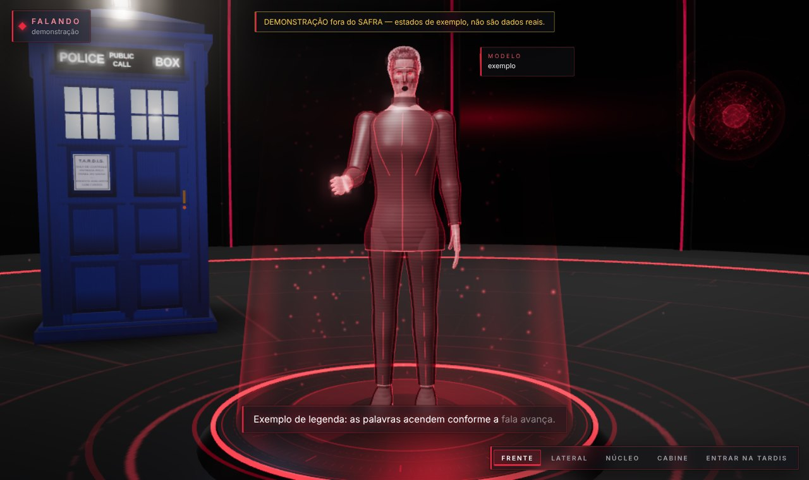
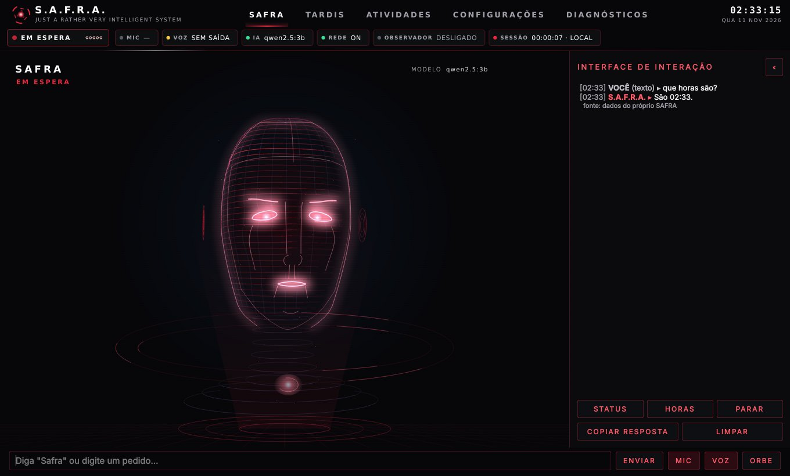
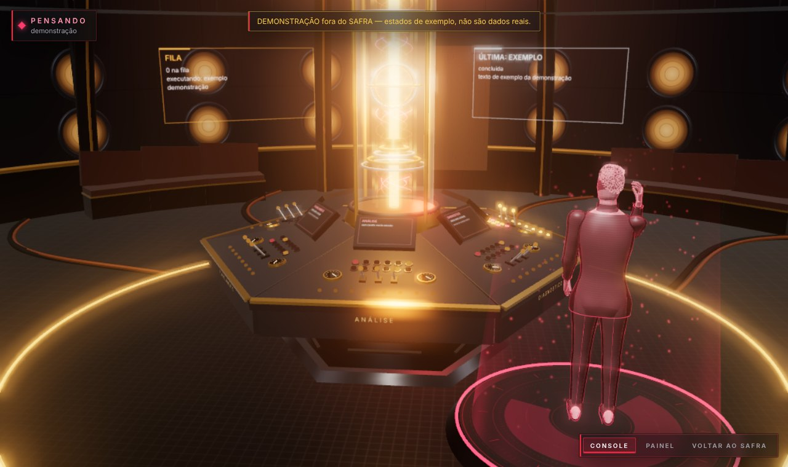
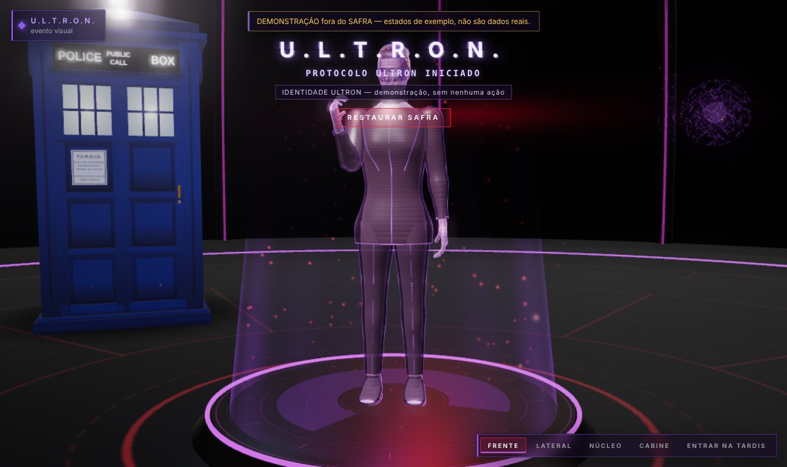

# 10 DESENVOLVIMENTO

Este capítulo descreve como o SAFRA foi construído e por quê. Em vez de listar arquivos, ele apresenta os
problemas de cada parte, as decisões tomadas, as alternativas descartadas e as dificuldades encontradas. As
evidências (testes, medições, commits) são citadas ao longo do texto; o detalhamento técnico completo está no
relatório técnico (`docs/technical/RELATORIO_TECNICO.md`).

## 10.1 Evolução do sistema

O repositório registra 94 commits entre 7 de outubro e 3 de novembro de 2026, antes da fase SAFRA. A evolução
pode ser dividida em cinco momentos (Quadro 10.1).

**Quadro 10.1 — Evolução do sistema (fonte: histórico do Git).**

| Período | Identidade | O que aconteceu | Problema que motivou |
|---|---|---|---|
| 07/10 | JARVIS original | 131 arquivos Python, 46 documentos de "fases", interface `jarvis_hud.py` | ponto de partida: crescimento por acréscimo, 38 % das linhas em cópias de backup, script principal quebrado |
| 08–12/10 | ULTRON | reconstrução em torno de um núcleo único; memória, voz, agente; primeiros testes; desempenho medido | módulos paralelos repetindo responsabilidades; falhas engolidas silenciosamente |
| 19–22/10 | JARVIS | auditoria do código real; voz diagnosticável; TARDIS; permissões por categoria; rosto 3D com boca sincronizada | o original tinha funções que se perderam; a voz falhava sem dizer onde |
| 29/10–03/11 | JARVIS ULTIMATE / Phoenix | CI em Linux e Windows; 10 defeitos encontrados por testes de segurança e falhas; central 3D em Three.js; perfis de inteligência; acesso remoto | o que funcionava no Linux falhava no Windows; ações sobre arquivos sem limites |
| 11/11 | **SAFRA** | auditoria acadêmica, requisitos, nova identidade, instrumentos de medição, este trabalho | transformar o projeto em objeto de pesquisa defensável |

Dois episódios ilustram por que a integração, e não os componentes, foi o desafio principal:

* **A interface que não abria no Windows** (commit `8417b29`): um cache de estado era usado antes de ser
  criado. No Linux, uma diferença de ordem de inicialização escondia o defeito. A correção veio junto de duas
  mudanças de arquitetura: o **modo console**, que usa o mesmo núcleo quando a interface falha, e um
  **diagnóstico por etapas**, com prazo para cada uma.
* **Os scripts que perdiam a entrada do usuário** (commit `cd9e7f3`): no Windows, o comando `chcp`, usado para
  ajustar a codificação de caracteres, consumia a entrada redirecionada. A causa só foi confirmada por "sondas"
  executadas no CI do Windows, que compararam o mesmo script com e sem o comando.

Um terceiro episódio aparece na própria fase SAFRA (Seção 10.11).

## 10.2 Núcleo e comunicação por eventos

**Problema.** O sistema precisa atender pedidos de várias entradas (voz, texto, botões, acesso remoto) e mostrar
o que acontece em várias saídas (interface, voz, cena 3D, site) sem que cada parte conheça todas as outras.

**Decisão.** Um núcleo único, o `NeuralCore`, constrói todos os componentes e é a **entrada única** de pedidos
(`submit` para texto e voz; `run_skill` para ações pedidas pela interface). O `LifecycleManager` inicia os
componentes em ordem topológica, conforme suas dependências, e os encerra em ordem inversa. A comunicação para
fora do núcleo é feita por um **Event Bus** com fila limitada (89 tipos de evento) e por um **estado global**
que, a cada mudança, publica apenas os nomes dos campos alterados.

**Por quê.** A alternativa — cada módulo chamar diretamente os outros — era a situação do sistema original e
produzia o acoplamento que impedia mudanças. Com eventos, a interface é apenas uma assinante: se o Qt não está
instalado, o núcleo roda no modo console sem nenhuma alteração. A fila limitada impede que um assinante lento
consuma memória sem limite; os descartes são contados e informados.

**Concorrência.** O processamento acontece em *workers* nomeados por fila (`ai`, `voice`, `memory`, `actions`…),
com cancelamento cooperativo: o pedido em andamento verifica periodicamente se foi cancelado. A thread da
interface nunca faz entrada e saída de dados. Um teste confirma que, após o encerramento, nenhuma thread do
sistema continua viva.

## 10.3 Processamento de comandos e inteligência

**Duas camadas.** O `IntentEngine` reconhece por regras os comandos frequentes em português — horas, datas,
lembretes, abrir programas, consultas à memória pessoal, controle do próprio sistema. Datas e horas como
"amanhã às 18h", "sexta 9h30" ou "dia 12/10 às 14:00" são interpretadas sem modelo de linguagem. O que as regras
não reconhecem segue para o `ReasoningEngine`, que monta o contexto (memórias recuperadas, estado do
computador) e consulta o modelo local pelo `ModelRouter`.

**Ferramentas sob controle.** O modelo pode propor ações, mas só entre as ferramentas **oferecidas para aquele
pedido**; um teste confirma que uma ferramenta não oferecida nunca é executada, mesmo que o modelo a peça. Toda
resposta carrega sua **procedência** — memória, ação verificada, modelo local, inferência —, mostrada ao usuário.

**Custo e privacidade.** O provedor na nuvem (OpenAI) é opcional, desligado por padrão, exige autorização no
primeiro uso pago e respeita limites mensais de gasto e de tokens, registrados no mesmo banco.

## 10.4 Memória persistente

**Um banco só.** Todas as memórias ficam num único arquivo SQLite em modo WAL, com 27 tabelas e migrações
versionadas (v1 a v7) aplicadas de forma idempotente. A decisão evita a situação do sistema original, em que
vários arquivos JSON e bancos guardavam partes do estado sem consistência entre si, e torna o backup simples
(API de backup do próprio SQLite).

**Tipos de memória.** O sistema separa memória de trabalho (o que acontece agora), episódica (o que foi tentado
e o resultado), semântica (fatos), procedural (como fazer), preferências e um grafo de conceitos. A **memória
pessoal** (compromissos, tarefas, ideias, lembretes) tem serviço próprio, busca de texto completo sem acentos e
um agendador de lembretes **determinístico**: uma thread dorme até o próximo instante relevante, cada disparo é
registrado para nunca se repetir, e lembretes perdidos com o programa fechado geram um único aviso.

**Proteções.** Textos com aparência de senha, token, número de cartão ou dado financeiro são recusados **antes**
de qualquer gravação — o que se confirmou de forma inesperada durante a preparação dos experimentos, quando um
fato de teste sobre a "senha do wi-fi" foi recusado pelo próprio sistema (Seção 12.3). Banco danificado
interrompe o início com mensagem clara sem tocar no arquivo; banco somente leitura mantém a conversa e informa
o que não foi gravado.

## 10.5 Interação por voz

**Captura e reconhecimento.** Um único componente é dono do microfone (duas leituras simultâneas disputariam o
dispositivo). O áudio é reamostrado para 16 kHz e reconhecido pelo Vosk, offline, com o modelo pequeno ou o
grande, conforme a memória disponível.

**Palavra de ativação.** O detector procura a palavra no **início** da frase — no meio, ela não ativa. Há três
tipos de forma: **fortes** (a palavra e variantes que não são palavras comuns), **nomes** (nomes próprios que
soam parecido, fortes só abrindo a frase) e **fracas** (confusões medidas com palavras comuns, que só ativam
seguidas de um comando reconhecido). Uma **calibração** grava a voz do usuário dizendo a palavra e aprende as
formas que o reconhecedor produz para ela, recusando palavras comuns. Depois de uma interação, uma janela de
continuação permite falar sem repetir a palavra.

**Síntese.** A resposta passa pela camada de prosódia (normalização de números, horas, valores e siglas;
divisão em frases; pausas), é sintetizada pelo Piper frase a frase e recebe o processamento do perfil de voz.
Enquanto o sistema fala, a escuta é suspensa, exceto para "pare" e para a palavra de ativação — o que evita
que o assistente reaja à própria voz.

**Dificuldade.** O nome "Jarvis" não existe no vocabulário do modelo pequeno do Vosk e era transcrito como
"aves" ou "aviso"; foi isso que motivou o sistema de formas e a calibração. A troca para "Safra" (Seção 10.11)
foi feita como hipótese a medir — e o resultado (Seção 12.1) não foi o esperado.

## 10.6 Sincronização labial

**Decisão.** A boca do holograma é guiada pelo **áudio real** que vai para o alto-falante, e não por uma animação
genérica. A `LipSyncTrack` divide o áudio em quadros de 10 ms e calcula a energia de cada um. Quando o modelo de
voz informa os fonemas de cada frase, eles são convertidos em 14 visemas (Seção 6.8) e distribuídos **apenas
pelos quadros sonoros** daquela frase, com peso maior para vogais; as pausas caem nos silêncios reais. A
abertura final é multiplicada pela energia do áudio: no silêncio, a boca fecha. Sem fonemas (voz do Windows), a
forma vem do espectro de cada quadro.

**Defeito encontrado.** Logo depois do fim da fala, a boca às vezes ficava minimamente aberta. A causa era
aritmética de ponto flutuante: 0,29 s correspondia ao quadro 28 + 0,999999…, e a interpolação misturava o último
quadro sonoro com o silêncio. A correção (commit `a1788c5`) trata instantes a menos de um milionésimo de um
quadro como o próprio quadro, e um teste determinístico falha sem ela.

## 10.7 Interface humanoide e cena 3D

**Tecnologia.** A interface principal é escrita em Qt (PySide6). A cena 3D — holograma, ORBE, convés e TARDIS —
é uma página local em Three.js aberta num `QWebEngineView`. A escolha permitiu usar a GPU pelo WebGL sem
escrever um motor gráfico próprio, mantendo o resto da interface em Qt.

**Holograma.** O corpo humano completo é construído proceduralmente sobre um esqueleto de 57 ossos (com três
falanges por dedo, olhos, sobrancelhas e mandíbula), com *skinning* calculado na GPU, roupas, cabelo e
expressões. O movimento é procedural e **dirigido por estados reais**: respiração e postura em repouso, olhar
voltado para a câmera, gestos proporcionais à energia da fala, braços sobre os painéis quando o holograma está
dentro da TARDIS e há uma tarefa em execução.

**Ponte segura.** A página não acessa a rede (um interceptador bloqueia qualquer pedido externo). O Python
envia estado, eventos e a trilha labial; a página só pode devolver pedidos de uma lista branca (abrir a TARDIS,
voltar, microfone, restaurar a identidade). Qualquer falha — WebGL ausente, contexto perdido, tempo esgotado —
faz a interface voltar para uma vista 2D e registrar o motivo. No CI do Windows, o WebGL não abriu (servidor sem
GPU) e a vista 2D funcionou, o que confirmou esse caminho.

**Desempenho medido.** Uma fase dedicada (commit `a706c27`) mediu o custo da interface antes e depois das
otimizações, nas mesmas condições: a CPU em repouso caiu de 39,2 % para 22,0 % e o quadro da TARDIS de 19,1 ms
para 3,7 ms, enquanto a memória subiu 22 MB por causa dos recursos novos. Perfis de qualidade (Econômico,
Equilibrado, Alto, Cinematográfico) mudam só o custo visual.

## 10.8 Ambiente virtual TARDIS

A TARDIS tem um lado lógico e um visual. O **motor** (`ultron/tardis`) mantém uma fila própria de tarefas de
análise, com prazos, cancelamento e persistência, e analisadores **determinísticos**: diagnóstico do estado real
dos módulos, telemetria medida do próprio sistema, organização da memória pessoal e planejamento que decompõe um
objetivo em etapas **sem executar nenhuma**. A **sala de controle 3D** reflete esse motor: o rotor central muda
conforme o modo, cada painel do console acende somente enquanto uma tarefa real do seu tipo está em execução, e o
holograma fica ao lado do console, olhando os painéis. A cabine externa preserva a identidade da nave da ficção.

## 10.9 Segurança e permissões

As camadas descritas na Seção 9 (validação → recusa antecipada → permissão por categoria → política de autonomia
→ autorização → execução com prazo → verificação → registro) foram construídas e, principalmente, **testadas
contra tentativas de quebrá-las**. A campanha de testes da Fase 7 (commit `8c01d70`) elevou a cobertura de linhas
de 74 % para 75 % mas, mais importante, encontrou **10 defeitos reais**, entre eles: as ações de arquivo podiam
alterar pastas do sistema, da inicialização automática e do próprio programa (um arquivo gravado na pasta de
plugins seria executado na partida seguinte); a segunda edição de um arquivo sobrescrevia a cópia de segurança
da primeira; cancelar um pedido com o modelo ainda carregando deixava o sistema "pensando" por dezenas de
segundos; um título de janela com quebras de linha podia simular uma seção nova dentro das instruções do modelo.
Todos foram corrigidos com testes que falham sem a correção.

O **Protocolo ULTRON**, identidade alternativa do assistente, mostra o valor dessa estrutura: o perfil
`ULTRON_OPERATOR` dá mais autonomia para rotinas pré-autorizadas, mas é **uma política aplicada ao mesmo
executor** — categorias bloqueadas continuam bloqueadas, apagar dados e ações de risco alto continuam exigindo
confirmação, e tudo é registrado e interrompível.

## 10.10 Diagnóstico, desempenho e confiabilidade

O sistema se diagnostica em várias camadas: um **monitor de saúde** verifica processador, memória, disco,
modelos, voz e interface a cada 15 segundos; um **diagnóstico por etapas** (`--diagnose`) testa configurações,
banco, núcleo, modelos, memória, TARDIS, voz em 8 etapas, percepção e a interface gráfica montada de verdade,
cada etapa com prazo; e as **métricas** registram tempos de quadro, atraso da interface e latências. A
**degradação controlada** (Seção 9.10) mantém o sistema útil quando falta uma parte, e a **instância única**
impede que dois processos disputem o microfone.

## 10.11 A nova identidade: SAFRA

**Identidade visual.** As cores do sistema já estavam centralizadas num arquivo de tokens, compartilhado pelo Qt,
pela cena 3D e pelo site. A nova paleta — vermelho, bordô, preto, grafite, textos em branco e cinza — foi
definida ali, com duas decisões apoiadas em medição: o vermelho principal foi ajustado de `#E5233A` para
`#EA2840` porque o primeiro tinha contraste de 4,44:1 sobre o fundo, abaixo dos 4,5:1 da WCAG 2.1, e o novo tem
4,67:1; e, numa interface vermelha, o vermelho não pode significar erro, então atenção passou a ser âmbar e falha,
laranja. As folhas de estilo do Qt, antes escritas com cores literais, passaram a ser **geradas da paleta**. O
Protocolo ULTRON, que usava vermelho como assinatura, passou a violeta e cromo para continuar distinguível.

**Palavra de ativação.** "Safra" passou a ser a primeira palavra de ativação e "Jarvis" continua aceita. A
migração das configurações (versão 2 → 3) acrescenta a palavra nova sem apagar as formas que o usuário já havia
calibrado e guarda uma cópia do arquivo anterior.

**Nome visível × identificador.** A troca de nome foi feita por um script que altera apenas textos e comentários,
protegendo nomes de variáveis e arquivos. Mesmo assim, ele alterou cinco identificadores que **pareciam texto**:
o nome do serviço no cofre de credenciais (a chave já salva deixaria de ser encontrada), pastas do sistema
original usadas na importação de dados, o prefixo de variáveis de ambiente, a entrada do início automático no
Windows e o objeto `window.JARVIS` pelo qual o Python envia o estado para a cena 3D — com este último, a cena
abriria normalmente, mas não receberia nenhum estado. Os testes de compatibilidade e o teste da cena 3D real,
executado com QtWebEngine sob um servidor X virtual, detectaram os casos, que foram revertidos antes do envio.
A lição foi registrada: renomear um produto exige separar o **nome visível** do **identificador**.

## 10.12 Componentes complementares

Dois componentes existem no sistema, mas não fazem parte das hipóteses centrais deste trabalho:

* **WEB ORB** — um site com apenas a ORBE que dá acesso remoto ao **mesmo** núcleo. O computador abre uma
  conexão de saída para um servidor intermediário (nenhuma porta é aberta no roteador); o celular é pareado por
  QR Code com confirmação no computador; ações sensíveis só podem ser confirmadas no computador. Foi verificado
  localmente de ponta a ponta, mas não foi publicado.
* **Protocolo ULTRON** — identidade alternativa reversível (aparência, voz, tom e perfil de permissões), descrita
  na Seção 10.9.

Um terceiro componente, um módulo de integração com um robô seguidor de linha, foi prototipado em outubro e
**retirado do escopo** do sistema e deste trabalho; o código permanece apenas no histórico do repositório.

## 10.13 Síntese das dificuldades

**Quadro 10.2 — Dificuldades técnicas e como foram resolvidas.**

| Dificuldade | Natureza | Como foi detectada | Solução |
|---|---|---|---|
| Sistema original não iniciava pelo script principal | integração | leitura do código e execução | reconstrução em torno de um núcleo único |
| Interface não abria no Windows | ordem de inicialização | relato e CI do Windows | correção + modo console + diagnóstico por etapas |
| Scripts perdiam a entrada no Windows | plataforma | sondas no CI do Windows | proteção do `chcp` em todos os scripts, com teste |
| Palavra "Jarvis" fora do vocabulário | reconhecimento | medição com fala sintetizada | formas fortes/fracas, calibração; troca para "Safra" como hipótese |
| Boca aberta após a fala | ponto flutuante | teste com a voz real no CI do Windows | quadro exato abaixo de 10⁻⁶ |
| Ações de arquivo sem limites | segurança | testes que tentam quebrar o sistema | recusa antecipada de alvos protegidos |
| CPU alta em repouso | desempenho | medição com o mesmo roteiro antes e depois | cadência por perfil, cache de camadas, animação só por mudança real |
| Renomeação alterando identificadores | compatibilidade | testes de compatibilidade e da cena 3D real | reversão dos identificadores; regra registrada |
