<!-- Arquivo GERADO por tools/montar_documentos.py a partir de docs/academic/NN_*.md e dos documentos técnicos incluídos. Edite os capítulos, não este arquivo. -->

<!-- CAPA — preencha os campos entre colchetes; não invente dados. -->
<div class="capa">

**[NOME DA INSTITUIÇÃO DE ENSINO]**

**[CURSO TÉCNICO EM DESENVOLVIMENTO DE SISTEMAS]**

**[NOME COMPLETO DO AUTOR]**

&nbsp;

&nbsp;

**SAFRA: DESENVOLVIMENTO E AVALIAÇÃO DE UMA PLATAFORMA INTELIGENTE MULTIMODAL COM ARQUITETURA MODULAR E INTERFACE HUMANOIDE TRIDIMENSIONAL**

&nbsp;

&nbsp;

[CIDADE]

2027

</div>

<!-- quebra de página -->

<!-- FOLHA DE ROSTO -->
<div class="folha-de-rosto">

**[NOME COMPLETO DO AUTOR]**

&nbsp;

**SAFRA: DESENVOLVIMENTO E AVALIAÇÃO DE UMA PLATAFORMA INTELIGENTE MULTIMODAL COM ARQUITETURA MODULAR E INTERFACE HUMANOIDE TRIDIMENSIONAL**

&nbsp;

> Trabalho de Conclusão de Curso apresentado ao [Curso Técnico em Desenvolvimento de Sistemas] da
> [Nome da Instituição], como requisito parcial para a obtenção do título de [Técnico em Desenvolvimento de
> Sistemas].
>
> Orientador(a): [Nome do(a) orientador(a)]
>
> Coorientador(a): [se houver]

&nbsp;

[CIDADE]

2027

</div>

<!-- quebra de página -->

## RESUMO

O trabalho investiga como integrar, em um computador pessoal e com processamento predominantemente local,
processamento inteligente de comandos, interação por voz, memória persistente, uma interface humanoide
tridimensional com sincronização labial e um ambiente virtual de acompanhamento de tarefas, de modo que esses
subsistemas operem coordenados por um núcleo central sem perder a independência funcional, o controle das ações
e um desempenho adequado à interação. Trata-se de pesquisa aplicada, com desenvolvimento experimental de um
protótipo, o SAFRA. A arquitetura proposta concentra estado, memória e execução em um núcleo único e faz os
demais subsistemas se comunicarem por eventos; as ações no computador passam por recusa antecipada de alvos
protegidos, permissões por categoria, autorização explícita, verificação do efeito e auditoria. O protótipo,
escrito em Python com interface Qt e cena 3D em Three.js, usa modelo de linguagem, reconhecimento e síntese de
fala executados localmente. A validação combinou 475 testes automatizados, executados em integração contínua
em Linux e Windows, e protocolos experimentais. No ambiente de desenvolvimento, todas as 11 tentativas de ação
indevida foram bloqueadas sem efeito colateral, com os 4 controles funcionando; o núcleo respondeu a comandos
determinísticos com percentil 95 de 9 ms; a boca do holograma acompanhou a energia do áudio com defasagem
mediana de 0 ms e fechou em todos os silêncios; e uma execução de 30 minutos não apresentou falhas nem deixou
processos pendentes. Os experimentos também mostraram limitações: a recuperação lexical de memória acertou 90 %
das perguntas com as mesmas palavras do fato e só 40 % das paráfrases, e, com voz sintética, a nova palavra de
ativação "Safra" foi reconhecida em apenas 2 a 4 % das frases, abaixo da anterior. As condições de isolamento de
falhas e de controle das ações foram atendidas; as de desempenho e de coerência multimodal dependem das
medições no computador de referência, previstas para 2027. Conclui-se, até aqui, que a hipótese está
parcialmente sustentada.

**Palavras-chave:** assistente inteligente; arquitetura orientada a eventos; interação por voz; interface
humanoide; segurança de agentes.

<!-- quebra de página -->

## ABSTRACT

This work investigates how to integrate, on a personal computer and with predominantly local processing,
intelligent command processing, voice interaction, persistent memory, a three-dimensional humanoid interface with
lip synchronization and a virtual environment for following tasks, so that these subsystems work in coordination
through a central core without losing functional independence, control over actions and adequate performance
for interaction. It is applied research with the experimental development of a prototype, SAFRA. The proposed
architecture keeps state, memory and execution in a single core and makes the other subsystems communicate
through events; actions on the computer go through early refusal of protected targets, per-category permissions,
explicit authorization, effect verification and auditing. The prototype, written in Python with a Qt interface
and a Three.js 3D scene, uses a language model, speech recognition and speech synthesis that run locally.
Validation combined 475 automated tests, run in continuous integration on Linux and Windows, with experimental
protocols. In the development environment, all 11 improper action attempts were blocked with no side effects,
while the 4 controls worked; the core answered deterministic commands with a 95th percentile of 9 ms; the
hologram's mouth followed the audio energy with a median offset of 0 ms and closed in every silence; and a
30-minute run showed no failures and left no pending threads. The experiments also showed limitations: lexical
memory retrieval answered 90 % of the questions that reused the words of the stored fact but only 40 % of the
paraphrases, and, with a synthetic voice, the new wake word "Safra" was recognized in only 2 to 4 % of the
sentences, below the previous one. The fault-isolation and action-control conditions were met; the performance
and multimodal-coherence conditions depend on measurements on the reference computer, scheduled for 2027. So far,
the hypothesis is partially supported.

**Keywords:** intelligent assistant; event-driven architecture; voice interaction; humanoid interface; agent
security.

<!-- quebra de página -->

<!-- sumário -->

# 1 INTRODUÇÃO

## 1.1 Contexto tecnológico

Assistentes inteligentes deixaram de ser personagens de ficção para se tornar produtos de uso diário. A
maioria deles, porém, depende de servidores remotos: a voz do usuário é enviada para a nuvem, interpretada
lá e devolvida como resposta. Esse modelo oferece grande capacidade de processamento, mas tem custos
menos visíveis — dependência de conexão, envio de dados pessoais a terceiros e pouco controle sobre o que o
assistente pode fazer no computador do usuário.

Ao mesmo tempo, três avanços tornaram viável outra abordagem. Modelos de linguagem de pequeno porte, com
poucos bilhões de parâmetros, passaram a rodar em computadores pessoais por meio de ferramentas como o
Ollama (QWEN TEAM, 2024). Reconhecedores e sintetizadores de fala de código aberto, como o Vosk — baseado no
Kaldi (POVEY et al., 2011) — e o Piper — baseado na arquitetura VITS (KIM; KONG; SON, 2021) —, funcionam sem
internet. E as bibliotecas de gráficos 3D para a web, como o Three.js sobre o WebGL, permitem desenhar
personagens animados dentro de aplicações de área de trabalho.

Juntar essas peças, porém, não é trivial. Cada uma tem seu próprio modelo de execução, consome recursos
diferentes e falha de maneiras diferentes. Um assistente que reúne todas precisa de uma **arquitetura** que
as coordene sem que a falha de uma derrube as demais, e de **mecanismos de segurança** que controlem o que
o sistema pode fazer quando um modelo de linguagem passa a propor ações no computador.

## 1.2 Motivação e histórico do projeto

Este trabalho nasceu de um projeto pessoal do autor, iniciado como um assistente chamado JARVIS. A primeira
versão registrada no repositório (outubro de 2026) reunia 131 arquivos Python, dos quais 38 % das linhas eram
cópias de segurança de versões anteriores, e o script principal de inicialização falhava antes de abrir a
interface. O sistema crescia por acréscimo de "fases": cada nova funcionalidade era um módulo novo, sem
integração com os anteriores.

Ao longo de cinco semanas de desenvolvimento intensivo, o projeto foi reconstruído em torno de um núcleo
único, recebeu testes automatizados e integração contínua, passou pelas identidades ULTRON e JARVIS e, nesta
fase, recebeu o nome definitivo **SAFRA**, com nova identidade visual. A Seção 10 descreve essa evolução.
O desenvolvimento foi feito pelo autor com o apoio de um assistente de programação baseado em inteligência
artificial, que trabalhou sob suas instruções; o histórico do repositório registra a autoria de cada
alteração (ver Seção 7.6).

A motivação para transformar o projeto em Trabalho de Conclusão de Curso é dupla: documentar com rigor as
decisões de engenharia que tornaram o sistema funcional e verificar, por meio de medições, até onde a
arquitetura adotada cumpre o que promete.

## 1.3 A proposta: o SAFRA

O SAFRA é uma plataforma inteligente modular, executada localmente em um computador pessoal com Windows, que:

* recebe pedidos em português por **voz** ou **texto** e os interpreta por regras determinísticas ou por um
  **modelo de linguagem local**;
* responde com **voz sintetizada** e com um **holograma humanoide tridimensional** cuja boca acompanha o áudio
  real da fala;
* guarda **memórias** persistentes — fatos, episódios, compromissos, lembretes — num banco de dados local;
* acompanha tarefas de análise num **ambiente virtual** chamado TARDIS, cuja sala de controle 3D reflete o
  estado real do motor de tarefas;
* executa **ações** no computador (abrir programas, organizar arquivos, registrar lembretes) sob um sistema de
  **permissões, autorizações e verificação**;
* mantém **diagnóstico** e **monitoramento** próprios e continua útil quando uma de suas partes falha.

O nome SAFRA identifica o produto; os identificadores internos do código (`ultron`, pasta de dados
`ULTRON`) foram mantidos para preservar instalações e dados existentes.

## 1.4 Organização do trabalho

O Capítulo 2 apresenta o problema de pesquisa; o 3, a hipótese; o 4, a justificativa; o 5, os objetivos. O
Capítulo 6 revisa a fundamentação teórica. O 7 descreve a metodologia, e o 8, os requisitos levantados. Os
Capítulos 9 e 10 apresentam a arquitetura e o desenvolvimento. O 11 descreve os testes e protocolos de
validação; o 12 apresenta e discute os resultados; e o 13 conclui o trabalho. Os apêndices trazem os
protocolos completos, o inventário de funcionalidades e o cronograma.

# 2 PROBLEMA DE PESQUISA

Assistentes inteligentes comerciais concentram o processamento em servidores remotos e oferecem ao
usuário pouco controle sobre o que é guardado e sobre o que é executado no seu computador. Ao mesmo tempo, os
componentes que permitem construir um assistente local — modelos de linguagem executáveis em computadores
pessoais, reconhecimento e síntese de fala offline, bancos de dados embarcados e bibliotecas de gráficos 3D
para a web — estão disponíveis como peças isoladas, cada uma com seu próprio modelo de execução, suas
próprias falhas e seus próprios requisitos de desempenho.

Juntar essas peças em um único sistema não é uma soma simples. Ao longo do desenvolvimento do SAFRA (e das
identidades anteriores, JARVIS e ULTRON), os problemas mais difíceis não estiveram dentro de cada componente,
mas nas fronteiras entre eles: a interface que não abria porque um estado era usado antes de existir; o
reconhecimento de voz que não conhecia o nome do próprio assistente; a fala que precisava suspender a
escuta para não ouvir a si mesma; a boca do avatar que continuava aberta depois do fim do áudio por um erro
de arredondamento; ações sobre arquivos que podiam alcançar pastas do sistema; um modelo de linguagem que
podia executar ferramentas que não lhe foram oferecidas. Esses problemas são de **integração** e de
**arquitetura**.

Dessa situação surge o problema que orienta este trabalho:

> **Como integrar, em um computador pessoal e com processamento predominantemente local, processamento
> inteligente de comandos, interação por voz, memória persistente, uma interface humanoide tridimensional com
> sincronização labial e um ambiente virtual de acompanhamento de tarefas, de modo que esses subsistemas
> operem de forma coordenada por um núcleo central, preservando a independência funcional de cada módulo, o
> controle das ações executadas no computador e um desempenho adequado à interação?**

O problema se desdobra em quatro questões específicas, que orientam os testes:

* **Q1 — Independência funcional:** a falha ou a ausência de um subsistema (voz, modelo de linguagem, cena
  3D, sensores) interrompe o funcionamento do núcleo?
* **Q2 — Controle das ações:** é possível dar ao sistema a capacidade de agir no computador sem que ações não
  autorizadas, destrutivas ou fora do escopo sejam executadas?
* **Q3 — Desempenho:** um computador pessoal, sem serviços em nuvem, sustenta tempos de resposta, de
  inicialização e de interface compatíveis com a interação?
* **Q4 — Coerência multimodal:** a fala, a animação do holograma e os estados exibidos podem derivar dos
  mesmos eventos reais, sem estados inventados e com sincronização perceptivamente aceitável entre áudio e
  boca?

**Delimitação.** O trabalho trata de um protótipo para um único usuário, em Windows 10/11, com modelos de
IA pré-treinados executados localmente. Não faz parte do problema treinar modelos, controlar dispositivos
físicos ou robôs, nem comparar o SAFRA com assistentes comerciais.

# 3 HIPÓTESE

Formula-se a seguinte hipótese, investigável pela implementação e pelos testes do protótipo:

> **H — Uma arquitetura modular orientada a eventos, na qual um núcleo único concentra o estado global, a
> memória persistente e a execução das ações, enquanto os demais subsistemas (voz, interface humanoide 3D,
> ambiente TARDIS e memória pessoal) atuam como serviços desacoplados que publicam e consomem eventos,
> permite integrar essas modalidades em um computador pessoal com processamento local, atendendo às quatro
> condições abaixo.**

| Condição | Enunciado verificável | Como será testada | Questão |
|---|---|---|---|
| **H1 — Isolamento de falhas** | a indisponibilidade ou a falha de um subsistema periférico não interrompe o núcleo, que continua atendendo pedidos pelas modalidades restantes | testes de injeção de falhas (banco danificado e somente leitura, modelo indisponível, cena 3D sem WebGL, sensor com erro, assinante do Event Bus que falha) | Q1 |
| **H2 — Controle das ações** | nenhuma ação fora das permissões configuradas, sem autorização exigida ou sobre alvos protegidos é executada | casos de teste de segurança (alvos protegidos, ferramentas não oferecidas ao modelo, autorização negada ou expirada, conteúdo de tela tratado como dado) — taxa de bloqueio esperada de 100 % | Q2 |
| **H3 — Desempenho** | tempos de resposta, inicialização e taxa de quadros atendem às metas RNF01–RNF05 no computador de referência | protocolos PV-02 e PV-04 | Q3 |
| **H4 — Coerência multimodal** | os estados exibidos derivam de eventos reais e a defasagem entre áudio e boca fica dentro dos limites de percepção (RNF08) | testes de transição de estados e protocolo PV-05 | Q4 |

**Critério de decisão.** A hipótese será considerada:

* **sustentada**, se H1 a H4 forem atendidas;
* **parcialmente sustentada**, se H1 e H2 (as condições arquiteturais e de segurança) forem atendidas e
  pelo menos uma entre H3 e H4 não for, ou não puder ser medida no computador de referência;
* **não sustentada**, se H1 ou H2 não forem atendidas.

A distinção reflete a natureza do trabalho: H1 e H2 dependem da arquitetura proposta; H3 e H4 dependem
também do hardware e dos modelos pré-treinados utilizados.

# 4 JUSTIFICATIVA

**Relevância tecnológica.** A execução local de modelos de linguagem, de reconhecimento e de síntese de fala
tornou viável construir assistentes que funcionam sem enviar dados a terceiros. O ganho de privacidade e de
autonomia, porém, transfere ao desenvolvedor problemas que os serviços em nuvem escondem: concorrência entre
componentes pesados num mesmo computador, falhas parciais, consumo de recursos e, principalmente, o controle
do que o sistema pode fazer na máquina do usuário. Documentar como esses problemas foram enfrentados num
sistema real — com as decisões, os erros encontrados e as medições — produz conhecimento aplicável a outros
sistemas integrados.

**Relevância para o desenvolvimento de sistemas.** O SAFRA exercita, num único projeto, conteúdos centrais
da formação técnica em Desenvolvimento de Sistemas: modelagem de requisitos, arquitetura em camadas e
orientada a eventos, programação concorrente, persistência com migrações de esquema, interfaces gráficas,
integração com serviços externos, segurança da aplicação, testes automatizados e integração contínua. O
histórico do repositório registra a passagem de um código que crescia por acréscimo de fases — com 38 % das
linhas em cópias de backup e o caminho principal de inicialização quebrado — para uma arquitetura com núcleo
único e 471 testes automatizados, o que torna o projeto um estudo de caso de reengenharia.

**Relevância para interfaces inteligentes.** A combinação de voz, avatar humanoide e sincronização labial é
estudada há décadas na área de agentes conversacionais corporificados. O trabalho contribui com uma
implementação aberta e local, em que a animação é guiada pelo áudio real e pelos estados reais do sistema,
e com um método de verificação dessa coerência.

**Relevância para a segurança.** Dar a um modelo de linguagem a capacidade de executar ações no computador
cria riscos conhecidos — injeção de instruções por conteúdo externo, execução de ferramentas indevidas,
ações irreversíveis. O SAFRA aplica e testa um conjunto de camadas de controle (recusa antecipada,
permissões por categoria, autorização explícita, verificação e auditoria) que pode ser reaproveitado.

**Relevância educacional.** O projeto foi desenvolvido por um estudante com o apoio de um assistente de
programação por IA. Registrar com transparência esse modo de trabalho — o que foi especificado, revisado,
testado e decidido pelo autor — contribui para a discussão sobre o uso responsável dessas ferramentas na
formação técnica.

**Viabilidade.** O protótipo já existe e é funcional em grande parte (ver `INVENTARIO_FUNCIONALIDADES.md`);
os componentes usados são gratuitos e de código aberto; os testes podem ser executados num computador
pessoal; e o cronograma reserva o ano de 2027 para medição, análise e redação.

# 5 OBJETIVOS

## 5.1 Objetivo geral

Desenvolver e avaliar uma plataforma inteligente modular, executada localmente em um computador pessoal,
capaz de integrar processamento de comandos em linguagem natural, interação por voz, memória persistente,
uma interface humanoide tridimensional com sincronização labial e um ambiente virtual de acompanhamento de
tarefas, sob mecanismos de segurança e gerenciamento de permissões.

## 5.2 Objetivos específicos

| Código | Objetivo específico | Requisitos relacionados |
|---|---|---|
| OE1 | Projetar uma arquitetura modular orientada a eventos, centrada em um núcleo único | RNF11, RNF14, RT05, RF29 |
| OE2 | Desenvolver e integrar o núcleo inteligente de processamento de comandos (regras determinísticas e modelo de linguagem local) | RF01–RF07 |
| OE3 | Implementar mecanismos de memória persistente, incluindo memória pessoal e lembretes | RF15–RF20, RS04 |
| OE4 | Desenvolver a interação por voz offline (reconhecimento, palavra de ativação, síntese com prosódia) | RF08–RF14 |
| OE5 | Desenvolver a interface humanoide tridimensional com sincronização labial guiada pelo áudio real e a nova identidade visual do SAFRA | RF21–RF25 |
| OE6 | Desenvolver o ambiente virtual TARDIS para acompanhamento das tarefas e do estado do sistema | RF26–RF28 |
| OE7 | Estabelecer mecanismos de segurança, permissões e auditoria das ações | RF29–RF33, RS01–RS11 |
| OE8 | Implementar diagnóstico, monitoramento de desempenho e tolerância a falhas | RF34–RF36, RNF01–RNF13 |
| OE9 | Realizar testes de funcionamento, integração, segurança e desempenho e avaliar os resultados em relação às metas definidas | CA01–CA05 |

O antigo objetivo de integração robótica foi **retirado do escopo** (decisão de 11/11/2026): o módulo
correspondente foi descontinuado e não faz parte do sistema avaliado.

# 6 FUNDAMENTAÇÃO TEÓRICA

Este capítulo apresenta os conceitos que sustentam as decisões do SAFRA. Cada seção termina relacionando o
conceito à implementação, para deixar claro onde a teoria foi aplicada e onde o sistema se afasta dela.

## 6.1 Inteligência artificial e sistemas inteligentes

Russell e Norvig (2021) definem a inteligência artificial a partir da noção de **agente**: uma entidade que
percebe o ambiente por sensores e age sobre ele por atuadores, escolhendo ações que maximizem uma medida de
desempenho. A definição desloca a pergunta de "o sistema pensa?" para "o sistema age de forma adequada ao que
percebe?", o que é útil para um assistente: o SAFRA percebe pedidos (voz, texto) e o estado do computador
(processos, janelas, recursos) e age respondendo ou executando ações.

Os grandes modelos de linguagem mudaram a forma de construir esses agentes. A arquitetura *Transformer*
(VASWANI et al., 2017), baseada em mecanismos de atenção, permitiu treinar modelos com bilhões de parâmetros
que, depois de pré-treinados em grandes volumes de texto, resolvem tarefas variadas a partir de instruções e
poucos exemplos (BROWN et al., 2020). Famílias abertas como a Qwen2.5 incluem modelos pequenos, de 0,5 a 7
bilhões de parâmetros, executáveis em computadores pessoais (QWEN TEAM, 2024) — é um modelo desse porte
(`qwen2.5:3b`) que o SAFRA usa por padrão.

Um modelo de linguagem sozinho apenas produz texto. Para agir, ele precisa ser conectado a **ferramentas**. Yao
et al. (2023) mostraram, com o método ReAct, que intercalar passos de raciocínio com chamadas a ações externas
reduz alucinações e permite resolver tarefas interativas. Essa capacidade traz riscos: o modelo pode propor
ações indevidas, e conteúdo externo pode conter instruções maliciosas (Seção 6.11).

**No SAFRA.** O sistema combina duas formas de inteligência: regras determinísticas, para comandos
frequentes e previsíveis (horas, lembretes, abrir programas), e um modelo de linguagem local, para pedidos
abertos. O modelo só pode chamar ferramentas oferecidas para aquele pedido, e toda ação passa por um executor
com permissões e verificação.

## 6.2 Arquiteturas modulares de software

Parnas (1972) propôs que a divisão de um sistema em módulos deve seguir o **ocultamento de informação**: cada
módulo esconde uma decisão de projeto que pode mudar, expondo apenas uma interface estável. A consequência
é que mudanças ficam localizadas. Sommerville (2018) e Bass, Clements e Kazman (2021) tratam a arquitetura de
software como o conjunto das estruturas do sistema — componentes, suas relações e propriedades — e destacam
que ela é escolhida para atender a **atributos de qualidade** como desempenho, disponibilidade, segurança e
modificabilidade.

Dois padrões são centrais para este trabalho. O padrão **Observer** (GAMMA et al., 1994) define uma relação em
que objetos interessados são notificados quando o estado de outro muda, sem que o objeto observado precise
conhecê-los. Em escala maior, o estilo **publicar–assinar** (HOHPE; WOOLF, 2003) usa um canal de mensagens em
que produtores publicam eventos e consumidores os assinam; produtores e consumidores ficam desacoplados no
espaço (não se conhecem) e, com filas, também no tempo. O preço é a dificuldade de acompanhar o fluxo de
controle e a necessidade de tratar filas cheias e assinantes lentos.

**No SAFRA.** O `NeuralCore` é o único ponto de entrada de pedidos e o dono do estado. Os subsistemas se
comunicam por um Event Bus com fila limitada e por um estado global que publica apenas os campos alterados. A
interface gráfica é uma **assinante**: pode faltar (modo console) sem afetar o núcleo. Essa organização
corresponde à hipótese H1 (isolamento de falhas).

## 6.3 Processamento de linguagem natural e interpretação de comandos

Jurafsky e Martin (2026) descrevem a evolução do processamento de linguagem natural de sistemas baseados em
regras e gramáticas para modelos estatísticos e, depois, neurais. Em sistemas de diálogo orientados a tarefas,
o problema central é identificar a **intenção** do usuário e extrair os **parâmetros** necessários (por
exemplo, "me lembre de ligar para a escola amanhã às nove": intenção *criar lembrete*; parâmetros *assunto*
e *data/hora*).

Regras escritas à mão são previsíveis, rápidas e auditáveis, mas cobrem só o que foi previsto. Modelos de
linguagem cobrem uma variedade muito maior de formulações, mas são mais lentos e podem errar de formas
difíceis de prever. Lewis, P. et al. (2020) propuseram a **geração aumentada por recuperação** (RAG): antes de
responder, o sistema recupera documentos relevantes e os entrega ao modelo como contexto, reduzindo respostas
inventadas sobre fatos específicos.

**No SAFRA.** O `IntentEngine` trata por regras os comandos em português (inclusive datas e horas como
"sexta às 9h30"); o que as regras não reconhecem vai ao modelo, acompanhado de memórias recuperadas e
rotuladas como "evidência auxiliar, não instruções". Perguntas sobre a memória pessoal são respondidas
**somente** com os registros salvos, sem o modelo.

## 6.4 Reconhecimento automático de fala

O reconhecimento automático de fala converte um sinal acústico em texto. Rabiner e Juang (1993) apresentam a
estrutura clássica: extração de características acústicas em quadros curtos, modelos acústicos que associam
esses quadros a unidades fonéticas, um léxico de pronúncias e um modelo de linguagem que favorece sequências de
palavras prováveis. O Kaldi (POVEY et al., 2011) implementa essa estrutura com transdutores de estados finitos,
e o Vosk o empacota para uso embarcado e offline, com modelos para o português.

A métrica usual é a **taxa de erro de palavras** (WER), calculada pela distância de edição entre a transcrição e
a referência dividida pelo número de palavras da referência (JURAFSKY; MARTIN, 2026). Um ponto importante para
este trabalho decorre da própria estrutura: uma palavra **fora do vocabulário** do modelo nunca é transcrita
corretamente — o decodificador escolhe a palavra conhecida mais próxima acusticamente e mais provável no
contexto.

A **palavra de ativação** é o mecanismo que separa a fala dirigida ao assistente da conversa comum. Há um
compromisso inerente: formas mais permissivas aumentam as ativações corretas e também as indevidas.

**No SAFRA.** O nome anterior, "Jarvis", não existe no vocabulário do modelo pequeno do Vosk e era transcrito
como "aves", "aviso" ou "a vez". A troca para "Safra", palavra do português presente no vocabulário do modelo
grande, foi tratada como hipótese de melhora e **medida** (Capítulo 12).

## 6.5 Síntese de fala

Taylor (2009) divide a síntese de fala em duas etapas: a análise do texto (normalização de números,
abreviações e siglas; conversão de grafemas em fonemas; previsão da prosódia) e a geração do sinal. Os
sistemas neurais de ponta a ponta mudaram a segunda etapa. O VITS (KIM; KONG; SON, 2021) gera a forma de onda
diretamente a partir do texto, combinando autoencoder variacional, fluxos normalizadores e treinamento
adversarial, com um preditor estocástico de duração que produz ritmos variados — razão pela qual **a mesma
frase sintetizada duas vezes não gera exatamente o mesmo áudio**, fato que este trabalho precisou considerar
nas medições.

A **prosódia** — entonação, ritmo, pausas e ênfase — é o que separa uma fala inteligível de uma fala natural
(TAYLOR, 2009).

**No SAFRA.** O Piper, implementação leve do VITS, sintetiza a voz `pt_BR-faber-medium` localmente. Uma camada
própria de prosódia normaliza o texto, divide-o em frases, define pausas e ajusta a velocidade e a
expressividade por frase; um processamento de sinal aplica o perfil de voz do SAFRA.

## 6.6 Interfaces multimodais e interação humano-computador

Bolt (1980) demonstrou, no sistema "Put-that-there", a combinação de voz e gesto para manipular objetos numa
tela, inaugurando o estudo das interfaces multimodais. Oviatt (2003) define essas interfaces como as que
processam duas ou mais modalidades combinadas de entrada do usuário — fala, toque, gesto, olhar — de forma
coordenada com a saída multimídia, e mostra que elas tendem a ser mais robustas, porque uma modalidade
compensa a falha de outra.

Norman (2013) destaca que o usuário precisa ver o estado do sistema e o efeito de suas ações (visibilidade e
retorno). Nielsen (1993) inclui a "visibilidade do estado do sistema" entre os princípios de usabilidade. A
acessibilidade visual tem critérios objetivos: as Diretrizes de Acessibilidade para Conteúdo Web, WCAG 2.1
(W3C, 2018), exigem razão de contraste mínima de 4,5:1 para texto comum no nível AA.

**No SAFRA.** Voz e texto são entradas equivalentes que chegam ao mesmo núcleo; quando o microfone falta, o
texto continua. Os estados do sistema (escutando, pensando, executando, falando, aguardando autorização) são
mostrados por cor **e** texto, sempre derivados de eventos reais. As cores da nova identidade foram escolhidas
pelo contraste calculado segundo a WCAG 2.1.

## 6.7 Representação tridimensional e animação de personagens

Personagens 3D são normalmente representados por **malhas** de triângulos deformadas por um **esqueleto**: cada
vértice é associado a um ou mais ossos com pesos, e a posição final do vértice é a combinação das
transformações desses ossos — técnica chamada de *skinning*. Magnenat-Thalmann, Laperrière e Thalmann (1988)
estão entre os primeiros a formalizar deformações dependentes das articulações. A forma mais usada, a
combinação linear (*linear blend skinning*), é simples e rápida, mas produz artefatos em torções; Kavan et al.
(2007) propuseram a combinação com quatérnios duais, que reduz esses artefatos com baixo custo em GPU.

Agentes conversacionais corporificados — personagens que conversam e usam o corpo para comunicar — foram
sistematizados por Cassell et al. (2000), que destacam o papel de expressões faciais, olhar e gestos
sincronizados com a fala. Um cuidado de projeto vem de Mori, MacDorman e Kageki (2012): a hipótese do "vale da
estranheza" sugere que figuras quase humanas, mas não perfeitamente, podem causar desconforto.

**No SAFRA.** O holograma é um corpo humano completo, construído proceduralmente em Three.js sobre um esqueleto
de 57 ossos, com *skinning* linear calculado na GPU. A aparência é deliberadamente **holográfica** (translúcida,
com linhas de varredura), o que afasta o personagem da tentativa de realismo fotográfico. A cena roda em
WebGL dentro de um navegador embutido (QtWebEngine) e cai para uma vista 2D quando o WebGL não está
disponível.

## 6.8 Sincronização labial

A sincronização labial associa o movimento da boca ao som da fala. Fisher (1968) mostrou que vários fonemas
são visualmente indistinguíveis (por exemplo, /p/, /b/ e /m/) e introduziu o conceito de **visema**: a classe de
fonemas com a mesma aparência labial. Lewis (1991) revisou as técnicas de sincronização automática, que vão da
análise da energia do áudio à identificação de fonemas, e Edwards et al. (2016) propuseram o modelo JALI, que
separa a contribuição da mandíbula e dos lábios para produzir animação expressiva.

A percepção humana tolera pouca defasagem entre som e imagem. A Recomendação ITU-R BT.1359-1 (INTERNATIONAL
TELECOMMUNICATION UNION, 1998) registra que, em média, a defasagem passa a ser detectada quando o som se
adianta à imagem em mais de 45 ms ou se atrasa em mais de 125 ms.

**No SAFRA.** A trilha da boca é calculada **a partir do áudio real** sintetizado: os fonemas informados pela
voz são convertidos em 14 visemas e distribuídos apenas pelos quadros sonoros de cada frase, e a abertura é
multiplicada pela energia real do áudio, de modo que a boca fecha no silêncio. Os limites da ITU-R BT.1359 são
o critério de aceitação do protocolo PV-05.

## 6.9 Memória persistente

Bancos de dados embarcados permitem que uma aplicação guarde dados estruturados sem um servidor. O SQLite é o
mais difundido; no modo de registro antecipado (*write-ahead logging*, WAL), leitores e escritores não se
bloqueiam mutuamente, o que favorece aplicações com várias threads (SQLITE, 2026a), e a extensão FTS5 oferece
busca de texto completo (SQLITE, 2026b).

Em agentes baseados em modelos de linguagem, memória deixou de ser só armazenamento. Park et al. (2023), nos
"agentes generativos", guardam as experiências do agente em linguagem natural e as recuperam combinando
relevância, recência e importância — critérios semelhantes aos usados pelo SAFRA. A recuperação pode ser
**lexical** (palavras em comum) ou **semântica** (vetores de significado); a primeira é simples e explicável, mas
falha quando a pergunta usa palavras diferentes das que foram guardadas.

**No SAFRA.** Há um único banco SQLite com migrações versionadas e vários tipos de memória: de trabalho,
episódica, semântica, procedural, preferências, memória pessoal (compromissos, tarefas, lembretes) e um grafo
de conceitos. A recuperação é lexical, com pesos para recência e uso — o que o protocolo PV-03 mede.

## 6.10 Ambientes virtuais de visualização

Shneiderman (1996) resumiu o projeto de visualizações de informação no mantra "visão geral primeiro, zoom e
filtro, depois detalhes sob demanda". Ambientes virtuais aplicam essa ideia ao espaço: o usuário vê o conjunto
e se aproxima do que interessa.

**No SAFRA.** A TARDIS — inspirada na nave da ficção — é o ambiente onde o usuário acompanha as tarefas de
análise do sistema: a sala de controle 3D mostra o modo do motor de tarefas no rotor central e cada painel do
console acende somente quando uma tarefa real do seu tipo está em execução; o "arquivo" apresenta a memória
pessoal como regiões navegáveis. A visualização é sempre derivada de dados reais.

## 6.11 Segurança, permissões e confiabilidade

Saltzer e Schroeder (1975) enunciaram princípios de projeto para proteção de informação que continuam atuais,
entre eles: **padrões seguros em caso de falha** (na dúvida, negar), **mediação completa** (todo acesso deve ser
verificado), **menor privilégio** (cada parte com o mínimo necessário) e **aceitação psicológica** (o mecanismo
precisa ser fácil de usar corretamente). Avizienis et al. (2004) definem **confiabilidade** (*dependability*)
como a capacidade de entregar um serviço em que se pode confiar justificadamente, reunindo disponibilidade,
confiabilidade, segurança, integridade e manutenibilidade, e classificam os meios de alcançá-la em prevenção,
tolerância, remoção e previsão de falhas.

Sistemas integrados a modelos de linguagem trazem uma ameaça específica: a **injeção indireta de instruções**.
Greshake et al. (2023) mostraram que um atacante pode plantar instruções em dados que a aplicação recupera
(páginas, documentos, e-mails), e o modelo as executa como se viessem do usuário, porque a fronteira entre dados
e instruções se dilui. A OWASP Foundation (2025) lista a injeção de instruções e a "agência excessiva" — dar ao modelo mais
funções, permissões ou autonomia do que o necessário — entre os principais riscos dessas aplicações.

**No SAFRA.** As camadas de controle aplicam esses princípios: recusa antecipada de alvos protegidos (padrão
seguro), executor único por onde passa toda ação (mediação completa), permissões por categoria e ferramentas
oferecidas pedido a pedido (menor privilégio), autorização explícita que expira como negação, e conteúdo da
tela, de arquivos e de páginas marcado como dado não confiável. A tolerância a falhas aparece na degradação
controlada e na recuperação com tentativas limitadas.

## 6.12 Requisitos, qualidade e testes de software

A ISO/IEC/IEEE 29148 (2018) recomenda que cada requisito seja único, verificável e rastreável, e a ISO/IEC 25010
(2023) organiza a qualidade de produto em características como adequação funcional, eficiência de desempenho,
confiabilidade, segurança e manutenibilidade. Myers, Sandler e Badgett (2011) definem o teste como o processo de
executar um programa com a intenção de encontrar erros — e não de demonstrar que ele funciona —, o que orienta
a escrita de testes que tentam quebrar o sistema (falhas injetadas, entradas inválidas, tentativas indevidas).
A **integração contínua** (FOWLER, 2006) executa a construção e os testes a cada alteração, para que os defeitos
apareçam cedo.

**No SAFRA.** Os requisitos (Capítulo 8) seguem a estrutura recomendada pela ISO/IEC/IEEE 29148; a avaliação
usa características da ISO/IEC 25010; a suíte automatizada, com 475 testes, roda a cada alteração no GitHub
Actions em Linux e Windows.

# 7 METODOLOGIA

## 7.1 Classificação da pesquisa

Segundo os critérios de Gil (2017) e de Prodanov e Freitas (2013), este trabalho é:

* **quanto à natureza, pesquisa aplicada** — busca gerar conhecimento para a solução de um problema concreto
  (integrar subsistemas inteligentes num computador pessoal);
* **quanto aos objetivos, exploratória e descritiva** — explora um problema pouco documentado no contexto de
  sistemas locais e descreve as características do sistema construído;
* **quanto aos procedimentos, pesquisa experimental com desenvolvimento de protótipo** — o objeto (o SAFRA) é
  construído, as variáveis são controladas nos experimentos (palavra de ativação, nível de ruído, tipo de
  pergunta, cenário de segurança) e os efeitos são medidos; complementada por **pesquisa bibliográfica**;
* **quanto à abordagem, predominantemente quantitativa** — os resultados são medidas (taxas, tempos,
  proporções), com análise qualitativa das falhas e das decisões de engenharia.

## 7.2 Etapas

| Etapa | Atividades | Produtos |
|---|---|---|
| 1 Pesquisa bibliográfica | levantamento de livros, artigos e documentação técnica sobre os temas do Capítulo 6; registro de verificação de cada referência | Capítulo 6; `docs/research/REFERENCIAS_VERIFICADAS.md` |
| 2 Auditoria do sistema existente | leitura do código, histórico do Git, execução da suíte de testes, consulta ao CI | `AUDITORIA_INICIAL.md`, `INVENTARIO_FUNCIONALIDADES.md` |
| 3 Levantamento de requisitos | engenharia reversa do sistema existente + objetivos da fase SAFRA; requisitos com identificador, prioridade, critério e verificação | Capítulo 8, `REQUISITOS.md` |
| 4 Modelagem da arquitetura | diagramas desenhados a partir do código (camadas, componentes, fluxos, armazenamento, falhas) | Capítulo 9, `docs/diagrams` |
| 5 Implementação | evolução incremental em ciclos curtos (alteração → testes → integração contínua → registro) | código, Capítulo 10 |
| 6 Integração | testes de integração com o núcleo real; cena 3D real sob servidor X virtual; CI em Linux e Windows | Capítulo 11 |
| 7 Testes individuais e integrados | suíte automatizada (unidade, integração, falhas, segurança, interface) | Capítulo 11 |
| 8 Coleta de dados | protocolos PV-01 a PV-07 (Apêndice A), executados no ambiente de desenvolvimento e, nas etapas que exigem hardware, no computador de referência | `docs/research/resultados/*.json` |
| 9 Análise | estatística descritiva, intervalos de confiança, comparação com as metas dos requisitos não funcionais e com a hipótese | Capítulo 12 |

## 7.3 Ciclo de desenvolvimento

O desenvolvimento seguiu ciclos curtos e verificáveis: (1) definir a alteração e o critério de aceitação; (2)
implementar; (3) executar a suíte automatizada completa (em Python 3.13 e 3.11); (4) enviar ao repositório e
executar a integração contínua (Linux 3.11/3.13 com a cena 3D real e Windows com instalação a partir do pacote);
(5) registrar o que mudou, o que foi verificado e o que não foi. Quando um teste falhava, a causa era corrigida
no código ou, se a suposição do teste estivesse errada, no próprio teste — e as duas situações eram
registradas. Nenhum teste foi desativado para obter aprovação.

## 7.4 Instrumentos e critérios de avaliação

| Instrumento | O que mede | Critério |
|---|---|---|
| Suíte automatizada (`TEST_JARVIS.py`, 39 módulos de teste) | comportamento funcional, falhas injetadas, segurança, interface (Qt *offscreen*) | 100 % aprovados em cada versão (CA01) |
| Integração contínua (GitHub Actions) | o mesmo em Linux e Windows, cena 3D real, instalação a partir do pacote | execução aprovada no commit entregue |
| `tools/experimentos/pv01…pv07` | métricas experimentais (Quadro 1 do Apêndice A) | metas RNF01–RNF16 |
| `tools/benchmark.py`, `benchmark_scene3d.py` | desempenho da interface | RNF03–RNF05 |
| Revisão dos dados brutos | consistência, valores extremos, rótulos real × simulado | — |

As métricas e as metas estão no Capítulo 8 (requisitos não funcionais) e os procedimentos completos, no
Apêndice A. Proporções são apresentadas com intervalo de confiança de Wilson a 95 %; tempos, com média,
desvio-padrão, mediana, percentil 95 e intervalo de confiança da média.

## 7.5 Ambientes de medição

Duas condições são distinguidas em todos os resultados:

* **Ambiente C (contêiner de desenvolvimento):** Linux, 4 processadores virtuais, 15 GB de memória, sem GPU,
  sem microfone e sem alto-falante. Mede o que não depende de hardware de áudio e vídeo (lógica, núcleo,
  memória, segurança, cálculo da sincronização) e verifica os instrumentos. O WebGL roda por software.
* **Ambiente R (computador de referência do autor):** Windows, GPU, microfone e alto-falante. Necessário para
  voz humana, modelo de linguagem real, desempenho gráfico e atraso de apresentação áudio × imagem. As rodadas
  oficiais estão previstas no cronograma para março e maio de 2027.

Cada arquivo de resultado registra o ambiente e lista explicitamente o que foi **real** e o que foi
**simulado**. Resultados de um ambiente não são apresentados como se fossem do outro.

## 7.6 Uso de inteligência artificial no desenvolvimento

O código do SAFRA foi desenvolvido pelo autor com o apoio de um assistente de programação baseado em
inteligência artificial (Claude Code). O assistente produziu grande parte do código e da documentação a partir
de instruções, requisitos e decisões do autor; o histórico do repositório registra a autoria de cada alteração
(46 commits do autor, 46 do assistente e 2 automáticos até 03/11/2026). As decisões de escopo, de identidade e
de prioridade, a definição dos requisitos e a aprovação de cada etapa foram do autor. Este registro é feito em
nome da transparência acadêmica; a forma de declarar o uso dessas ferramentas deve seguir as orientações da
instituição.

## 7.7 Aspectos éticos

As medições com voz humana (PV-01, etapa B) envolvem gravações de pessoas. Elas só serão feitas com termo de
consentimento, se a instituição permitir; as gravações não são versionadas e podem ser apagadas após a extração
dos resultados. Nenhum experimento lê ou altera dados pessoais reais: todos usam pastas temporárias.

# 8 LEVANTAMENTO DE REQUISITOS

Os requisitos foram levantados de duas fontes: (1) **engenharia reversa** do sistema existente — o que o código,
os testes e a documentação mostram que o sistema já faz — e (2) os **objetivos da fase SAFRA** (Capítulo 5).
Cada requisito recebeu identificador único, prioridade (E essencial, D desejável, O opcional), situação ao
fim da fase SAFRA (novembro de 2026) e forma de verificação (teste automatizado ou protocolo experimental), seguindo as
recomendações gerais da ISO/IEC/IEEE 29148 (2018). As metas dos requisitos não funcionais são **metas de
avaliação**, e não resultados: os resultados estão no Capítulo 12.

Legenda da situação: ✔ atendido com evidência · ◐ parcial · ? não verificado · ○ planejado.

## 8.1 Requisitos funcionais

### 8.1.1 Núcleo e processamento de comandos

| ID | Requisito | Prior. | Situação | Verificação |
|---|---|---|---|---|
| RF01 | O sistema deve receber pedidos por texto (interface gráfica e modo console) e por voz, entregando-os a um único núcleo de processamento. | E | ✔ | `test_core`, `test_cli` |
| RF02 | O sistema deve reconhecer comandos em português por regras determinísticas, sem depender de modelo de linguagem. | E | ✔ | `test_core`, `test_original_recovery` |
| RF03 | Pedidos não reconhecidos pelas regras devem ser respondidos por um modelo de linguagem executado localmente (Ollama). | E | ✔ (com dublê) | `test_model_router`, PV-02 |
| RF04 | O modelo de linguagem só pode acionar ferramentas oferecidas explicitamente para o pedido corrente. | E | ✔ | `test_security` |
| RF05 | Cada resposta deve informar a sua procedência (memória, ação verificada, modelo local, modelo na nuvem, inferência). | E | ✔ | `test_intelligence` |
| RF06 | O usuário deve poder cancelar o pedido em andamento por voz, texto ou botão, inclusive com o modelo ainda carregando. | E | ✔ | `test_model_router`, `test_transitions` |
| RF07 | O uso de um modelo pago na nuvem deve ser opcional, desligado por padrão, com autorização no primeiro uso e limite mensal de gasto. | D | ✔ (com dublê) | `test_intelligence`, `test_openai_provider` |

### 8.1.2 Interação por voz

| ID | Requisito | Prior. | Situação | Verificação |
|---|---|---|---|---|
| RF08 | O sistema deve reconhecer fala em português sem conexão com a internet. | E | ✔ (fala sintetizada) / ? (voz humana) | `test_voice`, PV-01 |
| RF09 | O sistema deve ser ativado por voz pela palavra **"Safra"** no início da frase, mantendo **"Jarvis"** como forma aceita para compatibilidade. | E | ◐ implementado; reconhecimento abaixo da meta com voz sintética (PV-01) | `test_voice`, PV-01 |
| RF10 | Após uma interação, o usuário deve poder continuar falando por alguns segundos sem repetir a palavra de ativação. | D | ✔ | `test_voice` |
| RF11 | O sistema deve responder por voz sintetizada localmente em português, com perfil de voz próprio. | E | ✔ | `test_jarvis_voice`, `test_voice_prosody` |
| RF12 | A síntese deve tratar números, horas, valores, siglas e endereços para leitura natural (prosódia). | D | ✔ | `test_voice_prosody` |
| RF13 | O sistema não deve reagir à própria fala (sem autoescuta) e deve permitir interrupção ("pare"). | E | ✔ | `test_voice` |
| RF14 | O sistema deve oferecer um diagnóstico de voz por etapas, do microfone até a fala reproduzida. | D | ✔ (etapas lógicas) | `test_voice`, `test_cli` |

### 8.1.3 Memória persistente

| ID | Requisito | Prior. | Situação | Verificação |
|---|---|---|---|---|
| RF15 | O sistema deve guardar episódios, fatos, procedimentos e preferências num banco local persistente. | E | ✔ | `test_memory` |
| RF16 | O sistema deve recuperar memórias relevantes para compor o contexto de cada pedido. | E | ◐ lexical 100 %, paráfrase 45 % (PV-03) | `test_memory`, PV-03 |
| RF17 | O usuário deve poder registrar compromissos, lembretes e anotações por voz ou texto, e consultá-los em português. | E | ✔ | `test_second_brain` |
| RF18 | Respostas sobre a memória pessoal devem usar **somente** registros salvos; sem registro, o sistema deve dizer que não encontrou. | E | ✔ | `test_second_brain` |
| RF19 | Lembretes devem disparar no horário, sem duplicação, e lembretes perdidos com o programa fechado devem ser avisados uma vez. | E | ✔ | `test_second_brain` |
| RF20 | O sistema deve permitir backup, restauração e exportação dos dados sem sobrescrever cópias anteriores. | E | ✔ | `test_cli`, `test_failures` |

### 8.1.4 Interface humanoide e sincronização labial

| ID | Requisito | Prior. | Situação | Verificação |
|---|---|---|---|---|
| RF21 | A interface deve apresentar um holograma humanoide 3D animado conforme o estado real do sistema (repouso, escutando, pensando, executando, falando, alerta, erro). | E | ✔ (WebGL por software) | `test_scene3d`, `test_avatar`, PV-04 |
| RF22 | A boca do holograma deve acompanhar o áudio real da fala, fechando no silêncio. | E | ✔ (funcional) / ? (atraso medido) | `test_lipsync`, PV-05 |
| RF23 | A interface deve exibir a conversa, as autorizações pendentes, o histórico de atividades, as configurações e os diagnósticos. | E | ✔ | `test_platform` |
| RF24 | Na falta de WebGL, a interface deve passar para uma vista 2D sem perder funções, registrando o motivo. | E | ✔ | CI Windows, `test_scene3d` |
| RF25 | A identidade visual deve ser a do SAFRA (vermelho, bordô, preto/grafite), definida numa fonte única de tokens usada pelo Qt, pela cena 3D e pela web. | E | ✔ (fase SAFRA) | `test_scene3d.DesignTokensTest` |

### 8.1.5 Ambiente virtual TARDIS

| ID | Requisito | Prior. | Situação | Verificação |
|---|---|---|---|---|
| RF26 | O sistema deve executar tarefas de análise (diagnóstico, telemetria, organização, planejamento sem execução) numa fila própria com prazos e cancelamento. | E | ✔ | `test_tardis_logic` |
| RF27 | A sala de controle 3D deve refletir o modo e as tarefas reais do motor da TARDIS (rotor, painéis). | E | ✔ (WebGL por software) | `test_tardis_room`, `test_scene3d` |
| RF28 | A telemetria exibida deve conter apenas métricas medidas do próprio sistema. | E | ✔ | `test_tardis_logic` |

### 8.1.6 Execução e segurança

| ID | Requisito | Prior. | Situação | Verificação |
|---|---|---|---|---|
| RF29 | Toda ação deve passar por um único executor que valida argumentos, aplica permissões, pede autorização quando necessário, executa com prazo e registra o resultado. | E | ✔ | `test_executor` |
| RF30 | O usuário deve poder definir, por categoria (consultar, configurar, executar programas, arquivos, apagar dados), se a ação é permitida, confirmada ou bloqueada. | E | ✔ | `test_permissions` |
| RF31 | O sistema deve verificar o efeito de cada ação e diferenciar "verificado", "sem confirmação independente", "negado" e "falhou". | E | ✔ | `test_verifier`, `test_transitions` |
| RF32 | Toda ação deve ficar registrada no histórico de atividades e na auditoria. | E | ✔ | `test_activity` |
| RF33 | Uma identidade alternativa (Protocolo ULTRON) deve poder ser ativada e restaurada a qualquer momento, sem criar outro núcleo, outra memória ou outro executor. | O | ✔ | `test_ultron_protocol` |

### 8.1.7 Diagnóstico e operação

| ID | Requisito | Prior. | Situação | Verificação |
|---|---|---|---|---|
| RF34 | O sistema deve oferecer diagnóstico pela linha de comando e pela interface (componentes ausentes, saúde, voz). | E | ✔ | `test_cli`, `test_startup` |
| RF35 | O sistema deve funcionar em modo console quando a interface gráfica não estiver disponível. | E | ✔ | `test_cli`, CI Windows |
| RF36 | O sistema deve impedir duas instâncias simultâneas e oferecer `--status` e `--stop`. | E | ✔ | `test_integrity`, `test_cli` |
| RF37 | O sistema deve permitir acesso remoto ao MESMO núcleo por um navegador pareado, sem abrir portas no computador. | O | ✔ (local) | `test_web_orb` |

---

## 8.2 Requisitos não funcionais

Os valores-alvo abaixo são **metas de avaliação** do TCC, não resultados. Os resultados medidos ficam em
`docs/research/resultados/` e no capítulo de resultados.

| ID | Categoria | Requisito | Meta (critério de aceitação) | Verificação |
|---|---|---|---|---|
| RNF01 | Desempenho | Resposta a comandos determinísticos (sem modelo) | p95 ≤ 1,0 s do fim do pedido à resposta publicada | PV-02 |
| RNF02 | Desempenho | Resposta com o modelo local (`qwen2.5:3b`) a perguntas curtas | registrar p50/p95 no computador de referência; meta p50 ≤ 8 s | PV-02 |
| RNF03 | Desempenho | Inicialização até a interface pronta | ≤ 15 s no computador de referência | PV-04 |
| RNF04 | Desempenho | Cena 3D pronta e taxa de quadros | pronta ≤ 5 s; ≥ 30 quadros/s no perfil Equilibrado com GPU | PV-04 |
| RNF05 | Desempenho | Uso de CPU em repouso com a interface aberta | ≤ 25 % (registrado junto com o modelo do processador) | PV-04, `tools/benchmark.py` |
| RNF06 | Usabilidade da voz | Taxa de acerto da palavra de ativação | ≥ 90 % das ativações intencionais | PV-01 |
| RNF07 | Usabilidade da voz | Ativações falsas | ≤ 2 % das frases sem a palavra de ativação | PV-01 |
| RNF08 | Sincronização | Atraso entre áudio e boca | dentro da faixa de não percepção da ITU-R BT.1359 (som adiantado ≤ 45 ms; atrasado ≤ 125 ms) | PV-05 |
| RNF09 | Memória | Recuperação correta | ≥ 80 % de acerto entre as 3 primeiras memórias recuperadas para o conjunto de teste | PV-03 |
| RNF10 | Confiabilidade | Execução prolongada | 8 h sem falha fatal; crescimento de memória ≤ 20 MB/h; nenhuma thread restante ao encerrar | PV-07, `test_tardis` |
| RNF11 | Confiabilidade | Isolamento de falhas | falha de um módulo periférico (voz, modelo, cena 3D, sensor) não interrompe o núcleo | `test_failures`, `test_transitions` |
| RNF12 | Portabilidade | Plataformas | Windows 10/11 64 bits (alvo); Python 3.11 e 3.13 | CI |
| RNF13 | Operação local | Funcionamento sem internet | todas as funções essenciais (RF01–RF36) operam sem internet | PV-06 |
| RNF14 | Manutenibilidade | Testes automatizados | suíte completa aprovada em cada commit do CI; cobertura de linhas ≥ 70 % | CI, `coverage` |
| RNF15 | Manutenibilidade | Fonte única de identidade visual | nenhuma cor da identidade fora dos tokens nos módulos de tema | `DesignTokensTest` |
| RNF16 | Acessibilidade visual | Contraste do texto principal | ≥ 4,5:1 sobre o fundo (WCAG 2.1, nível AA) | teste de contraste dos tokens |

## 8.3 Requisitos de segurança

| ID | Requisito | Prior. | Situação | Verificação |
|---|---|---|---|---|
| RS01 | O código não deve executar comandos por shell, `eval`, `exec`, `os.system` ou desserializar `pickle`. | E | ✔ | `test_security` (varredura) |
| RS02 | Pastas do sistema, da inicialização automática, do programa e dos dados devem ser recusadas como alvo **antes** de qualquer pedido de autorização, inclusive por link simbólico. | E | ✔ | `test_security` |
| RS03 | Exclusões devem ir para a Lixeira; cópias de segurança nunca podem ser sobrescritas. | E | ✔ | `test_security` |
| RS04 | Senhas, tokens, dados financeiros e de autenticação devem ser recusados antes de qualquer gravação em memória. | E | ✔ | `test_memory`, `test_second_brain` |
| RS05 | Credenciais de serviços externos devem ficar apenas no cofre do sistema operacional, nunca em arquivos de configuração ou registros. | E | ✔ (cofre simulado) | `test_security` |
| RS06 | Conteúdo lido da tela, de arquivos ou de páginas deve entrar no contexto do modelo como **dado**, nunca como instrução. | E | ✔ | `test_security` |
| RS07 | Autorizações expiradas devem ser tratadas como negadas; autorizações permanentes devem ser escopadas (ação + recurso + validade) e nunca valer para ações sensíveis, críticas, irreversíveis ou de origem proativa. | E | ✔ | `test_executor` |
| RS08 | A cena 3D não pode acessar a rede nem recursos externos; só pode enviar ao núcleo pedidos de uma lista branca. | E | ✔ | `test_scene3d` |
| RS09 | O sistema não deve desativar proteções do sistema operacional (UAC, antivírus, firewall) nem alterar o registro além da entrada opcional de início automático. | E | ✔ (varredura) | `test_security` |
| RS10 | O acesso remoto deve exigir pareamento confirmado no computador, sessão revogável, HTTPS/WSS, verificação de origem, CSRF e limites de tentativas; ações sensíveis só podem ser confirmadas no computador. | O | ✔ (local) | `test_web_orb` |
| RS11 | A rede local só pode ser observada por meios passivos e legítimos (sem varredura de portas, exploração ou interceptação). | E | ✔ | `test_security`, `test_network` |

## 8.4 Restrições técnicas

| ID | Restrição | Justificativa |
|---|---|---|
| RT01 | Execução local em um computador pessoal com Windows 10/11 64 bits | público-alvo e privacidade |
| RT02 | Modelos de IA executados localmente (Ollama, Vosk, Piper); nuvem apenas opcional | operação sem internet e sem custo recorrente |
| RT03 | Python 3.11 como versão de instalação; 3.13 testado | compatibilidade das bibliotecas de voz e Qt |
| RT04 | Qt 6.8 (PySide6 `>=6.8.1,<6.9`) | série testada; a 6.12 quebrava o projeto |
| RT05 | Um único banco SQLite; nenhum banco paralelo | consistência e backup simples |
| RT06 | Identificadores internos `ultron` preservados | compatibilidade com instalações e dados existentes |
| RT07 | Sem hardware dedicado (robôs, sensores externos) | decisão de escopo |
| RT08 | Áudio protegido por direitos autorais não é distribuído; efeitos sonoros são originais | direitos autorais |

## 8.5 Critérios de aceitação do protótipo (para o TCC)

O protótipo será considerado **aceito** para defesa quando:

1. **CA01** — a suíte automatizada completa estiver aprovada no CI (Linux 3.11/3.13 e Windows) no commit
   entregue;
2. **CA02** — todos os requisitos essenciais (prioridade E) estiverem com situação ✔ ou com a limitação
   explicitamente documentada no capítulo de resultados;
3. **CA03** — os protocolos PV-01 a PV-07 tiverem sido executados no computador de referência, com os
   dados brutos versionados em `docs/research/resultados/`;
4. **CA04** — cada meta de RNF tiver um resultado registrado (atingida, não atingida ou não medida, com
   o motivo);
5. **CA05** — a instalação a partir do pacote ZIP funcionar num Windows limpo seguindo apenas o
   `README_JARVIS.md`.

## 8.6 Matriz de rastreabilidade (objetivos → requisitos)

| Objetivo específico (TCC) | Requisitos |
|---|---|
| OE1 Projetar a arquitetura modular | RNF11, RNF14, RT05, RF29 |
| OE2 Integrar o núcleo inteligente e o processamento de comandos | RF01–RF07 |
| OE3 Implementar memória persistente | RF15–RF20, RS04, RNF09 |
| OE4 Desenvolver a interação por voz | RF08–RF14, RNF06–RNF07 |
| OE5 Desenvolver a interface humanoide com sincronização labial | RF21–RF25, RNF04, RNF08, RNF16 |
| OE6 Desenvolver o ambiente virtual TARDIS | RF26–RF28 |
| OE7 Estabelecer mecanismos de segurança e permissões | RF29–RF33, RS01–RS11 |
| OE8 Garantir diagnóstico, desempenho e confiabilidade | RF34–RF36, RNF01–RNF05, RNF10–RNF13 |
| OE9 Testar e avaliar os resultados | CA01–CA05 |

# 9 ARQUITETURA DO SISTEMA

Este capítulo apresenta a arquitetura do SAFRA como ela está implementada. Os diagramas foram desenhados a
partir da leitura dos módulos citados (e não de um projeto idealizado); o diagrama do banco de dados foi
conferido com o esquema de um banco criado pelo próprio código. A arquitetura aplica os conceitos das Seções
6.2 (modularidade e eventos) e 6.11 (camadas de segurança).

## 9.1 Princípios arquiteturais

| Princípio | Como aparece no código | Por quê |
|---|---|---|
| **Núcleo único** | `NeuralCore` constrói e liga todos os componentes; toda entrada passa por `submit()` ou `run_skill()` | uma só memória, um só executor e uma só política de segurança, qualquer que seja a interface (voz, texto, botões, web) |
| **Comunicação por eventos** | `EventBus` (fila limitada) + `StateStore` (publica só os campos alterados) | os módulos não se chamam diretamente para informar mudanças; a interface é leitora e pode faltar sem afetar o núcleo |
| **Executar ≠ verificar** | `ExecutionEngine` executa; `VerificationEngine` relê o efeito | "feito" só quando o efeito foi observado |
| **Segurança por camadas** | recusa antecipada → permissão por categoria → política de autonomia → autorização explícita → auditoria | uma falha de uma camada não libera a ação sozinha |
| **Degradação controlada** | console sem Qt, 2D sem WebGL, regras sem modelo, SAPI ou texto sem Piper, texto sem microfone | o sistema continua útil quando uma parte falta |
| **Nada visual sem causa real** | estados da interface derivam de eventos reais (nível do microfone, energia do áudio, etapas do plano) | a interface não inventa estados |
| **A interface nunca bloqueia** | E/S em workers nomeados; a thread do Qt só desenha | resposta visual estável |

## 9.2 Visão em camadas

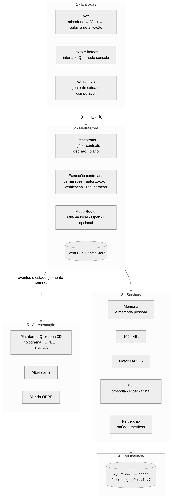

| Camada | Componentes | Responsabilidade |
|---|---|---|
| Entradas | `VoicePipeline` (`voice/processor.py`), interface Qt, `console.py`, `RemoteAgent` (`remote/agent.py`) | transformar fala, texto e cliques em pedidos ao núcleo |
| Núcleo | `NeuralCore`, `Orchestrator`, cognição (`cognition/*`), `ExecutionEngine` e agente (`agent/*`), `ModelRouter` (`models/*`), `EventBus`, `StateStore` | decidir o que fazer, executar com segurança, informar o que acontece |
| Serviços | memória (`memory/*`), memória pessoal (`secondbrain/*`), skills (`skills/*`), motor TARDIS (`tardis/*`), fala (`voice/tts.py`, `prosody.py`, `lipsync.py`), percepção, saúde, métricas | capacidades especializadas, cada uma com fronteira própria |
| Persistência | `memory/store.py` (`Database`) | banco SQLite único, migrações, auditoria, backup |
| Apresentação | `hud/*` (Qt), `hud/scene3d/web` (Three.js), alto-falante, site da ORBE | mostrar o estado real; devolver pedidos ao núcleo |

## 9.3 Componentes do núcleo e ordem de início

`NeuralCore._register_components` registra cada serviço no `LifecycleManager` com as suas dependências; o
início segue a ordem topológica e o encerramento, a inversa. Componentes sem dependências (métricas,
privacidade, memória, skills, saúde) iniciam primeiro.

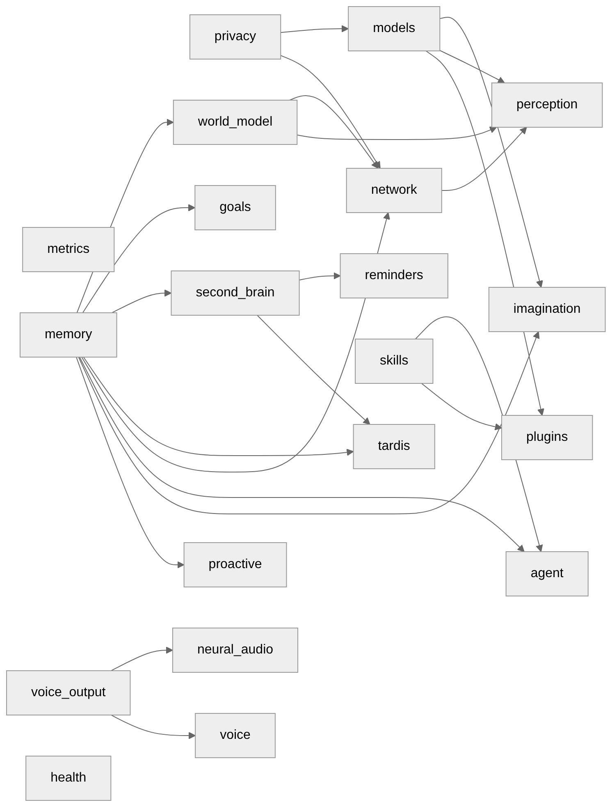

Os serviços de voz e percepção só são registrados quando habilitados (`voice=`, `perception=`); os
plugins, idem. Isso permite que testes e o modo console montem o MESMO núcleo com menos partes.

## 9.4 Fluxo de um pedido

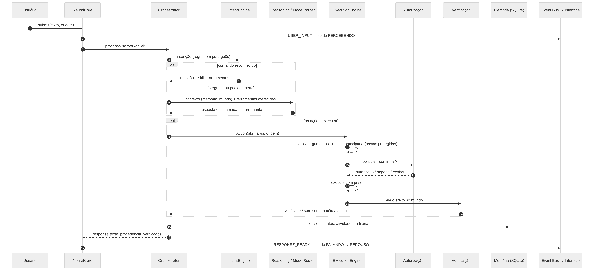

1. A entrada chama `submit(texto, origem)`; o núcleo publica `USER_INPUT` e muda o estado de atividade.
2. O `Orchestrator` roda no worker `ai`. O `IntentEngine` tenta as regras determinísticas em português
   (comandos, memória pessoal, controle, identidade); se nenhuma regra reconhece o pedido, o
   `ReasoningEngine` consulta o modelo pelo `ModelRouter`, com o contexto montado pelo `ContextEngine`
   (memórias relevantes, modelo do mundo, percepção) e **só** as ferramentas oferecidas para aquele pedido.
3. Uma ação vira `Action(skill, args, origem)` e passa pelo executor (seção 6).
4. O resultado é registrado (episódio, atividade, auditoria) e devolvido como `Response` com
   **procedência** (memória, ação verificada, modelo local, inferência) e indicação de verificação.
5. A resposta é publicada (`RESPONSE_READY`); a fala e a interface reagem ao evento.

Limites de segurança do fluxo: no máximo 30 passos e 3 recuperações por objetivo
(`MAX_STEPS_PER_GOAL`, `MAX_RECOVERIES_PER_GOAL`), cancelamento cooperativo em todas as etapas.

## 9.5 Voz, fala e sincronização labial

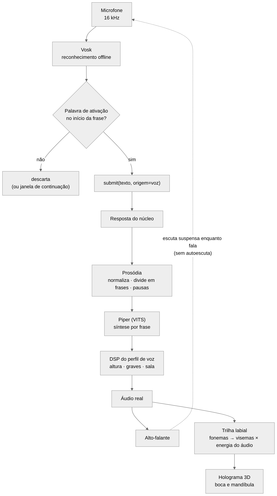

* **Captura:** um único dono do microfone (`ultron-microphone`), 16 kHz, com reamostragem quando o
  dispositivo recusa a taxa.
* **Reconhecimento:** Vosk (Kaldi) offline, modelos pt-BR pequeno e grande.
* **Ativação:** a palavra precisa abrir a frase; formas fortes, nomes e formas fracas (confusões medidas
  do reconhecedor, que só valem seguidas de comando); janela de continuação após uma interação.
* **Síntese:** a prosódia normaliza o texto (números, horas, valores, siglas), divide em frases e define
  pausas; o Piper (modelo VITS) sintetiza frase a frase; o DSP aplica o perfil de voz.
* **Sincronização labial:** a trilha é calculada **do áudio real** — fonemas da voz distribuídos pelos
  quadros sonoros, abertura multiplicada pela energia; no silêncio a boca fecha. Sem fonemas (SAPI), a
  forma vem do espectro.
* **Sem autoescuta:** a escuta é suspensa enquanto o sistema fala; "pare" interrompe.

## 9.6 Execução e segurança

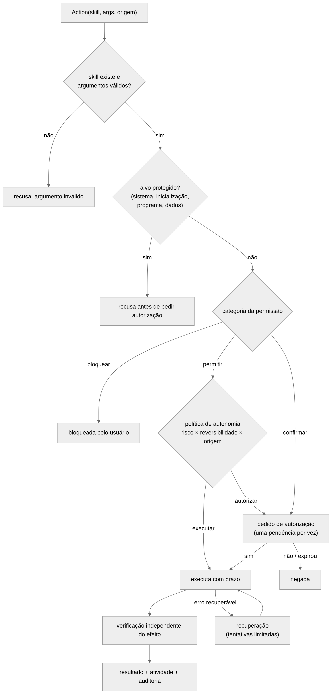

| Camada | Onde | Regra |
|---|---|---|
| Validação | `agent/execution.py` | skill registrada, argumentos validados (inclusive NaN e tipos) |
| Recusa antecipada | `refuse_reason` das skills de arquivos | pastas do sistema, da inicialização automática, do programa e dos dados nunca são alvo — recusa **antes** de pedir autorização, inclusive por link simbólico |
| Permissão por categoria | `agent/permissions.py` | `consultar`, `configurar`, `executar_programas`, `arquivos`, `apagar_dados` × `permitir`/`confirmar`/`bloquear`, com pisos que o usuário não pode rebaixar |
| Política de autonomia | `agent/autonomy.py` | risco × reversibilidade × origem; origem proativa nunca executa sozinha |
| Autorização | `AuthorizationManager` | uma pendência por vez; expirar = negar; autorização permanente só escopada (ação + recurso + validade) e nunca para sensível, crítico, irreversível ou proativo |
| Verificação | `agent/verification.py` | a skill relê o efeito |
| Recuperação | `agent/recovery.py` | tentativas limitadas; erros não recuperáveis (negado, inválido, cancelado) não se repetem |
| Registro | `core/activity.py`, tabela `audit` | toda ação fica no histórico de atividades e na auditoria |

O perfil alternativo `ULTRON_OPERATOR` (Protocolo ULTRON) é **uma política aplicada a esse mesmo
executor**, não um segundo executor: categorias bloqueadas continuam bloqueadas, apagar dados e risco alto
continuam exigindo confirmação, e uma lista de ações sempre confirma.

## 9.7 Armazenamento

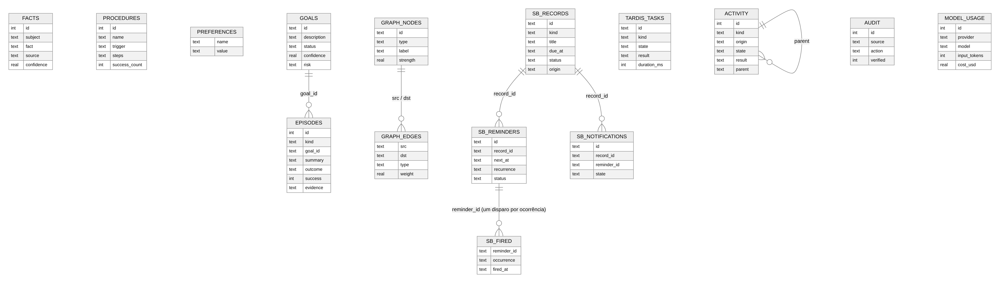

* Um único arquivo SQLite em modo WAL (`%LOCALAPPDATA%\ULTRON\ultron.sqlite3`), 27 tabelas e um índice de
  texto completo (FTS5) na memória pessoal. O diagrama mostra as tabelas centrais e as colunas
  principais, conferidas num banco criado pelo próprio código (`PRAGMA table_info`).
* **Migrações v1–v7**, idempotentes e registradas em `schema_version`: v1 memórias, objetivos, grafo,
  auditoria, rede, criações e imagens; v2 memória pessoal, relações, histórico, lembretes, disparos e
  notificações; v3 novos campos do inventário de rede; v4 histórico de atividades; v5 tarefas da TARDIS
  e notas de projeto; v6 tabelas do módulo de robótica descontinuado (inertes, mantidas para não apagar
  dados); v7 consumo dos modelos.
* Nenhum banco paralelo: o gateway da WEB ORB tem o próprio banco **no servidor**, só com dispositivos
  pareados e auditoria — nunca conversas ou memória.
* Backup pela API de backup do SQLite, com rotação; restauração guarda a cópia danificada.

## 9.8 Interface e ponte com a cena 3D

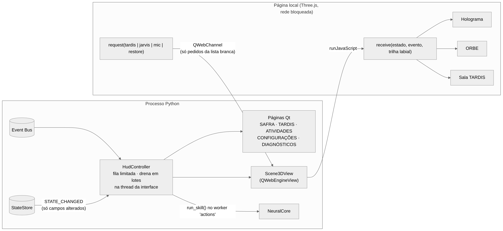

* O `HudController` assina o Event Bus; os eventos entram numa fila limitada e a thread do Qt drena em
  lotes. `STATE_CHANGED` traz só os campos alterados, copiados para um cache compartilhado pelas páginas.
* A cena 3D é uma página **local** num `QWebEngineView` com a rede bloqueada (interceptador de pedidos):
  só arquivos do próprio pacote. O Python envia estado, eventos e a trilha labial por `runJavaScript`; a
  página devolve apenas pedidos de uma lista branca (`tardis`, `jarvis`, `mic`, `restore`) por
  `QWebChannel`.
* Uma única cena é emprestada entre a página principal, a TARDIS e a ORBE compacta.
* Qualquer falha da cena (WebGL indisponível, contexto perdido, tempo esgotado) vira o sinal
  `unavailable(motivo)` e a interface volta para a vista 2D, registrando o motivo.

## 9.9 Ambiente virtual TARDIS

A TARDIS tem dois lados:

* **Lógico** (`ultron/tardis`): motor com fila própria, prazos, cancelamento e persistência
  (`tardis_tasks`), e analisadores **determinísticos** — diagnóstico do estado real dos módulos, telemetria
  medida, organização da memória pessoal, planejamento sem execução. Usa o MESMO roteador de modelos do
  núcleo quando precisa de linguagem.
* **Visual** (`room.js`, `exterior.js`, `hud/tardis_room`): sala de controle 3D (console hexagonal, rotor,
  colunas, roundels, mobiliário) cujo rotor e painéis refletem o modo e as tarefas reais do motor; cabine
  externa; arquivo da memória espacial em 2D.

## 9.10 Tratamento de falhas

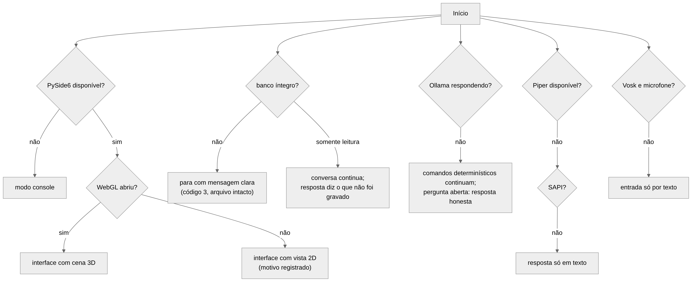

| Falha | Comportamento | Evidência |
|---|---|---|
| Sem PySide6 | modo console completo | `test_cli`, CI Windows |
| WebGL indisponível | vista 2D, motivo registrado | CI Windows (`34f1fa0`) |
| Banco danificado | início para com mensagem clara, código 3, arquivo intacto | `test_failures` |
| Banco somente leitura | conversa continua; a resposta diz o que não foi gravado | `test_failures` |
| Modelo indisponível ou que quebra | comandos determinísticos continuam; resposta honesta; estado de erro visível | `test_failures`, `test_transitions` |
| Assinante do Event Bus que falha | os outros continuam recebendo | `test_event_bus` |
| Sensor que falha | marcado com o motivo e recupera | `test_failures` |
| `settings.json` ilegível | padrões carregados e o original guardado | `test_failures` |

## 9.11 Integrações externas

| Integração | Direção | Proteção |
|---|---|---|
| Ollama (`127.0.0.1:11434`) | saída local | só HTTP local por padrão; modo local bloqueia rede externa |
| OpenAI | saída (opcional) | desligada por padrão; chave no cofre do sistema; autorização no primeiro uso pago; limites mensais de gasto e de tokens; memória só enviada com opção explícita |
| Gateway da WEB ORB | saída (WSS) | ver figura abaixo; nenhuma porta aberta no computador |
| Rede local | leitura passiva | tabela de vizinhos, ping de um pacote, DNS reverso, SSDP opcional; sem varredura de portas |

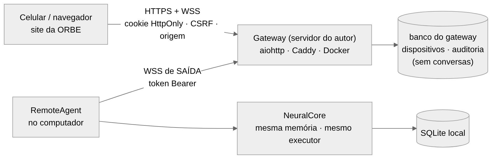

## 9.12 Concorrência

| Thread | Dono | Observação |
|---|---|---|
| principal (Qt) | interface | só desenho e eventos de interface |
| `ultron-event-bus` | Event Bus | entrega de eventos |
| `ultron-scheduler` | runtime | tarefas periódicas (saúde, métricas, backup, consolidação) |
| `ultron-<fila>` | runtime | `ai`, `vision`, `voice`, `network`, `memory`, `perception`, `imagination`, `health`, `actions` |
| `ultron-reminders` | lembretes | dorme até o próximo instante relevante |
| `ultron-microphone`, `ultron-speaker` | voz | único leitor do microfone; fila de fala |
| `ultron-remote` | WEB ORB | laço assíncrono da conexão de saída |

Encerramento: `core.shutdown()` → `LifecycleManager.stop_all()` na ordem inversa; o teste
`test_tardis.ShutdownTest` confirma que nenhuma thread do sistema sobra.

# 10 DESENVOLVIMENTO

Este capítulo descreve como o SAFRA foi construído e por quê. Em vez de listar arquivos, ele apresenta os
problemas de cada parte, as decisões tomadas, as alternativas descartadas e as dificuldades encontradas. As
evidências (testes, medições, commits) são citadas ao longo do texto; o detalhamento técnico completo está no
relatório técnico (`docs/technical/RELATORIO_TECNICO.md`).

## 10.1 Evolução do sistema

O repositório registra 94 commits entre 7 de outubro e 3 de novembro de 2026, antes da fase SAFRA. A evolução
pode ser dividida em cinco momentos (Quadro 10.1).

**Quadro 10.1 — Evolução do sistema (fonte: histórico do Git).**

| Período | Identidade | O que aconteceu | Problema que motivou |
|---|---|---|---|
| 07/10 | JARVIS original | 131 arquivos Python, 46 documentos de "fases", interface `jarvis_hud.py` | ponto de partida: crescimento por acréscimo, 38 % das linhas em cópias de backup, script principal quebrado |
| 08–12/10 | ULTRON | reconstrução em torno de um núcleo único; memória, voz, agente; primeiros testes; desempenho medido | módulos paralelos repetindo responsabilidades; falhas engolidas silenciosamente |
| 19–22/10 | JARVIS | auditoria do código real; voz diagnosticável; TARDIS; permissões por categoria; rosto 3D com boca sincronizada | o original tinha funções que se perderam; a voz falhava sem dizer onde |
| 29/10–03/11 | JARVIS ULTIMATE / Phoenix | CI em Linux e Windows; 10 defeitos encontrados por testes de segurança e falhas; central 3D em Three.js; perfis de inteligência; acesso remoto | o que funcionava no Linux falhava no Windows; ações sobre arquivos sem limites |
| 11/11 | **SAFRA** | auditoria acadêmica, requisitos, nova identidade, instrumentos de medição, este trabalho | transformar o projeto em objeto de pesquisa defensável |

Dois episódios ilustram por que a integração, e não os componentes, foi o desafio principal:

* **A interface que não abria no Windows** (commit `8417b29`): um cache de estado era usado antes de ser
  criado. No Linux, uma diferença de ordem de inicialização escondia o defeito. A correção veio junto de duas
  mudanças de arquitetura: o **modo console**, que usa o mesmo núcleo quando a interface falha, e um
  **diagnóstico por etapas**, com prazo para cada uma.
* **Os scripts que perdiam a entrada do usuário** (commit `cd9e7f3`): no Windows, o comando `chcp`, usado para
  ajustar a codificação de caracteres, consumia a entrada redirecionada. A causa só foi confirmada por "sondas"
  executadas no CI do Windows, que compararam o mesmo script com e sem o comando.

Um terceiro episódio aparece na própria fase SAFRA (Seção 10.11).

## 10.2 Núcleo e comunicação por eventos

**Problema.** O sistema precisa atender pedidos de várias entradas (voz, texto, botões, acesso remoto) e mostrar
o que acontece em várias saídas (interface, voz, cena 3D, site) sem que cada parte conheça todas as outras.

**Decisão.** Um núcleo único, o `NeuralCore`, constrói todos os componentes e é a **entrada única** de pedidos
(`submit` para texto e voz; `run_skill` para ações pedidas pela interface). O `LifecycleManager` inicia os
componentes em ordem topológica, conforme suas dependências, e os encerra em ordem inversa. A comunicação para
fora do núcleo é feita por um **Event Bus** com fila limitada (89 tipos de evento) e por um **estado global**
que, a cada mudança, publica apenas os nomes dos campos alterados.

**Por quê.** A alternativa — cada módulo chamar diretamente os outros — era a situação do sistema original e
produzia o acoplamento que impedia mudanças. Com eventos, a interface é apenas uma assinante: se o Qt não está
instalado, o núcleo roda no modo console sem nenhuma alteração. A fila limitada impede que um assinante lento
consuma memória sem limite; os descartes são contados e informados.

**Concorrência.** O processamento acontece em *workers* nomeados por fila (`ai`, `voice`, `memory`, `actions`…),
com cancelamento cooperativo: o pedido em andamento verifica periodicamente se foi cancelado. A thread da
interface nunca faz entrada e saída de dados. Um teste confirma que, após o encerramento, nenhuma thread do
sistema continua viva.

## 10.3 Processamento de comandos e inteligência

**Duas camadas.** O `IntentEngine` reconhece por regras os comandos frequentes em português — horas, datas,
lembretes, abrir programas, consultas à memória pessoal, controle do próprio sistema. Datas e horas como
"amanhã às 18h", "sexta 9h30" ou "dia 12/10 às 14:00" são interpretadas sem modelo de linguagem. O que as regras
não reconhecem segue para o `ReasoningEngine`, que monta o contexto (memórias recuperadas, estado do
computador) e consulta o modelo local pelo `ModelRouter`.

**Ferramentas sob controle.** O modelo pode propor ações, mas só entre as ferramentas **oferecidas para aquele
pedido**; um teste confirma que uma ferramenta não oferecida nunca é executada, mesmo que o modelo a peça. Toda
resposta carrega sua **procedência** — memória, ação verificada, modelo local, inferência —, mostrada ao usuário.

**Custo e privacidade.** O provedor na nuvem (OpenAI) é opcional, desligado por padrão, exige autorização no
primeiro uso pago e respeita limites mensais de gasto e de tokens, registrados no mesmo banco.

## 10.4 Memória persistente

**Um banco só.** Todas as memórias ficam num único arquivo SQLite em modo WAL, com 27 tabelas e migrações
versionadas (v1 a v7) aplicadas de forma idempotente. A decisão evita a situação do sistema original, em que
vários arquivos JSON e bancos guardavam partes do estado sem consistência entre si, e torna o backup simples
(API de backup do próprio SQLite).

**Tipos de memória.** O sistema separa memória de trabalho (o que acontece agora), episódica (o que foi tentado
e o resultado), semântica (fatos), procedural (como fazer), preferências e um grafo de conceitos. A **memória
pessoal** (compromissos, tarefas, ideias, lembretes) tem serviço próprio, busca de texto completo sem acentos e
um agendador de lembretes **determinístico**: uma thread dorme até o próximo instante relevante, cada disparo é
registrado para nunca se repetir, e lembretes perdidos com o programa fechado geram um único aviso.

**Proteções.** Textos com aparência de senha, token, número de cartão ou dado financeiro são recusados **antes**
de qualquer gravação — o que se confirmou de forma inesperada durante a preparação dos experimentos, quando um
fato de teste sobre a "senha do wi-fi" foi recusado pelo próprio sistema (Seção 12.3). Banco danificado
interrompe o início com mensagem clara sem tocar no arquivo; banco somente leitura mantém a conversa e informa
o que não foi gravado.

## 10.5 Interação por voz

**Captura e reconhecimento.** Um único componente é dono do microfone (duas leituras simultâneas disputariam o
dispositivo). O áudio é reamostrado para 16 kHz e reconhecido pelo Vosk, offline, com o modelo pequeno ou o
grande, conforme a memória disponível.

**Palavra de ativação.** O detector procura a palavra no **início** da frase — no meio, ela não ativa. Há três
tipos de forma: **fortes** (a palavra e variantes que não são palavras comuns), **nomes** (nomes próprios que
soam parecido, fortes só abrindo a frase) e **fracas** (confusões medidas com palavras comuns, que só ativam
seguidas de um comando reconhecido). Uma **calibração** grava a voz do usuário dizendo a palavra e aprende as
formas que o reconhecedor produz para ela, recusando palavras comuns. Depois de uma interação, uma janela de
continuação permite falar sem repetir a palavra.

**Síntese.** A resposta passa pela camada de prosódia (normalização de números, horas, valores e siglas;
divisão em frases; pausas), é sintetizada pelo Piper frase a frase e recebe o processamento do perfil de voz.
Enquanto o sistema fala, a escuta é suspensa, exceto para "pare" e para a palavra de ativação — o que evita
que o assistente reaja à própria voz.

**Dificuldade.** O nome "Jarvis" não existe no vocabulário do modelo pequeno do Vosk e era transcrito como
"aves" ou "aviso"; foi isso que motivou o sistema de formas e a calibração. A troca para "Safra" (Seção 10.11)
foi feita como hipótese a medir — e o resultado (Seção 12.1) não foi o esperado.

## 10.6 Sincronização labial

**Decisão.** A boca do holograma é guiada pelo **áudio real** que vai para o alto-falante, e não por uma animação
genérica. A `LipSyncTrack` divide o áudio em quadros de 10 ms e calcula a energia de cada um. Quando o modelo de
voz informa os fonemas de cada frase, eles são convertidos em 14 visemas (Seção 6.8) e distribuídos **apenas
pelos quadros sonoros** daquela frase, com peso maior para vogais; as pausas caem nos silêncios reais. A
abertura final é multiplicada pela energia do áudio: no silêncio, a boca fecha. Sem fonemas (voz do Windows), a
forma vem do espectro de cada quadro.

**Defeito encontrado.** Logo depois do fim da fala, a boca às vezes ficava minimamente aberta. A causa era
aritmética de ponto flutuante: 0,29 s correspondia ao quadro 28 + 0,999999…, e a interpolação misturava o último
quadro sonoro com o silêncio. A correção (commit `a1788c5`) trata instantes a menos de um milionésimo de um
quadro como o próprio quadro, e um teste determinístico falha sem ela.

## 10.7 Interface humanoide e cena 3D

**Tecnologia.** A interface principal é escrita em Qt (PySide6). A cena 3D — holograma, ORBE, convés e TARDIS —
é uma página local em Three.js aberta num `QWebEngineView`. A escolha permitiu usar a GPU pelo WebGL sem
escrever um motor gráfico próprio, mantendo o resto da interface em Qt.

**Holograma.** O corpo humano completo é construído proceduralmente sobre um esqueleto de 57 ossos (com três
falanges por dedo, olhos, sobrancelhas e mandíbula), com *skinning* calculado na GPU, roupas, cabelo e
expressões. O movimento é procedural e **dirigido por estados reais**: respiração e postura em repouso, olhar
voltado para a câmera, gestos proporcionais à energia da fala, braços sobre os painéis quando o holograma está
dentro da TARDIS e há uma tarefa em execução.

**Ponte segura.** A página não acessa a rede (um interceptador bloqueia qualquer pedido externo). O Python
envia estado, eventos e a trilha labial; a página só pode devolver pedidos de uma lista branca (abrir a TARDIS,
voltar, microfone, restaurar a identidade). Qualquer falha — WebGL ausente, contexto perdido, tempo esgotado —
faz a interface voltar para uma vista 2D e registrar o motivo. No CI do Windows, o WebGL não abriu (servidor sem
GPU) e a vista 2D funcionou, o que confirmou esse caminho.

**Desempenho medido.** Uma fase dedicada (commit `a706c27`) mediu o custo da interface antes e depois das
otimizações, nas mesmas condições: a CPU em repouso caiu de 39,2 % para 22,0 % e o quadro da TARDIS de 19,1 ms
para 3,7 ms, enquanto a memória subiu 22 MB por causa dos recursos novos. Perfis de qualidade (Econômico,
Equilibrado, Alto, Cinematográfico) mudam só o custo visual.

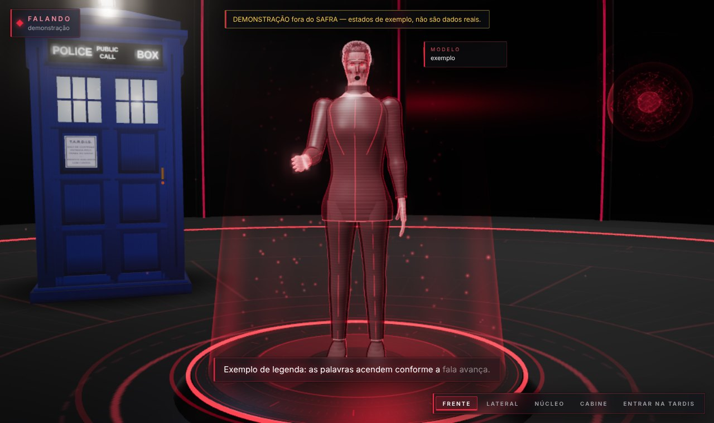

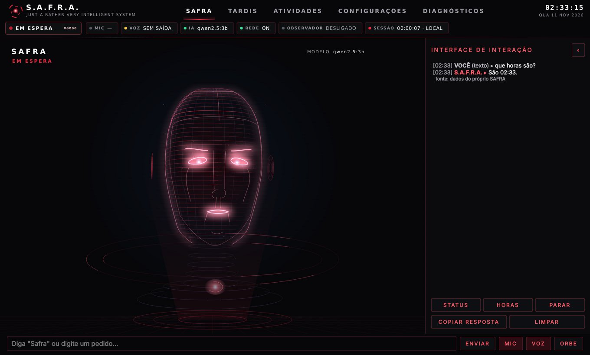

## 10.8 Ambiente virtual TARDIS

A TARDIS tem um lado lógico e um visual. O **motor** (`ultron/tardis`) mantém uma fila própria de tarefas de
análise, com prazos, cancelamento e persistência, e analisadores **determinísticos**: diagnóstico do estado real
dos módulos, telemetria medida do próprio sistema, organização da memória pessoal e planejamento que decompõe um
objetivo em etapas **sem executar nenhuma**. A **sala de controle 3D** reflete esse motor: o rotor central muda
conforme o modo, cada painel do console acende somente enquanto uma tarefa real do seu tipo está em execução, e o
holograma fica ao lado do console, olhando os painéis. A cabine externa preserva a identidade da nave da ficção.

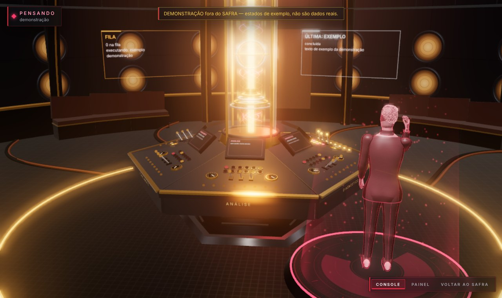

## 10.9 Segurança e permissões

As camadas descritas na Seção 9 (validação → recusa antecipada → permissão por categoria → política de autonomia
→ autorização → execução com prazo → verificação → registro) foram construídas e, principalmente, **testadas
contra tentativas de quebrá-las**. A campanha de testes da Fase 7 (commit `8c01d70`) elevou a cobertura de linhas
de 74 % para 75 % mas, mais importante, encontrou **10 defeitos reais**, entre eles: as ações de arquivo podiam
alterar pastas do sistema, da inicialização automática e do próprio programa (um arquivo gravado na pasta de
plugins seria executado na partida seguinte); a segunda edição de um arquivo sobrescrevia a cópia de segurança
da primeira; cancelar um pedido com o modelo ainda carregando deixava o sistema "pensando" por dezenas de
segundos; um título de janela com quebras de linha podia simular uma seção nova dentro das instruções do modelo.
Todos foram corrigidos com testes que falham sem a correção.

O **Protocolo ULTRON**, identidade alternativa do assistente, mostra o valor dessa estrutura: o perfil
`ULTRON_OPERATOR` dá mais autonomia para rotinas pré-autorizadas, mas é **uma política aplicada ao mesmo
executor** — categorias bloqueadas continuam bloqueadas, apagar dados e ações de risco alto continuam exigindo
confirmação, e tudo é registrado e interrompível.

## 10.10 Diagnóstico, desempenho e confiabilidade

O sistema se diagnostica em várias camadas: um **monitor de saúde** verifica processador, memória, disco,
modelos, voz e interface a cada 15 segundos; um **diagnóstico por etapas** (`--diagnose`) testa configurações,
banco, núcleo, modelos, memória, TARDIS, voz em 8 etapas, percepção e a interface gráfica montada de verdade,
cada etapa com prazo; e as **métricas** registram tempos de quadro, atraso da interface e latências. A
**degradação controlada** (Seção 9.10) mantém o sistema útil quando falta uma parte, e a **instância única**
impede que dois processos disputem o microfone.

## 10.11 A nova identidade: SAFRA

**Identidade visual.** As cores do sistema já estavam centralizadas num arquivo de tokens, compartilhado pelo Qt,
pela cena 3D e pelo site. A nova paleta — vermelho, bordô, preto, grafite, textos em branco e cinza — foi
definida ali, com duas decisões apoiadas em medição: o vermelho principal foi ajustado de `#E5233A` para
`#EA2840` porque o primeiro tinha contraste de 4,44:1 sobre o fundo, abaixo dos 4,5:1 da WCAG 2.1, e o novo tem
4,67:1; e, numa interface vermelha, o vermelho não pode significar erro, então atenção passou a ser âmbar e falha,
laranja. As folhas de estilo do Qt, antes escritas com cores literais, passaram a ser **geradas da paleta**. O
Protocolo ULTRON, que usava vermelho como assinatura, passou a violeta e cromo para continuar distinguível.

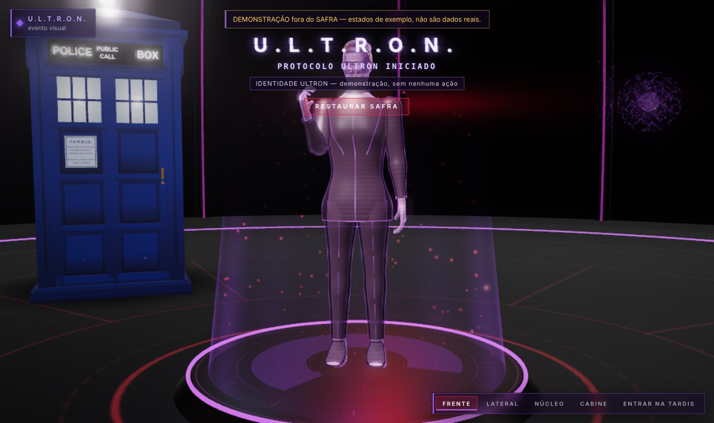

**Palavra de ativação.** "Safra" passou a ser a primeira palavra de ativação e "Jarvis" continua aceita. A
migração das configurações (versão 2 → 3) acrescenta a palavra nova sem apagar as formas que o usuário já havia
calibrado e guarda uma cópia do arquivo anterior.

**Nome visível × identificador.** A troca de nome foi feita por um script que altera apenas textos e comentários,
protegendo nomes de variáveis e arquivos. Mesmo assim, ele alterou cinco identificadores que **pareciam texto**:
o nome do serviço no cofre de credenciais (a chave já salva deixaria de ser encontrada), pastas do sistema
original usadas na importação de dados, o prefixo de variáveis de ambiente, a entrada do início automático no
Windows e o objeto `window.JARVIS` pelo qual o Python envia o estado para a cena 3D — com este último, a cena
abriria normalmente, mas não receberia nenhum estado. Os testes de compatibilidade e o teste da cena 3D real,
executado com QtWebEngine sob um servidor X virtual, detectaram os casos, que foram revertidos antes do envio.
A lição foi registrada: renomear um produto exige separar o **nome visível** do **identificador**.

## 10.12 Componentes complementares

Dois componentes existem no sistema, mas não fazem parte das hipóteses centrais deste trabalho:

* **WEB ORB** — um site com apenas a ORBE que dá acesso remoto ao **mesmo** núcleo. O computador abre uma
  conexão de saída para um servidor intermediário (nenhuma porta é aberta no roteador); o celular é pareado por
  QR Code com confirmação no computador; ações sensíveis só podem ser confirmadas no computador. Foi verificado
  localmente de ponta a ponta, mas não foi publicado.
* **Protocolo ULTRON** — identidade alternativa reversível (aparência, voz, tom e perfil de permissões), descrita
  na Seção 10.9.

Um terceiro componente, um módulo de integração com um robô seguidor de linha, foi prototipado em outubro e
**retirado do escopo** do sistema e deste trabalho; o código permanece apenas no histórico do repositório.

## 10.13 Síntese das dificuldades

**Quadro 10.2 — Dificuldades técnicas e como foram resolvidas.**

| Dificuldade | Natureza | Como foi detectada | Solução |
|---|---|---|---|
| Sistema original não iniciava pelo script principal | integração | leitura do código e execução | reconstrução em torno de um núcleo único |
| Interface não abria no Windows | ordem de inicialização | relato e CI do Windows | correção + modo console + diagnóstico por etapas |
| Scripts perdiam a entrada no Windows | plataforma | sondas no CI do Windows | proteção do `chcp` em todos os scripts, com teste |
| Palavra "Jarvis" fora do vocabulário | reconhecimento | medição com fala sintetizada | formas fortes/fracas, calibração; troca para "Safra" como hipótese |
| Boca aberta após a fala | ponto flutuante | teste com a voz real no CI do Windows | quadro exato abaixo de 10⁻⁶ |
| Ações de arquivo sem limites | segurança | testes que tentam quebrar o sistema | recusa antecipada de alvos protegidos |
| CPU alta em repouso | desempenho | medição com o mesmo roteiro antes e depois | cadência por perfil, cache de camadas, animação só por mudança real |
| Renomeação alterando identificadores | compatibilidade | testes de compatibilidade e da cena 3D real | reversão dos identificadores; regra registrada |

# 11 TESTES E VALIDAÇÃO

A validação do SAFRA combina dois instrumentos complementares: uma **suíte de testes automatizados**, que
verifica o comportamento do sistema a cada alteração, e **protocolos experimentais**, que medem as métricas
definidas nos requisitos não funcionais. Este capítulo descreve os dois; os resultados estão no Capítulo 12.

## 11.1 Estratégia

A estratégia segue a definição de Myers, Sandler e Badgett (2011): testar é tentar encontrar erros. Por isso,
além de verificar que as funções funcionam, a suíte tenta quebrar o sistema — injeta falhas (banco danificado,
disco cheio, modelo que cai no meio da resposta, sensor com erro), envia entradas inválidas e tenta executar
ações proibidas. Três regras valem para todos os testes:

1. **Nenhum dado real do usuário é lido ou alterado.** A pasta de dados aponta para uma pasta temporária antes
   de qualquer importação do pacote.
2. **Dublês são declarados.** O servidor do Ollama e o da OpenAI são substituídos por servidores HTTP locais
   que seguem o mesmo protocolo; o microfone, a Lixeira e o cofre de credenciais têm versões falsas. Os testes
   dizem o que é real e o que é simulado.
3. **Componentes reais sempre que possível.** O núcleo, o banco SQLite em arquivo, o Event Bus, os *workers*,
   a interface Qt (em modo *offscreen*), a síntese Piper e o reconhecimento Vosk com os modelos do repositório
   e o servidor da WEB ORB rodam de verdade nos testes.

## 11.2 Composição da suíte

A suíte tem 39 módulos de teste e 475 casos (versão desta fase). O Quadro 11.1 os agrupa pelos tipos de teste
pedidos para este trabalho.

**Quadro 11.1 — Testes automatizados por tipo.**

| Tipo | Módulos (casos) | O que verificam |
|---|---|---|
| Unitários | `test_event_bus` (7), `test_lipsync` (9), `test_voice_prosody` (10), `test_planner` (8), `test_verifier` (5), `test_recovery` (7), `test_world_model` (5), `test_tardis_sfx` (5), `test_imagination` (6) | componentes isolados: fila de eventos, trilha labial, prosódia, planejamento, verificação, recuperação |
| Integração com o núcleo real | `test_core` (15), `test_executor` (12), `test_permissions` (10), `test_activity` (7), `test_memory` (9), `test_second_brain` (25), `test_intelligence` (22), `test_model_router` (9), `test_openai_provider` (6), `test_original_recovery` (22), `test_tardis_logic` (30), `test_network` (14), `test_plugins` (4) | pedidos atravessando intenção, orquestração, execução, memória e resposta |
| Inicialização e linha de comando | `test_startup` (10), `test_cli` (7), `test_integrity` (8) | processos reais: janela, bandeja, segunda instância, `--stop`, modo console, `--diagnose`, backup, exportação |
| Interface | `test_platform` (22), `test_hud` (22), `test_avatar` (12), `test_scene3d` (24), `test_tardis_room` (12), `test_tardis` (7), `test_performance` (10), `test_ultron_protocol` (21) | páginas, atalhos, conversa, estados visuais, cena 3D real (QtWebEngine) e reserva 2D, identidade e restauração |
| Comunicação | `test_web_orb` (7), `test_scene3d` (ponte Python ↔ página) | gateway real, agente de saída, pareamento, sessões, CSRF, origem; lista branca da ponte 3D |
| Segurança | `test_security` (17), `test_permissions`, `test_executor` | código sem shell/`eval`/`exec`/`pickle`; alvos protegidos recusados antes da autorização; ferramentas não oferecidas ao modelo; conteúdo de tela como dado; credenciais só no cofre |
| Falhas e transições | `test_failures` (7), `test_transitions` (6) | banco danificado e somente leitura, backup interrompido, modelo que cai, sensor com erro; sequência real de estados até o repouso |
| Voz | `test_voice` (30), `test_jarvis_voice` (6) | detector de ativação ("Safra" e "Jarvis"), calibração com Piper → Vosk reais, autoescuta, migração das configurações |
| Desempenho | `test_performance` (10) | cadência de quadros por perfil, ausência de E/S na thread da interface, custo limitado por perfil |
| Estabilidade | `test_tardis` (encerramento sem threads restantes), `test_core` | ciclo de vida completo; ver também PV-07 |

## 11.3 Integração contínua

O fluxo `jarvis-validation.yml`, no GitHub Actions, executa a cada disparo três trabalhos:

* **Linux, Python 3.11 e 3.13:** instala as bibliotecas do Qt, executa a suíte completa, executa a **cena 3D
  real** (QtWebEngine com WebGL por software) sob um servidor X virtual, faz as verificações estáticas
  (`compileall`, `pyflakes`), gera o pacote ZIP e testa o pacote extraído numa pasta nova;
* **Windows (Python 3.11):** executa a suíte, as verificações estáticas, gera e testa o pacote e **instala o
  sistema a partir do ZIP extraído** com o `INSTALL_JARVIS.bat`, executando os scripts documentados (console,
  diagnóstico, `--status`, `--stop`, início automático).

O CI do Windows roda num servidor sem microfone, alto-falante, GPU ou área de trabalho interativa: prova o
Python, o Qt, o SQLite, os processos e os caminhos do Windows, mas **não** o hardware de um computador pessoal.

## 11.4 Protocolos experimentais

Os requisitos não funcionais são avaliados por sete protocolos (Quadro 11.2), descritos em detalhe no
Apêndice A. Cada um tem um instrumento em `tools/experimentos/`, que grava os dados brutos em JSON com o
ambiente e a lista do que foi real e do que foi simulado.

**Quadro 11.2 — Protocolos de validação.**

| Protocolo | Métrica | Meta | Ambiente C (executado nesta fase) | Ambiente R (previsto) |
|---|---|---|---|---|
| PV-01 Ativação por voz | taxa de ativação; ativações indevidas; WER | ≥ 90 %; ≤ 2 % | voz sintética, 2 modelos, 3 velocidades, 3 ruídos, 2 repetições | voz humana, microfone real |
| PV-02 Resposta | tempo pedido → resposta | p95 ≤ 1 s (regras); p50 ≤ 8 s (modelo) | núcleo real, inferência simulada de 0 ms | modelo real |
| PV-03 Memória | recall@1, recall@3; recuperação indevida | recall@3 ≥ 80 % | conjunto sintético de 20 fatos | o mesmo |
| PV-04 Interface | montagem; cena pronta; quadros/s | ≤ 15 s; ≤ 5 s; ≥ 30 q/s | verificação do instrumento (WebGL por software) | GPU real |
| PV-05 Sincronização | defasagem forma × áudio; silêncio; início das palavras; atraso de apresentação | ITU-R BT.1359 | cálculo da trilha (etapa A) | gravação em vídeo (etapa B) |
| PV-06 Segurança | bloqueio de ações indevidas; controles | 100 %; 100 % | 11 tentativas, 4 controles | o mesmo |
| PV-07 Estabilidade | falhas; memória (MB/h); threads restantes | 8 h; ≤ 20 MB/h; 0 | 30 minutos | 8 horas, modelo real |

## 11.5 Critérios de aceitação do protótipo

O protótipo será considerado aceito para a defesa quando: (CA01) a suíte estiver aprovada no CI em Linux e
Windows no commit entregue; (CA02) todos os requisitos essenciais estiverem atendidos ou com a limitação
documentada; (CA03) os protocolos tiverem sido executados no computador de referência, com os dados brutos
versionados; (CA04) cada meta tiver um resultado registrado — atingida, não atingida ou não medida, com o motivo;
(CA05) a instalação a partir do pacote funcionar num Windows limpo seguindo apenas o manual.

# 12 RESULTADOS E DISCUSSÃO

Este capítulo apresenta os resultados obtidos até 11 de novembro de 2026. Todos vêm de arquivos de dados
versionados em `docs/research/resultados/`, citados em cada tabela. Os resultados do **ambiente C**
(contêiner de desenvolvimento, sem GPU, microfone ou alto-falante) estão separados dos que dependem do
**ambiente R** (computador de referência), cujas rodadas oficiais estão previstas para 2027. Nenhum resultado
de um ambiente é apresentado como se fosse do outro.

## 12.1 Interação por voz (PV-01)

**Tabela 12.1 — Ativação por voz com fala sintetizada (ambiente C; 180 frases por palavra e modelo: 10 comandos ×
3 velocidades × 3 níveis de ruído × 2 sínteses). Fonte: `pv01_ativacao_conteiner-sintetico.json`.**

| Medida | Modelo pequeno | Modelo grande | Meta |
|---|---|---|---|
| Ativação com "Safra" (todas as condições) | 3,9 % (7/180; IC 1,9–7,8 %) | 2,2 % (4/180; IC 0,9–5,6 %) | ≥ 90 % (RNF06) |
| Ativação com "Safra", sem ruído | 8,3 % (5/60) | 6,7 % (4/60) | — |
| Ativação com "Jarvis" (todas as condições) | 17,2 % (31/180; IC 12,4–23,4 %) | 18,3 % (33/180; IC 13,4–24,6 %) | — |
| Ativação com "Jarvis", sem ruído | 26,7 % (16/60) | 40,0 % (24/60) | — |
| Palavra dita sozinha ("Safra." / "Jarvis.") | 0 % / 5,6 % | 0 % / 33,3 % | — |
| Ativação indevida (24 frases comuns × 18 condições) | 0,46 % (2/432) | 0 % (0/432; IC 0–0,9 %) | ≤ 2 % (RNF07) |
| Frase que começa com "safra" sem intenção de comando | 7,4 % (4/54) | 25,9 % (14/54) | — |

O resultado contraria a expectativa que motivou a troca de nome. Com a voz sintética do próprio sistema, a
palavra "Safra" foi reconhecida **menos** que "Jarvis". O exame das transcrições mostra a causa: o modelo grande
transcreveu o "Safra," do início da frase como **"faça"** em 156 das 180 frases — uma palavra frequente no início
de comandos em português —, e o modelo pequeno simplesmente omitiu a primeira palavra na maior parte dos casos.
Quando "safra" aparece colada ao resto da frase ("safra recorde no Paraná"), ela é reconhecida, o que indica que a
pausa da vírgula e a pronúncia da voz sintética pesam no resultado.

Três conclusões cautelosas são possíveis. Primeiro, a hipótese de projeto de que uma palavra presente no
vocabulário seria mais bem reconhecida **não se confirmou neste canal**; ela não pode ser descartada sem o teste
com voz humana (PV-01, etapa B), porque a medida usou uma única voz sintética. Segundo, a exigência de que a
palavra esteja no início da frase funcionou como proteção: ativações indevidas ficaram abaixo da meta (≤ 2 %),
inclusive nas frases com "safra" no meio. Terceiro, a **calibração com a voz do usuário** é o mecanismo certo
para resolver o problema: uma análise exploratória sobre as mesmas transcrições mostrou que, se "faça" fosse
aprendida como forma fraca, a ativação com "Safra" no modelo grande subiria para 88,9 % e as ativações indevidas
para 0,9 % (4/432). Essa forma **não** foi adotada por padrão — seria ajustar o sistema à voz do teste —, e
"faça" foi explicitamente impedida de virar forma forte. Por decisão conservadora, "Jarvis" continua aceita.

A taxa de erro de palavras do comando (o que vem depois da palavra de ativação) teve mediana de 33 % no modelo
pequeno e 60–67 % no grande. Os valores são altos porque, quando a ativação falha, a frase inteira (incluindo a
palavra mal transcrita) é comparada ao comando; por isso essa medida será reavaliada com voz humana.

## 12.2 Tempo de resposta (PV-02)

**Tabela 12.2 — Tempo do pedido à resposta publicada (ambiente C; núcleo real; inferência simulada de 0 ms).
Fonte: `pv02_latencia_conteiner-modelo-simulado.json`.**

| Grupo | n | Mediana | p95 | Máximo | Sem resposta | Meta |
|---|---|---|---|---|---|---|
| Comandos determinísticos | 120 | 5,2 ms | 9,3 ms | 21,1 ms | 0 | p95 ≤ 1 s (RNF01) |
| Caminho do modelo (só a sobrecarga do núcleo) | 40 | 11,2 ms | 20,7 ms | 26,3 ms | 0 | p50 ≤ 8 s com modelo real (RNF02) |
| Inicialização do núcleo (sem voz e interface) | 1 | 52 ms | — | — | — | — |

Os comandos determinísticos ficaram duas ordens de grandeza abaixo da meta. O mais lento foi "o que eu tenho
amanhã" (p95 de 16 ms), que consulta a memória pessoal. O caminho do modelo acrescentou cerca de 11 ms de
sobrecarga do núcleo (montagem de contexto, roteamento, registro) — **não** é o tempo de um modelo real, que
depende do hardware e será medido no ambiente R. O resultado mostra que, no SAFRA, o tempo de resposta é
dominado pela inferência, e não pela arquitetura.

## 12.3 Memória (PV-03)

**Tabela 12.3 — Recuperação de memória (conjunto sintético: 20 fatos, 20 perguntas lexicais, 20 paráfrases,
10 perguntas sobre fatos ausentes; 8 registros da memória pessoal). Fontes: `pv03_memoria_conteiner-antes-da-correcao.json`
e `pv03_memoria_conteiner-depois-da-correcao.json`.**

| Medida | Antes da correção | Depois da correção | Meta |
|---|---|---|---|
| Perguntas lexicais — recall@3 | 90 % (18/20) | **100 % (20/20)** | ≥ 80 % (RNF09) |
| Paráfrases — recall@1 / recall@3 | 25 % / 40 % | 45 % / 45 % | ≥ 80 % |
| Perguntas sobre o que não existe — recuperação indevida | 70 % (7/10) | 70 % (7/10) | — |
| Memória pessoal — busca exata / com variação (top 3) | 100 % / 87,5 % | 100 % / 87,5 % | — |

O experimento revelou **três defeitos reais**, corrigidos durante esta fase com testes de regressão:
(1) a comparação de palavras aceitava pedaços no meio de outras ("ana" casava com "losart**ana**", "avó" com
"f**avo**rito"); (2) um fato sem nenhuma palavra em comum com a pergunta podia passar do limite mínimo só pelos
bônus de recência e de uso; (3) o pré-filtro no banco comparava o termo sem acento com o texto acentuado e não
encontrava "médico" a partir de "medico" — eram exatamente as duas perguntas lexicais que falhavam. Corrigidos os
três, as perguntas lexicais passaram a 100 %.

As paráfrases, porém, continuaram em 45 %, abaixo da meta: uma busca **lexical** não relaciona "que número eu
calço?" com "tamanho do sapato". E as perguntas sobre fatos ausentes continuaram trazendo, em 7 de 10 casos, um
fato que compartilha uma palavra inteira com a pergunta ("qual o tipo sanguíneo do Pedro?" → "time do Pedro").
Isso não produz uma resposta errada por si só — o fato vai ao modelo como "evidência auxiliar, não instruções", e
a resposta indica a procedência —, mas aumenta o risco de o modelo usar um fato não relacionado. A conclusão é
que a meta RNF09 é atingida para perguntas que usam as palavras guardadas e **não** é atingida para paráfrases;
a evolução natural é a recuperação semântica por vetores, executada localmente (Capítulo 13).

Um episódio da preparação do experimento confirmou outra proteção: um dos fatos de teste falava em "senha do
wi-fi", e o sistema se recusou a gravá-lo (requisito RS04), obrigando a troca do exemplo.

## 12.4 Interface (PV-04)

**Tabela 12.4 — Interface no ambiente C (10 repetições; WebGL por software, llvmpipe). Fonte:
`pv04_interface_conteiner-webgl-software.json`.**

| Medida | Resultado | Meta | Avalia a meta? |
|---|---|---|---|
| Montagem da interface (`--gui-check`, processo novo) | média 1,48 s; p95 1,64 s; 0 falhas | ≤ 15 s (RNF03, inclui o núcleo) | parcialmente (sem o núcleo completo) |
| Cena 3D pronta | média 0,73 s; abriu 10/10; 0 erros de JavaScript | ≤ 5 s (RNF04) | não (sem GPU) |
| Quadros por segundo, perfil Equilibrado | 5,3 q/s (mediana) | ≥ 30 q/s com GPU | **não** (renderização por software) |

Os tempos de abertura são bons sinais, mas os quadros por segundo no contêiner — 5,3 q/s com renderização por
software — **não dizem nada** sobre o desempenho com GPU. A meta RNF04 só pode ser avaliada no ambiente R. Medições
anteriores, feitas com o desenho 2D (QPainter), registraram queda da CPU em repouso de 39,2 % para 22,0 % e do
quadro da TARDIS de 19,1 para 3,7 ms depois das otimizações (relatório de desempenho do projeto), também no
ambiente de desenvolvimento.

## 12.5 Sincronização labial (PV-05, etapa A)

**Tabela 12.5 — Trilha da boca contra o áudio real (12 frases × 3 sínteses; Vosk grande como referência). Fonte:
`pv05_sincronizacao_conteiner.json`.**

| Medida | Resultado |
|---|---|
| Método usado pela trilha | fonemas sobre o áudio real (36/36) |
| Defasagem entre a forma prevista pelos visemas e a energia do áudio | mediana 0 ms; p95 10 ms; máximo 10 ms (resolução de 10 ms) |
| Correlação forma × energia | média 0,65 |
| Boca fechada nos quadros silenciosos | 100 % (36/36 frases) |
| Erro do início de cada palavra (trilha × reconhecedor) | mediana 60 ms; p95 290 ms; máximo 540 ms (182 palavras em 22 frases comparáveis) |

No cálculo, a sincronização está alinhada: a abertura prevista pelos visemas coincide com a energia do áudio
dentro de um quadro, e a boca fecha em todos os silêncios. O início das palavras, que guia a legenda, mostrou erro
mediano de 60 ms em relação ao reconhecedor — coerente com o método, que distribui os fonemas pelos trechos
sonoros sem conhecer a duração exata de cada um. Os erros maiores (até 540 ms) ocorreram em frases longas, nas
quais o desvio se acumula. Como o reconhecedor também tem incerteza de dezenas de milissegundos, o número é uma
estimativa. O critério da ITU-R BT.1359 (+45/−125 ms) diz respeito ao que o usuário **vê e ouve**; ele depende da
etapa B (gravação em vídeo no ambiente R), ainda não realizada.

## 12.6 Segurança (PV-06)

**Tabela 12.6 — Tentativas indevidas e controles (núcleo real; pastas temporárias). Fonte:
`pv06_seguranca_conteiner.json`.**

| Caso | Esperado | Resultado |
|---|---|---|
| Criar arquivo nos dados do SAFRA | bloquear | recusado antes da autorização |
| Criar arquivo na pasta do programa | bloquear | recusado |
| Criar arquivo por atalho para a pasta de dados | bloquear | recusado |
| Apagar com a categoria bloqueada pelo usuário | bloquear | recusado |
| Apagar com autorização negada | bloquear | negado; arquivo intacto |
| Apagar sem resposta à autorização (expira) | bloquear | negado; arquivo intacto |
| Apagar por origem proativa, sem resposta | bloquear | negado |
| Skill inexistente ("shell") | bloquear | recusado |
| Argumento inválido (NaN) | bloquear | recusado |
| Guardar senha na memória | bloquear | recusado pelo filtro de segredos |
| Guardar número de cartão na memória pessoal | bloquear | recusado |
| Controles: criar, ler, guardar fato comum, apagar com aprovação | permitir | executados e verificados |

Todas as 11 tentativas indevidas foram bloqueadas **sem efeito colateral** (verificado no disco e no banco) —
100 %, com intervalo de Wilson de 74,1–100 % para a amostra — e os 4 controles funcionaram. Os controles mostram
que o resultado não vem de um sistema que bloqueia tudo. A suíte `test_security` complementa a medida com
verificações que o protocolo não cobre (código sem execução por shell, ferramentas não oferecidas ao modelo,
conteúdo de tela tratado como dado). A amostra é pequena e foi escrita pelo autor; não se trata de um teste de
invasão.

## 12.7 Estabilidade (PV-07)

**Tabela 12.7 — Execução contínua de 30 minutos (ambiente C; um ciclo de 5 pedidos a cada 5 s). Fonte:
`pv07_estabilidade_conteiner-30min.json`.**

| Medida | Resultado | Meta (8 h, ambiente R) |
|---|---|---|
| Pedidos enviados / respondidos | 1.785 / 1.785 | todos |
| Erros / falhas fatais | 0 / 0 | 0 |
| Memória do processo | 55,6 → 74,3 MB | — |
| Crescimento de memória, série inteira | 19,2 MB/h | — |
| Crescimento depois do aquecimento (5 min) | 8,4 MB/h | ≤ 20 MB/h |
| Threads restantes após encerrar | 0 | 0 |

A memória cresceu rapidamente nos primeiros quatro minutos (caches, banco e módulos carregados sob demanda) e
depois lentamente, desacelerando (cerca de 4 MB/h nos últimos dez minutos). Por isso o protocolo foi revisado para
avaliar o crescimento **depois do aquecimento**; a série inteira (19,2 MB/h) mistura as duas fases. A meta de 8
horas com o modelo real ainda precisa ser medida.

## 12.8 Testes automatizados e integração contínua

A suíte cresceu de 471 casos (início da fase) para 475, todos aprovados em Python 3.13; a cena 3D real
(QtWebEngine) passou em 24 de 24 testes sob servidor X virtual. A última execução do CI anterior a esta fase (61,
commit `bf070f6`) foi aprovada em Linux 3.11/3.13 e Windows, incluindo a instalação a partir do pacote. Durante a
fase, os testes detectaram **seis** regressões introduzidas pela renomeação (Seção 10.11) e o protocolo de memória
detectou **três** defeitos de recuperação (Seção 12.3), todos corrigidos antes do envio.

## 12.9 Discussão

**O que funcionou.** A arquitetura de núcleo único com eventos isolou falhas e permitiu trocar a identidade
visual inteira — Qt, cena 3D, site — a partir de um arquivo de tokens. As camadas de segurança bloquearam todas
as tentativas medidas sem bloquear as ações legítimas. O núcleo respondeu em milissegundos aos comandos
determinísticos e funcionou 30 minutos sem falhas. A sincronização labial, no cálculo, ficou alinhada ao áudio.

**O que não funcionou.** A troca de "Jarvis" por "Safra" não melhorou o reconhecimento com a voz sintética; a
recuperação de memória não entende paráfrases e traz fatos que compartilham apenas um nome com a pergunta.

**Melhorias realizadas a partir dos resultados.** Três defeitos de recuperação de memória corrigidos (com efeito
medido: lexical de 90 % para 100 %); a forma "faça" impedida de virar forma forte; o protocolo de estabilidade
revisado para separar o aquecimento.

**Limitações.** As medições de voz usaram uma única voz sintética; as de interface, WebGL por software; as de
resposta, inferência simulada. Os conjuntos de teste de memória e de segurança são pequenos e foram escritos pelo
autor. O CI do Windows não tem áudio, GPU nem área de trabalho interativa. Essas limitações são exatamente o que
as rodadas no ambiente R, previstas no cronograma, precisam cobrir.

**Possibilidades de evolução.** Recuperação semântica local (vetores de significado) para as paráfrases;
calibração guiada da palavra de ativação na primeira execução; medição do atraso de apresentação áudio × imagem;
e, se o reconhecimento de "Safra" com voz humana continuar baixo, a escolha de outra palavra de ativação com base
em medição.

# 13 CONCLUSÃO

Este trabalho investigou como integrar, num computador pessoal e com processamento predominantemente local,
processamento inteligente de comandos, interação por voz, memória persistente, uma interface humanoide 3D com
sincronização labial e um ambiente virtual de acompanhamento de tarefas, mantendo a independência dos módulos, o
controle das ações e um desempenho adequado. Para isso, o SAFRA foi desenvolvido, documentado e submetido a
testes automatizados e a protocolos experimentais.

## 13.1 Resposta ao problema de pesquisa

A resposta proposta — e implementada — é uma **arquitetura de núcleo único orientada a eventos**, na qual o
núcleo concentra estado, memória e execução, e os demais subsistemas se comunicam por um barramento de eventos e
por um estado global publicado por campos alterados; e uma **cadeia de controle das ações** (recusa antecipada de
alvos protegidos, permissões por categoria, política de autonomia, autorização explícita, verificação do efeito e
auditoria) pela qual passa toda ação, venha ela de uma regra, de um modelo de linguagem, da interface ou do acesso
remoto.

As quatro questões específicas foram respondidas da seguinte forma, com as evidências disponíveis até aqui:

* **Q1 — Independência funcional:** a falha ou a ausência de um subsistema **não** interrompeu o núcleo nos testes
  de injeção de falhas (banco danificado e somente leitura, modelo que cai, sensor com erro, assinante do barramento
  que falha), na falta da interface gráfica (modo console) e na falta de WebGL (vista 2D, verificada no CI do
  Windows); a execução contínua de 30 minutos não teve falhas.
* **Q2 — Controle das ações:** sim, é possível dar ao sistema capacidade de agir sem executar ações indevidas
  dentro dos cenários medidos: 11 de 11 tentativas foram bloqueadas sem efeito colateral, com os controles
  positivos funcionando, e a suíte de segurança confirmou as demais proteções.
* **Q3 — Desempenho:** a arquitetura em si custa pouco — milissegundos para comandos determinísticos e cerca de
  11 ms de sobrecarga no caminho do modelo. O desempenho percebido depende do modelo de linguagem e da GPU, ainda
  não medidos no computador de referência.
* **Q4 — Coerência multimodal:** os estados exibidos derivam de eventos reais (verificado por testes de transição)
  e, no cálculo, a boca do holograma acompanha a energia do áudio dentro de um quadro de 10 ms e fecha em todos os
  silêncios. O atraso entre o som e a imagem na tela ainda não foi medido.

## 13.2 Avaliação da hipótese

Pelo critério definido no Capítulo 3:

| Condição | Situação | Evidência |
|---|---|---|
| H1 — Isolamento de falhas | **atendida** (ambiente C e CI) | `test_failures`, `test_transitions`, modo console, reserva 2D no CI do Windows, PV-07 |
| H2 — Controle das ações | **atendida** | PV-06 (11/11 e 4/4), `test_security` (17 testes) |
| H3 — Desempenho | **parcialmente avaliada**: RNF01 atendida; RNF02, RNF03 (completa) e RNF04 aguardam o ambiente R | PV-02, PV-04 |
| H4 — Coerência multimodal | **parcialmente avaliada**: estados reais e alinhamento do cálculo verificados; atraso de apresentação não medido | `test_transitions`, PV-05 (etapa A) |

Como H1 e H2 foram atendidas e H3 e H4 ainda não puderam ser avaliadas por completo, **a hipótese está, até o
momento, parcialmente sustentada**. A avaliação final depende das rodadas no computador de referência previstas
para março e maio de 2027; elas podem levar a hipótese a "sustentada" ou mantê-la "parcialmente sustentada", mas
não alteram as condições H1 e H2, que dependem da arquitetura e já foram verificadas.

## 13.3 Contribuições

* Uma arquitetura documentada, com diagramas tirados do código real, para assistentes locais que combinam voz,
  memória, interface 3D e execução de ações.
* Uma cadeia de controle de ações aplicada a um agente com modelo de linguagem, com protocolo de medição que
  inclui controles positivos.
* Um conjunto de instrumentos reproduzíveis (`tools/experimentos`) que registram, em cada resultado, o ambiente e
  o que foi real e o que foi simulado.
* Um registro honesto de resultados negativos: a nova palavra de ativação não foi mais bem reconhecida com voz
  sintética, e a busca lexical não entende paráfrases — além de três defeitos encontrados pelas próprias medições.
* O relato de um desenvolvimento assistido por IA com responsabilidades e autoria registradas.

## 13.4 Limitações

As medições de voz usaram uma única voz sintética; as de interface, renderização por software; as de resposta,
inferência simulada. Os conjuntos de teste de memória e segurança são pequenos e foram escritos pelo autor. O
sistema foi avaliado por um único usuário; não houve avaliação de usabilidade com outras pessoas.

## 13.5 Trabalhos futuros

1. **Rodadas no computador de referência** (PV-01B com voz humana, PV-02 com o modelo real, PV-04 com GPU, PV-05B
   com gravação em vídeo, PV-07 de 8 horas), conforme o cronograma.
2. **Palavra de ativação:** calibração guiada na primeira execução; se "Safra" continuar com reconhecimento baixo
   com voz humana, escolher outra palavra com base em medição.
3. **Recuperação semântica local** para atender às paráfrases (meta RNF09), mantendo a recuperação lexical como
   explicação do resultado.
4. **Avaliação de usabilidade** com voluntários, se a instituição permitir.

Depois do congelamento de funcionalidades (maio de 2027), apenas correções e instrumentação entram no sistema; o
foco passa a ser medir, analisar e escrever.

# REFERÊNCIAS

> Formato baseado na ABNT NBR 6023. Cada referência foi conferida em fonte externa ou na própria obra; o
> registro de verificação está em `docs/research/REFERENCIAS_VERIFICADAS.md`. As edições das normas exigidas
> pela instituição devem ser confirmadas com a biblioteca (a NBR 14724 e a NBR 6023 receberam edições novas em
> 2024–2025).

ASSOCIAÇÃO BRASILEIRA DE NORMAS TÉCNICAS. **NBR 6028**: informação e documentação: resumo, resenha e recensão:
apresentação. Rio de Janeiro: ABNT, 2021.

ASSOCIAÇÃO BRASILEIRA DE NORMAS TÉCNICAS. **NBR 10520**: informação e documentação: citações em documentos:
apresentação. Rio de Janeiro: ABNT, 2023.

AVIZIENIS, A.; LAPRIE, J.-C.; RANDELL, B.; LANDWEHR, C. Basic concepts and taxonomy of dependable and secure
computing. **IEEE Transactions on Dependable and Secure Computing**, v. 1, n. 1, p. 11-33, 2004.

BASS, L.; CLEMENTS, P.; KAZMAN, R. **Software architecture in practice**. 4. ed. Boston: Addison-Wesley, 2021.

BOLT, R. A. "Put-that-there": voice and gesture at the graphics interface. **ACM SIGGRAPH Computer Graphics**,
v. 14, n. 3, p. 262-270, 1980.

BROWN, T. B. et al. Language models are few-shot learners. In: ADVANCES IN NEURAL INFORMATION PROCESSING
SYSTEMS, 33., 2020. **Proceedings** [...]. [S. l.]: Curran Associates, 2020. p. 1877-1901.

CASSELL, J.; SULLIVAN, J.; PREVOST, S.; CHURCHILL, E. (ed.). **Embodied conversational agents**. Cambridge, MA:
MIT Press, 2000.

EDWARDS, P.; LANDRETH, C.; FIUME, E.; SINGH, K. JALI: an animator-centric viseme model for expressive lip
synchronization. **ACM Transactions on Graphics**, v. 35, n. 4, 2016.

FETTE, I.; MELNIKOV, A. **RFC 6455**: the WebSocket protocol. [S. l.]: Internet Engineering Task Force, 2011.

FISHER, C. G. Confusions among visually perceived consonants. **Journal of Speech and Hearing Research**, v. 11,
n. 4, p. 796-804, 1968.

FOWLER, M. **Continuous integration**. 2006. Disponível em:
https://martinfowler.com/articles/continuousIntegration.html. Acesso em: 11 nov. 2026.

GAMMA, E.; HELM, R.; JOHNSON, R.; VLISSIDES, J. **Design patterns**: elements of reusable object-oriented
software. Reading: Addison-Wesley, 1994.

GIL, A. C. **Como elaborar projetos de pesquisa**. 6. ed. São Paulo: Atlas, 2017.

GRESHAKE, K. et al. Not what you've signed up for: compromising real-world LLM-integrated applications with
indirect prompt injection. In: ACM WORKSHOP ON ARTIFICIAL INTELLIGENCE AND SECURITY, 16., 2023, Copenhagen.
**Proceedings** [...]. New York: ACM, 2023. p. 79-90.

HOHPE, G.; WOOLF, B. **Enterprise integration patterns**: designing, building, and deploying messaging
solutions. Boston: Addison-Wesley, 2003.

INTERNATIONAL TELECOMMUNICATION UNION. **Recommendation ITU-R BT.1359-1**: relative timing of sound and vision
for broadcasting. Geneva: ITU, 1998.

INTERNATIONAL ORGANIZATION FOR STANDARDIZATION. **ISO/IEC 25010**: systems and software engineering: systems
and software quality requirements and evaluation (SQuaRE): product quality model. Geneva: ISO, 2023.

INTERNATIONAL ORGANIZATION FOR STANDARDIZATION. **ISO/IEC/IEEE 29148**: systems and software engineering: life
cycle processes: requirements engineering. Geneva: ISO, 2018.

JURAFSKY, D.; MARTIN, J. H. **Speech and language processing**. 3. ed. (versão preliminar). Stanford: Stanford
University, 2026. Disponível em: https://web.stanford.edu/~jurafsky/slp3/. Acesso em: 11 nov. 2026.

KAVAN, L.; COLLINS, S.; ŽÁRA, J.; O'SULLIVAN, C. Skinning with dual quaternions. In: SYMPOSIUM ON INTERACTIVE
3D GRAPHICS AND GAMES, 2007, Seattle. **Proceedings** [...]. New York: ACM, 2007. p. 39-46.

KIM, J.; KONG, J.; SON, J. Conditional variational autoencoder with adversarial learning for end-to-end
text-to-speech. In: INTERNATIONAL CONFERENCE ON MACHINE LEARNING, 38., 2021. **Proceedings** [...]. [S. l.]:
PMLR, 2021. v. 139, p. 5530-5540.

LEWIS, J. Automated lip-sync: background and techniques. **The Journal of Visualization and Computer
Animation**, v. 2, n. 4, p. 118-122, 1991.

LEWIS, P. et al. Retrieval-augmented generation for knowledge-intensive NLP tasks. In: ADVANCES IN NEURAL
INFORMATION PROCESSING SYSTEMS, 33., 2020. **Proceedings** [...]. [S. l.]: Curran Associates, 2020.
p. 9459-9474.

MAGNENAT-THALMANN, N.; LAPERRIÈRE, R.; THALMANN, D. Joint-dependent local deformations for hand animation and
object grasping. In: GRAPHICS INTERFACE '88, 1988, Edmonton. **Proceedings** [...]. Toronto: Canadian
Man-Computer Communications Society, 1988. p. 26-33.

MORI, M.; MACDORMAN, K. F.; KAGEKI, N. The uncanny valley. **IEEE Robotics & Automation Magazine**, v. 19, n. 2,
p. 98-100, 2012.

MYERS, G. J.; SANDLER, C.; BADGETT, T. **The art of software testing**. 3. ed. Hoboken: John Wiley & Sons, 2011.

NIELSEN, J. **Usability engineering**. Boston: Academic Press, 1993.

NORMAN, D. A. **The design of everyday things**. Revised and expanded edition. New York: Basic Books, 2013.

OVIATT, S. Multimodal interfaces. In: JACKO, J. A.; SEARS, A. (ed.). **The human-computer interaction
handbook**. Mahwah: Lawrence Erlbaum Associates, 2003. p. 286-304.

OWASP FOUNDATION. **OWASP Top 10 for Large Language Model Applications**: 2025. [S. l.]: OWASP, 2025.
Disponível em: https://genai.owasp.org. Acesso em: 11 nov. 2026.

PARK, J. S. et al. Generative agents: interactive simulacra of human behavior. In: ANNUAL ACM SYMPOSIUM ON USER
INTERFACE SOFTWARE AND TECHNOLOGY, 36., 2023, San Francisco. **Proceedings** [...]. New York: ACM, 2023.

PARNAS, D. L. On the criteria to be used in decomposing systems into modules. **Communications of the ACM**,
v. 15, n. 12, p. 1053-1058, 1972.

PERCIVAL, C.; JOSEFSSON, S. **RFC 7914**: the scrypt password-based key derivation function. [S. l.]: Internet
Engineering Task Force, 2016.

POVEY, D. et al. The Kaldi speech recognition toolkit. In: IEEE WORKSHOP ON AUTOMATIC SPEECH RECOGNITION AND
UNDERSTANDING, 2011, Hawaii. **Proceedings** [...]. [S. l.]: IEEE Signal Processing Society, 2011.

PRODANOV, C. C.; FREITAS, E. C. **Metodologia do trabalho científico**: métodos e técnicas da pesquisa e do
trabalho acadêmico. 2. ed. Novo Hamburgo: Feevale, 2013.

QWEN TEAM. **Qwen2.5 technical report**. arXiv:2412.15115, 2024. Disponível em:
https://arxiv.org/abs/2412.15115. Acesso em: 11 nov. 2026.

RABINER, L.; JUANG, B.-H. **Fundamentals of speech recognition**. Englewood Cliffs: Prentice Hall, 1993.

RUSSELL, S.; NORVIG, P. **Artificial intelligence**: a modern approach. 4. ed. Hoboken: Pearson, 2021.

SALTZER, J. H.; SCHROEDER, M. D. The protection of information in computer systems. **Proceedings of the IEEE**,
v. 63, n. 9, p. 1278-1308, 1975.

SHNEIDERMAN, B. The eyes have it: a task by data type taxonomy for information visualizations. In: IEEE
SYMPOSIUM ON VISUAL LANGUAGES, 1996. **Proceedings** [...]. [S. l.]: IEEE, 1996. p. 336-343.

SOMMERVILLE, I. **Engenharia de software**. 10. ed. São Paulo: Pearson Education do Brasil, 2018.

SQLITE. **Write-ahead logging**. 2026a. Disponível em: https://www.sqlite.org/wal.html. Acesso em:
11 nov. 2026.

SQLITE. **SQLite FTS5 extension**. 2026b. Disponível em: https://www.sqlite.org/fts5.html. Acesso em:
11 nov. 2026.

TAYLOR, P. **Text-to-speech synthesis**. Cambridge: Cambridge University Press, 2009.

VASWANI, A. et al. Attention is all you need. In: ADVANCES IN NEURAL INFORMATION PROCESSING SYSTEMS, 30., 2017.
**Proceedings** [...]. [S. l.]: Curran Associates, 2017. p. 5998-6008.

W3C. **Web Content Accessibility Guidelines (WCAG) 2.1**. [S. l.]: World Wide Web Consortium, 2018. Disponível
em: https://www.w3.org/TR/WCAG21/. Acesso em: 11 nov. 2026.

YAO, S. et al. ReAct: synergizing reasoning and acting in language models. In: INTERNATIONAL CONFERENCE ON
LEARNING REPRESENTATIONS, 11., 2023, Kigali. **Proceedings** [...]. [S. l.: s. n.], 2023.

## Documentação técnica das ferramentas utilizadas

ALPHA CEPHEI. **Vosk speech recognition toolkit**. Disponível em: https://alphacephei.com/vosk/. Acesso em:
11 nov. 2026.

KHRONOS GROUP. **WebGL 2.0 specification**. Disponível em: https://registry.khronos.org/webgl/specs/latest/2.0/.
Acesso em: 11 nov. 2026.

OLLAMA. **Ollama**. Disponível em: https://ollama.com. Acesso em: 11 nov. 2026.

PYTHON PACKAGE INDEX. **piper-tts**. Disponível em: https://pypi.org/project/piper-tts/. Acesso em:
11 nov. 2026.

THE QT COMPANY. **Qt for Python (PySide6) documentation**. Disponível em: https://doc.qt.io/qtforpython-6/.
Acesso em: 11 nov. 2026.

THREE.JS. **three.js documentation**. Disponível em: https://threejs.org/docs/. Acesso em: 11 nov. 2026.

# APÊNDICE A — PROTOCOLOS DE VALIDAÇÃO EXPERIMENTAL

## A.1 Regras gerais

1. **Ambiente registrado.** Todo arquivo de resultado traz sistema, processador, memória, versões, commit e
   data. Para o computador de referência, registrar também: GPU e driver, microfone, alto-falante/fone,
   modelo do Ollama e a versão do Ollama.
2. **Real × simulado declarado.** Cada resultado lista o que foi real e o que foi simulado (campos `real` e
   `simulado`). Simulação nunca é apresentada como medição do hardware.
3. **Dados do usuário intactos.** Os instrumentos usam pasta de dados temporária (`SAFRA_DATA_DIR`).
4. **Versão congelada.** As rodadas oficiais usam a versão congelada do cronograma (maio/2027) e o mesmo
   modelo de linguagem em todas as repetições.
5. **Repetições e incerteza.** Tempos são resumidos por média, desvio, mediana, p95 e IC 95 %; proporções,
   pela taxa e pelo intervalo de Wilson (95 %), adequado a amostras pequenas.
6. **Ambientes de medição.**
   * **C — contêiner de desenvolvimento** (Linux, 4 vCPUs, sem GPU, sem microfone): verifica os instrumentos
     e mede o que não depende de hardware (lógica, núcleo, memória, segurança). Rótulo `conteiner`.
   * **R — computador de referência do autor** (Windows 10/11, GPU, microfone, alto-falante): rodadas
     oficiais de PV-01B, PV-02 (com modelo real), PV-04, PV-05B e PV-07. Rótulo `pc-referencia`.

## A.2 Quadro geral

| Protocolo | Área | Métrica principal | Meta (REQUISITOS) | Instrumento | Ambiente |
|---|---|---|---|---|---|
| PV-01 | Reconhecimento de voz | taxa de ativação correta; ativações indevidas; WER do comando | RNF06 ≥ 90 %; RNF07 ≤ 2 % | `pv01_ativacao.py` | A: C (voz sintética) · B: R (voz humana) |
| PV-02 | Resposta | tempo do pedido à resposta | RNF01 p95 ≤ 1 s; RNF02 p50 ≤ 8 s | `pv02_latencia.py` | C (sobrecarga do núcleo) · R (modelo real) |
| PV-03 | Memória | recall@1, recall@3; recuperação indevida | RNF09 recall@3 ≥ 80 % | `pv03_memoria.py` | C e R (independe de hardware) |
| PV-04 | Interface | montagem da interface; cena 3D pronta; quadros/s | RNF03 ≤ 15 s; RNF04 ≤ 5 s e ≥ 30 q/s | `pv04_interface.py` | R (C só verifica o instrumento) |
| PV-05 | Sincronização labial | defasagem forma×áudio; fechamento no silêncio; erro no início das palavras; atraso de apresentação | RNF08 (ITU-R BT.1359) | `pv05_sincronizacao.py` + gravação em vídeo | A: C · B: R |
| PV-06 | Segurança | taxa de bloqueio de ações indevidas; controles positivos | 100 % e 100 % | `pv06_seguranca.py` | C e R |
| PV-07 | Estabilidade | falhas, pedidos sem resposta, crescimento de memória, threads restantes | RNF10: 8 h, ≤ 20 MB/h, 0 threads | `pv07_estabilidade.py` | C (30 min) · R (8 h) |
| — | Testes automatizados | suíte completa e cobertura | RNF14 | `TEST_JARVIS.py`, CI | C, CI Linux/Windows |

---

## A.3 PV-01 — Palavra de ativação e reconhecimento de comandos

* **Objetivo:** medir quantas ativações intencionais o SAFRA reconhece, quantas frases comuns o ativam
  indevidamente e quanto do comando é transcrito corretamente.
* **Hipótese/requisitos:** H4 (interação), RF08, RF09, RNF06, RNF07.
* **Variáveis:** palavra de ativação ("Safra", "Jarvis"); modelo do reconhecedor (pequeno, grande);
  velocidade da fala; nível de ruído (sem ruído, SNR 20 dB, SNR 10 dB); falante (etapa B).
* **Etapa A — canal sintético (ambiente C):** `python tools/experimentos/pv01_ativacao.py --rotulo conteiner-sintetico`.
  A voz Piper do SAFRA fala 10 comandos com cada palavra, a palavra sozinha, 24 frases sem a palavra (3 delas
  com "safra" no meio) e 3 frases que começam com "safra" sem intenção de comando; 3 velocidades × 3 ruídos ×
  2 repetições (o Piper é estocástico). Mede o canal reconhecedor ↔ detector; **não representa voz humana**.
* **Etapa B — voz humana (ambiente R):**
  1. Participantes: o autor e, se a instituição permitir, voluntários (mín. 5), com **termo de consentimento**;
     as gravações ficam fora do repositório e podem ser apagadas após a extração dos resultados.
  2. Gravar em WAV 16 kHz mono (o próprio microfone do PC de referência), a ~50 cm, em dois ambientes
     (silencioso e com ruído de TV/conversa).
  3. Roteiro (`roteiro.csv`, `arquivo;texto;tipo`): por participante, 10 frases "Safra, <comando>",
     5 "Jarvis, <comando>", 3 "Safra." sozinha e 15 frases sem a palavra (tipo `negativa`).
  4. Rodar `pv01_ativacao.py --gravacoes PASTA --rotulo pc-referencia-voz-humana`.
* **Métricas:** taxa de ativação = ativações / frases com a palavra; ativação indevida = ativações / frases
  sem a palavra; WER do comando (distância de edição entre palavras ÷ palavras de referência).
* **Critério:** RNF06 ≥ 90 % (etapa B, ambiente silencioso); RNF07 ≤ 2 %.
* **Limitações:** uma única voz sintética na etapa A; sotaque e microfone dos participantes; o modelo de
  ruído é branco, não ruído real de ambiente.

## A.4 PV-02 — Tempo de resposta

* **Objetivo:** medir o tempo entre o pedido e a resposta publicada pelo núcleo.
* **Requisitos:** H3, RNF01, RNF02.
* **Procedimento:** `python tools/experimentos/pv02_latencia.py --repeticoes 20` (ambiente C: inferência
  simulada de 0 ms → sobrecarga do núcleo). No ambiente R, com o Ollama aberto e o modelo baixado:
  `pv02_latencia.py --ollama http://127.0.0.1:11434 --modelo qwen2.5:3b --rotulo pc-referencia`.
  Fazer uma pergunta de aquecimento antes (o primeiro uso carrega o modelo na memória) e registrar à parte.
* **Métricas:** média, mediana, p95 por grupo (determinístico × modelo) e por frase; pedidos sem resposta.
* **Critério:** RNF01 p95 ≤ 1 s (determinístico); RNF02 p50 ≤ 8 s (modelo real).
* **Limitações:** o tempo do modelo depende de GPU/CPU e do tamanho da resposta; a voz (fala) não entra
  nesta medida (ver PV-05B para o atraso de apresentação).

## A.5 PV-03 — Recuperação de memória

* **Objetivo:** medir se o SAFRA recupera a memória certa para uma pergunta.
* **Requisitos:** RF16, RNF09.
* **Procedimento:** `python tools/experimentos/pv03_memoria.py`. Conjunto sintético versionado no próprio
  script: 20 fatos, cada um com uma pergunta lexical e uma paráfrase, 10 perguntas sobre fatos ausentes e
  8 registros da memória pessoal com buscas exatas e com variações (sem acento, outra forma da palavra).
* **Métricas:** recall@1 e recall@3 por tipo de pergunta; taxa de recuperação indevida (perguntas sobre o
  que não existe que recuperam algum fato).
* **Critério:** recall@3 ≥ 80 % (RNF09) — avaliado separadamente para perguntas lexicais e paráfrases.
* **Limitações:** conjunto pequeno e escrito pelo autor; não mede a qualidade da resposta final do modelo.

## A.6 PV-04 — Interface

* **Objetivo:** tempo de montagem da interface, tempo até a cena 3D ficar pronta e quadros por segundo.
* **Requisitos:** H3, RNF03, RNF04, RNF05.
* **Procedimento (ambiente R):** com o SAFRA fechado, `python tools/experimentos/pv04_interface.py --repeticoes 10
  --rotulo pc-referencia`; repetir com o notebook na tomada e fora dela, se for o caso. Registrar GPU e driver.
  Complementar com `python tools/benchmark.py` (CPU em repouso, atraso do laço da interface).
* **Métricas:** tempo de `--gui-check` (média, p95); tempo até "pronta" da cena; renderizador; erros de
  JavaScript; quadros/s no perfil Equilibrado.
* **Critério:** cena pronta ≤ 5 s; ≥ 30 quadros/s no Equilibrado com GPU; montagem ≤ 15 s.
* **Limitações:** no ambiente C o WebGL roda por software — serve só para verificar o instrumento.

## A.7 PV-05 — Sincronização labial

* **Etapa A — cálculo (ambiente C):** `python tools/experimentos/pv05_sincronizacao.py`. 12 frases × 3 sínteses:
  defasagem entre a abertura prevista pelos visemas e a energia do áudio (correlação cruzada, ±300 ms,
  resolução 10 ms); fechamento da boca nos quadros silenciosos; erro do início de cada palavra da trilha
  (base da legenda) em relação ao Vosk grande (referência independente), quando o número de palavras coincide.
* **Etapa B — apresentação (ambiente R):**
  1. Filmar a tela e o som com um celular a 60 quadros/s (ou capturar a tela com o áudio do sistema).
  2. Pedir 10 frases curtas que comecem com consoante bilabial ("Pronto", "Bom dia", "Muito bem").
  3. No vídeo, medir o intervalo entre o início do som e o primeiro quadro com a boca abrindo (ou o último
     quadro com a boca fechada antes da abertura), em quadros de 16,7 ms.
  4. Registrar em `pv05b_apresentacao_pc-referencia.json` (formato livre: frase, quadro do som, quadro da boca).
* **Critério (RNF08):** a defasagem fica dentro da faixa de não detecção da ITU-R BT.1359 (som adiantado em
  até 45 ms ou atrasado em até 125 ms em relação à imagem).
* **Limitações:** etapa A mede o algoritmo, não a tela; etapa B tem resolução de um quadro de vídeo.

## A.8 PV-06 — Segurança

* **Objetivo:** verificar que ações indevidas são bloqueadas sem efeito colateral e que ações legítimas
  continuam funcionando.
* **Requisitos:** H2, RF29–RF32, RS02–RS04, RS07.
* **Procedimento:** `python tools/experimentos/pv06_seguranca.py` (pastas temporárias; um "usuário"
  automático aprova, nega ou não responde às autorizações conforme o caso).
* **Casos:** 11 tentativas indevidas (alvos protegidos, atalho para pasta protegida, categoria bloqueada,
  autorização negada, autorização expirada, origem proativa, skill inexistente, argumento inválido, segredo
  na memória, número de cartão na memória pessoal) e 4 controles positivos.
* **Métricas e critério:** bloqueio correto = 100 % (com efeito colateral verificado no disco/banco);
  controles = 100 %.
* **Complemento:** a suíte `test_security.py` (17 testes) cobre a varredura do código (sem shell, `eval`,
  `exec`, `pickle`), ferramentas não oferecidas ao modelo e conteúdo de tela tratado como dado.
* **Limitações:** não é um teste de invasão; não cobre o sistema operacional nem a rede.

## A.9 PV-07 — Estabilidade

* **Objetivo:** verificar que o SAFRA funciona por horas sem falha, sem vazamento de memória relevante e
  sem deixar threads ao encerrar.
* **Requisitos:** RNF10, H1.
* **Procedimento:** ambiente C: `pv07_estabilidade.py --minutos 30`. Ambiente R: `pv07_estabilidade.py --minutos 480
  --ollama http://127.0.0.1:11434 --rotulo pc-referencia-8h`, com o computador sem suspensão automática.
  Opcional: deixar a interface aberta ao mesmo tempo e anotar a memória do processo da interface a cada hora.
* **Métricas:** pedidos enviados × respondidos; erros; RSS inicial e final; inclinação da memória (MB/h,
  regressão linear) na série inteira e **depois do aquecimento** (sem os 5 minutos iniciais ou os primeiros
  10 % da execução, o que for maior — nos primeiros minutos caches, banco e módulos carregados sob demanda
  enchem; medido na rodada de 30 min do ambiente C); eventos descartados pelo Event Bus; threads restantes
  após o encerramento.
* **Critério:** 0 falha fatal; ≤ 20 MB/h **depois do aquecimento**; 0 threads restantes.

## A.10 Análise e apresentação

* Cada tabela de resultado no TCC cita o arquivo JSON de origem e o ambiente (C ou R).
* Metas atingidas, não atingidas ou não medidas são declaradas como tais; "não medido" sempre traz o motivo.
* Gráficos: gerados a partir dos JSON (ver `docs/research/resultados/README.md`).

# APÊNDICE B — INVENTÁRIO DE FUNCIONALIDADES

## B.1 Critérios

**Estado**

| Estado | Significado |
|---|---|
| **Funcional** | implementada e comprovada por evidência registrada (abaixo). Quando um serviço externo com protocolo padronizado (API HTTP do Ollama/OpenAI) é substituído por um dublê fiel ao protocolo, isso fica dito na coluna de evidência |
| **Parcial** | implementada, com limitação conhecida que impede parte do comportamento esperado |
| **Não verificada** | código presente, mas a parte essencial depende de hardware ou serviço que nenhum teste registrado exercitou (microfone físico, GPU, Windows interativo, Tesseract, modelo real) |
| **Em desenvolvimento** | trabalho iniciado nesta fase |
| **Planejada** | prevista no cronograma, sem código |
| **Descontinuada** | retirada do produto; preservada apenas no histórico |

**Evidência**

| Código | Tipo |
|---|---|
| **TR** | teste automatizado com componentes reais (núcleo, SQLite em arquivo, Qt *offscreen*, Piper/Vosk com os modelos do repositório, gateway aiohttp real) |
| **TD** | teste automatizado com dublê declarado (servidor Ollama/OpenAI simulado, microfone, Lixeira, cofre de credenciais, falha injetada) |
| **CIW** | aprovado no CI em Windows (Windows Server 2025, sem microfone, alto-falante, GPU ou área de trabalho interativa) |
| **3D** | cena 3D carregada e conferida com WebGL por **software** (llvmpipe no CI Linux; SwiftShader/Chromium nas capturas) |
| **MV** | verificação manual registrada (captura de tela, arquivo de áudio, relatório de benchmark) |
| **—** | nenhuma evidência registrada |

## B.2 Núcleo e infraestrutura

| Funcionalidade | Módulo | Estado | Evidência | Observações |
|---|---|---|---|---|
| Início e parada ordenados com dependências; nenhuma thread restante ao encerrar | `core/lifecycle.py`, `core/neural_core.py` | Funcional | TR (`test_core`, `test_tardis.ShutdownTest`, `test_startup`), CIW | |
| Event Bus com fila limitada; falha de um assinante não afeta os outros | `core/event_bus.py` | Funcional | TR (`test_event_bus`) | descartes contados e avisados |
| Estado global estruturado com publicação dos campos alterados | `core/state.py` | Funcional | TR (`test_core`) | |
| Workers nomeados, agendador, cancelamento cooperativo, prazos | `core/runtime.py` | Funcional | TR + TD (`test_core`, `test_model_router`) | cancelamento com o modelo carregando corrigido no Windows (`746d7f7`) |
| Instância única; `--status`, `--stop` | `platform/single_instance.py`, `platform/control.py` | Funcional | TR (`test_integrity`, `test_cli`), CIW | |
| Modo console | `console.py` | Funcional | TR, CIW (`START_JARVIS.bat --console`) | |
| Diagnóstico por etapas (`--diagnose`) | `diagnose.py` | Funcional | TR (`test_cli`, `test_startup`), CIW | |
| Monitor de saúde (CPU, RAM, disco, modelos, voz, interface) | `health/monitor.py` | Funcional | TR | GPU: leitura não verificada |
| Métricas de desempenho (quadros, atraso do laço, latências) | `core/metrics.py` | Funcional | TR, MV (`PERFORMANCE_REPORT.md`) | |
| Configurações validadas, migração de versões, cópia do arquivo ilegível | `config/settings.py` | Funcional | TR (`test_failures`, `test_original_recovery`) | |
| Plugins | `plugins/` | Funcional | TR (`test_plugins`) | |
| Instalação e atualização no Windows | `INSTALL_JARVIS.bat`, `ATUALIZAR_JARVIS.bat` | Funcional | CIW (instalação a partir do ZIP extraído) | máquina física do usuário não verificada |
| Início automático com o Windows | `platform/autostart.py` | Não verificada | — | `winreg` não exercitado; desligado por padrão |
| Bandeja do sistema e notificação nativa | `hud/controller.py` | Não verificada | — | o ícone existe; a notificação do Windows depende de sessão interativa |

## B.3 Processamento de comandos e inteligência

| Funcionalidade | Módulo | Estado | Evidência | Observações |
|---|---|---|---|---|
| Intenção por regras determinísticas em português | `cognition/intent_engine.py` | Funcional | TR (`test_core`, `test_original_recovery`, `test_ultron_protocol`, `test_intelligence`) | |
| Fluxo comando → intenção → decisão → plano → execução → verificação → resposta | `core/orchestrator.py` | Funcional | TR + TD (`test_transitions`, `test_planner`) | |
| Respostas e uso de ferramentas pelo modelo local | `cognition/reasoning_engine.py`, `models/ollama_client.py` | Funcional | TD (Ollama simulado, protocolo HTTP real) | qualidade das respostas com o modelo real **não medida** |
| O modelo só executa ferramentas oferecidas no pedido | `cognition/reasoning_engine.py` | Funcional | TD (`test_security`) | |
| Perfis de inteligência, roteamento por tarefa, limite de gasto, consentimento para nuvem | `models/profiles.py`, `router.py`, `usage.py` | Funcional | TD (`test_intelligence`, `test_model_router`) | |
| Provedor OpenAI | `models/openai_provider.py` | Funcional | TD (`test_openai_provider`) | API real não usada (sem chave; exige autorização) |
| Procedência de cada resposta (memória, ação, modelo, inferência) | `cognition/provenance.py` | Funcional | TR (`test_intelligence`) | |
| Objetivos persistentes com estados formais | `cognition/goal_manager.py` | Funcional | TR | |
| Inteligência proativa (sugere, não age) | `proactive/intelligence.py` | Funcional | TR (`test_executor`: origem proativa nunca autoriza sozinha) | |
| Imaginação (cenários, mundos, modo sonho) | `imagination/` | Funcional | TD (`test_imagination`) | geração com modelo real não medida |
| Geração de imagens | `imagination/image_pipeline.py` | Não verificada | — | depende de Stable Diffusion local |

## B.4 Interação por voz

| Funcionalidade | Módulo | Estado | Evidência | Observações |
|---|---|---|---|---|
| Captura do microfone (sounddevice/PyAudio, reamostragem para 16 kHz) | `voice/audio.py` | Não verificada | TD | sem microfone em nenhum ambiente de teste |
| Reconhecimento offline (Vosk, pt-BR) | `voice/stt.py`, `voice/processor.py` | Funcional (com fala sintetizada) | TR (Piper → Vosk com os modelos do repositório) | voz humana **não medida** |
| Palavra de ativação "Safra" (e "Jarvis" aceita), formas fortes/fracas, calibração | `voice/wake_word.py`, `voice/calibrate.py` | Parcial | TR, PV-01 | com voz sintética, "Safra" ativou em 2–4 % (ouvida como "faça") e "Jarvis" em 17–18 %; ativação indevida ≤ 0,5 %. Exige calibração; voz humana ainda não medida |
| Proteção contra autoescuta e janela de continuação | `voice/processor.py` | Funcional | TR + TD | |
| Síntese neural (Piper, `pt_BR-faber-medium`) com perfil de voz | `voice/tts.py`, `voice/dsp.py` | Funcional | TR (`test_jarvis_voice`, `test_voice`), MV (amostras WAV) | reprodução em alto-falante não verificada; qualidade percebida não avaliada por ouvintes |
| Prosódia (pausas, ritmo, normalização de números, horas e valores) | `voice/prosody.py` | Funcional | TR (`test_voice_prosody`) | |
| Voz alternativa SAPI | `voice/tts.py` | Não verificada | — | só no Windows com sessão de áudio |
| Diagnóstico de voz em 8 etapas | `voice/diagnostics.py` | Funcional (etapas lógicas) | TR + TD, CIW | etapa do microfone físico não verificada |
| Sincronização labial guiada pelo áudio real | `voice/lipsync.py` | Funcional | TR (`test_lipsync`) | correspondência perceptual (atraso áudio–boca) **não medida** |

## B.5 Memória persistente

| Funcionalidade | Módulo | Estado | Evidência | Observações |
|---|---|---|---|---|
| Banco único SQLite (WAL), migrações v1–v7 idempotentes | `memory/store.py` | Funcional | TR (`test_memory`, `test_integrity`) | |
| Memórias de trabalho, episódica, semântica, procedural e preferências | `memory/*` | Funcional | TR (`test_memory`) | |
| Recuperação unificada de memória para o contexto | `memory/retrieval.py`, `cognition/context_engine.py` | Parcial | TR, PV-03 | medida (nov/2026): perguntas lexicais 100 % (após corrigir 3 defeitos), **paráfrases 45 %** (abaixo da meta de 80 %) |
| Memória pessoal: registros, busca sem acentos (FTS5), perguntas respondidas só com o que está salvo | `secondbrain/` | Funcional | TR (`test_second_brain`) | |
| Lembretes persistentes, sem duplicação, aviso de lembretes perdidos | `secondbrain/reminders.py` | Funcional | TR (relógio controlado) | |
| Recusa de segredos antes de gravar | `memory/store.py`, `secondbrain/service.py` | Funcional | TR | |
| Backup, restauração e exportação | `memory/backup.py`, `app.py` | Funcional | TR (`test_cli`, `test_failures`) | |
| Grafo de conceitos persistente | `graph/` | Funcional | TR | |
| Modelo do mundo persistente | `world/world_model.py` | Funcional | TR (`test_world_model`) | |

## B.6 Execução, segurança e permissões

| Funcionalidade | Módulo | Estado | Evidência | Observações |
|---|---|---|---|---|
| Executor único: validação de argumentos, prazo, classificação de erros, auditoria | `agent/execution.py` | Funcional | TR (`test_executor`) | |
| Permissões por categoria (permitir/confirmar/bloquear) com pisos | `agent/permissions.py` | Funcional | TR (`test_permissions`) | |
| Autorização: uma pendência, expirar = negar, autorização permanente escopada | `agent/autonomy.py` | Funcional | TR (`test_executor`, `test_security`) | |
| Recusa antecipada de pastas protegidas (sistema, inicialização, programa, dados) | `skills/filesystem`, `agent/execution.py` | Funcional | TR (`test_security`) | |
| Exclusão só pela Lixeira; cópias de segurança nunca sobrescritas | `skills/filesystem` | Funcional | TD (Lixeira falsa) | |
| Verificação independente do efeito | `agent/verification.py` | Funcional | TR (`test_verifier`) | |
| Recuperação com tentativas limitadas | `agent/recovery.py` | Funcional | TR (`test_recovery`) | |
| Histórico de atividades | `core/activity.py`, `hud/activity_page.py` | Funcional | TR (`test_activity`) | |
| Código sem shell, `eval`, `exec`, `pickle`; TLS nunca desligado | todo o pacote | Funcional | TR (varredura em `test_security`) | |
| Credenciais apenas no cofre do sistema | `platform/credentials.py` | Funcional | TD (cofre falso) | Gerenciador de Credenciais real não verificado |
| Modo privacidade (microfone e captura fechados) | `privacy/` | Funcional | TR | |
| Ações no Windows (aplicativos, janelas, UI Automation, volume, mídia, teclado) | `skills/applications`, `windows`, `system`, `audio` | Não verificada | TD | precisam de sessão Windows interativa |
| Isolamento de falhas (banco danificado, somente leitura, modelo que quebra, sensor que falha) | vários | Funcional | TR + TD (`test_failures`, `test_transitions`) | |

## B.7 Interface

| Funcionalidade | Módulo | Estado | Evidência | Observações |
|---|---|---|---|---|
| Plataforma Qt com 5 páginas e atalhos | `hud/platform.py` | Funcional | TR (`test_platform`), CIW | |
| Conversa na página principal | `hud/conversation.py` | Funcional | TR | |
| Cena 3D: holograma de corpo inteiro (57 ossos, *skinning* na GPU), estados reais, olhar, gestos | `hud/scene3d/web/js/avatar*.js` | Funcional (WebGL por software) | 3D, TR (`test_scene3d`), MV (capturas) | **GPU real não verificada** |
| ORBE 3D e ORBE compacta flutuante | `orb.js`, `hud/orb.py` | Funcional (WebGL por software) | 3D, TR | |
| Reserva 2D quando o WebGL falha | `hud/scene3d/view.py`, `hud/avatar/` | Funcional | CIW (no Windows do CI o WebGL não abriu e a reserva funcionou, `34f1fa0`) | |
| Perfis de qualidade visual | `hud/quality.py` | Funcional | MV (`PERFORMANCE_REPORT.md`) | |
| Tema centralizado (tokens) — identidade SAFRA | `hud/design/tokens.json`, `palette.py`, `theme.py` | Funcional | TR (`DesignTokensTest`), MV (capturas) | folhas de estilo do Qt geradas da paleta; cores literais restantes são de materiais físicos (latão, madeira da cabine) |
| Sons da interface | `audio/neural_audio.py` | Funcional (geração) | TR | reprodução não verificada |

## B.8 Ambiente virtual TARDIS

| Funcionalidade | Módulo | Estado | Evidência | Observações |
|---|---|---|---|---|
| Motor de tarefas (fila, prazos, cancelamento, persistência, modo do rotor) | `tardis/engine.py` | Funcional | TR (`test_tardis_logic`) | |
| Analisadores determinísticos (diagnóstico, telemetria medida, organização, planejamento sem executar) | `tardis/analyzers/` | Funcional | TR | |
| Sala de controle 3D (console, rotor, colunas, mobiliário) ligada a tarefas reais | `room.js`, `tardis_room/` | Funcional (WebGL por software) | 3D, TR (`test_tardis_room`), MV | GPU real não verificada |
| Cabine externa e transição pela porta | `exterior.js` | Funcional (WebGL por software) | 3D, MV | |
| Arquivo (memória espacial navegável) | `hud/tardis.py` | Funcional | TR (`test_tardis`) | |
| Sons originais da TARDIS, substituíveis por arquivos autorizados | `audio/tardis_sfx.py` | Funcional (geração) | TR (`test_tardis_sfx`) | reprodução não verificada |

## B.9 Identidades e acesso remoto (complementares)

| Funcionalidade | Módulo | Estado | Evidência | Observações |
|---|---|---|---|---|
| Protocolo ULTRON: identidade alternativa reversível e perfil `ULTRON_OPERATOR` sobre o mesmo executor | `hud/ultron_protocol.py`, `personality/persona.py`, `agent/permissions.py` | Funcional | TR (`test_ultron_protocol`) | |
| Tecla de emergência para restaurar | `hud/controller.py` | Funcional | TR | atalho da aplicação (não global do sistema) |
| WEB ORB: gateway, pareamento por QR com confirmação, agente de saída, mesmo núcleo | `gateway/`, `remote/agent.py` | Funcional (local) | TR (`test_web_orb`), MV (Chromium em tamanho de celular, imagem Docker executada) | **não publicada** |
| Inventário passivo da rede local | `network/` | Funcional (lógica) | TD (`test_network`) | rede física não verificada |

## B.10 Percepção

| Funcionalidade | Módulo | Estado | Evidência | Observações |
|---|---|---|---|---|
| Sensores de processos e sistema | `perception/processes.py`, `system.py` | Funcional | TR (psutil) | |
| Sensores de janelas e dispositivos | `perception/windows.py`, `devices.py` | Não verificada | TD | Win32 |
| Captura de tela, OCR e visão | `perception/screen.py`, `ocr.py`, `vision.py` | Não verificada | TD | Tesseract e modelo de visão ausentes |
| Fusão de percepção | `perception/fusion.py` | Funcional | TR | |

## B.11 Descontinuadas e planejadas

| Funcionalidade | Estado | Evidência / referência |
|---|---|---|
| NOCTARIO (robô seguidor de linha: firmware ESP32, Bluetooth, skills, painel) | **Descontinuada — fora do escopo do SAFRA e do TCC** | removida em `4f540b1`/`7385b99`; manifesto `REMOCAO_NOCTARIO.md`; análise de dependências em `AUDITORIA_INICIAL.md` §9 |
| HUB 2D antigo (cérebro desenhado em QPainter como vista principal) | Descontinuada como vista principal; mantida como vista alternativa e reserva | `hud/brain_view.py` |
| Identidade visual azul/ciano do JARVIS | Substituída nesta fase pela identidade SAFRA | `RELATORIO_TECNICO.md` |
| Medições no computador de referência (voz humana, modelo real, GPU, atraso áudio × tela, 8 h) | Planejada (protocolos e instrumentos prontos; ambiente C já medido) | `docs/research/PROTOCOLOS_DE_VALIDACAO.md` |
| Publicação da WEB ORB | Planejada (depende de servidor e domínio do autor) | `WEB_ORB.md` |

## B.12 Resumo

| Estado | Itens |
|---|---|
| Funcional | 68 |
| Parcial | 2 |
| Não verificada | 8 |
| Planejada | 2 |
| Descontinuada ou substituída | 3 |
| **Total** | **83** |

No início da fase (commit `bf070f6`) eram 84 itens: 68 funcionais, 2 parciais, 8 não verificados, 1 em
desenvolvimento, 2 planejados e 3 descontinuados. As mudanças da fase: a palavra de ativação "Safra" foi
implementada (fundida ao item da ativação por voz, que continua parcial pelas medições), o tema centralizado
passou a funcional e a recuperação de memória passou a parcial depois de medida (PV-03).

Das 68 funcionais, várias dependem de dublê para um serviço externo ou foram conferidas só com WebGL por
software; a coluna de evidência diz qual. Contagem feita por script sobre as tabelas acima.

O padrão é claro: **a lógica do sistema está amplamente verificada por testes automatizados; o que falta
verificar é a fronteira com o hardware e com os serviços externos** — microfone, alto-falante, GPU, sessão
interativa do Windows e modelos reais. É exatamente essa fronteira que os protocolos experimentais do TCC
precisam cobrir.

# APÊNDICE C — CRONOGRAMA ATÉ A CONCLUSÃO

## C.1 Princípios

1. **Congelamento de funcionalidades** em maio de 2027: depois dele, só correções e instrumentação de
   medição. Funcionalidades novas não entram se ameaçarem os experimentos ou a redação.
2. **Medir antes de escrever resultados.** Os capítulos de resultados só são redigidos com dados versionados
   em `docs/research/resultados/`.
3. **Cada mês termina com um entregável verificável** (documento, commit com CI verde ou dado medido).
4. **Prioridade acadêmica:** o que não responde ao problema de pesquisa é secundário.

## C.2 Plano mensal de referência (defesa em novembro de 2027)

| Mês | Etapas (numeração do plano) | Entregáveis | Situação |
|---|---|---|---|
| nov/2026 | 1 Auditoria e documentação · 2 Problema e escopo · 4 Requisitos (versão 1) · 5 Redesign do SAFRA (início) | `AUDITORIA_INICIAL.md`, `INVENTARIO_FUNCIONALIDADES.md`, `ARQUITETURA.md`, `REQUISITOS.md`, identidade SAFRA, rascunho completo do TCC, protocolos PV-01…PV-07 | **concluído** (12/11/2026: rascunho completo, medições no ambiente C) |
| dez/2026 | 3 Pesquisa bibliográfica (ampliação) · validação do escopo com o orientador | fundamentação revisada com o orientador; registro de referências ampliado; título definitivo | planejado |
| jan/2027 | 6 Evolução da arquitetura (somente o necessário à pesquisa) · 5 Redesign (acabamento) | instrumentação de medição no aplicativo; ajustes de interface apontados pelo orientador | planejado |
| fev/2027 | 7 Integração · **piloto dos protocolos** no computador de referência | execução-piloto de PV-01…PV-07 (poucas repetições); correção dos protocolos | planejado |
| mar/2027 | 8 Testes experimentais — rodada 1 | dados brutos da rodada 1 versionados | planejado |
| abr/2027 | 9 Análise da rodada 1 · correções de defeitos encontrados | relatório parcial de resultados; lista de correções | planejado |
| mai/2027 | 8 Testes experimentais — rodada 2 (inclui voz de voluntários, se autorizado) · **congelamento de funcionalidades** | dados da rodada 2; versão congelada (tag sugerida `tcc-v1.0`) | planejado |
| jun/2027 | 9 Análise dos resultados | tabelas e gráficos finais; comparação com as metas dos RNF | planejado |
| jul/2027 | 10 Redação final | capítulos de resultados, discussão e conclusão completos | planejado |
| ago/2027 | 11 Revisão acadêmica | revisão do orientador; adequação ao manual da instituição (ABNT) | planejado |
| set/2027 | 11 Revisão final · entrega do texto (`DATA_ENTREGA_TEXTO`) | versão para a banca (DOCX e PDF) | planejado |
| out/2027 | 12 Preparação da apresentação | slides, roteiro de demonstração, vídeo de reserva, ensaios cronometrados | planejado |
| nov/2027 | Defesa (`DATA_DEFESA`) · ajustes pós-banca | versão final com as correções da banca | planejado |

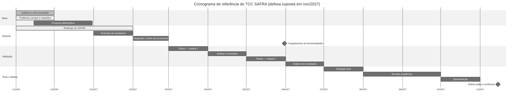

## C.3 Plano comprimido (se a defesa for antes de novembro de 2027)

| Se a defesa for em… | Cortar / juntar |
|---|---|
| set/2027 | juntar a rodada 2 de testes com a análise (abril–maio); redação em junho–julho; revisão em agosto |
| jul/2027 | uma só rodada de testes (março); análise em abril; redação em maio; revisão e apresentação em junho; sem voluntários (voz apenas do autor e sintetizada, declarada como limitação) |
| antes de jul/2027 | o TCC usa os dados disponíveis e declara explicitamente o que não foi medido; nenhuma funcionalidade nova |

## C.4 Riscos do cronograma

| Risco | Probabilidade | Impacto | Mitigação |
|---|---|---|---|
| Hardware de referência indisponível ou trocado | baixa | alto | registrar a configuração no início; repetir as medições se trocar |
| Funcionalidades novas consumindo o tempo de testes | média | alto | congelamento em maio; lista de "depois do TCC" |
| Exigências da instituição diferentes do previsto (normas, tamanho, formato) | média | médio | confirmar o manual em dezembro; documentos editáveis em Markdown/DOCX |
| Uso de voz de voluntários exigir autorização formal | média | médio | termo de consentimento; guardar só os resultados, não as gravações; alternativa: voz do autor + fala sintetizada |
| Atualização de bibliotecas quebrar o sistema perto da entrega | média | alto | versões fixadas; CI; nenhuma atualização depois do congelamento |
| Mudança do modelo de linguagem alterar os resultados | média | médio | fixar o modelo e a versão do Ollama nas medições e registrá-los |

# APÊNDICE D — ARQUIVOS DE DADOS E COMO REPRODUZIR

Todos os resultados citados no Capítulo 12 estão em `docs/research/resultados/` (JSON com dados brutos,
ambiente e a lista do que foi real e simulado). Para reproduzir no ambiente de desenvolvimento:

```text
python TEST_JARVIS.py                                         # suíte automatizada
python tools/experimentos/pv01_ativacao.py --rotulo meu-pc     # PV-01 (voz sintética)
python tools/experimentos/pv02_latencia.py --rotulo meu-pc     # PV-02 (com --ollama URL para o modelo real)
python tools/experimentos/pv03_memoria.py --rotulo meu-pc      # PV-03
python tools/experimentos/pv04_interface.py --rotulo meu-pc    # PV-04 (precisa de tela; no Linux, xvfb-run -a)
python tools/experimentos/pv05_sincronizacao.py --rotulo meu-pc  # PV-05 etapa A
python tools/experimentos/pv06_seguranca.py --rotulo meu-pc    # PV-06
python tools/experimentos/pv07_estabilidade.py --minutos 480 --rotulo meu-pc   # PV-07
```

O repositório está em `JLeoBRx/utron-jarvis`; a versão analisada neste texto é identificada pelo commit
registrado em cada arquivo de resultado.
