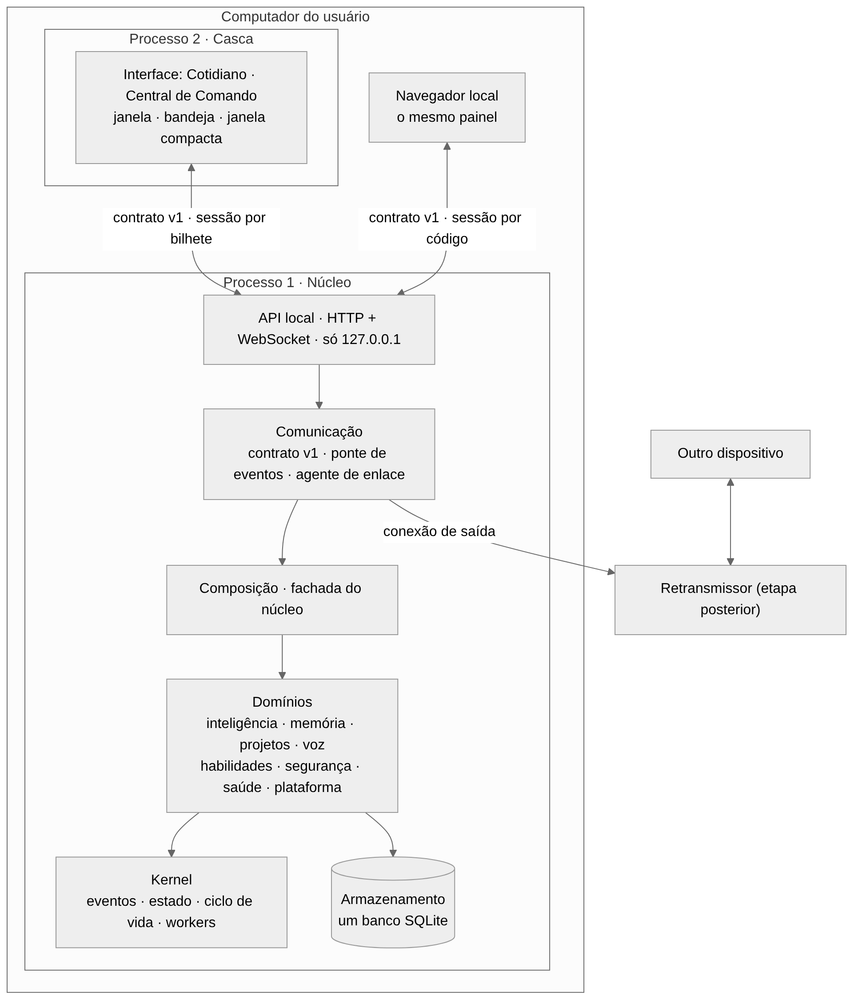
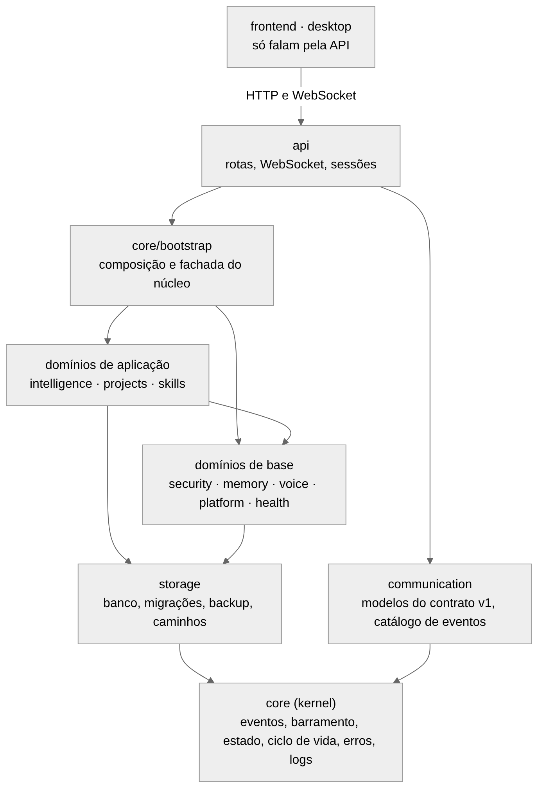
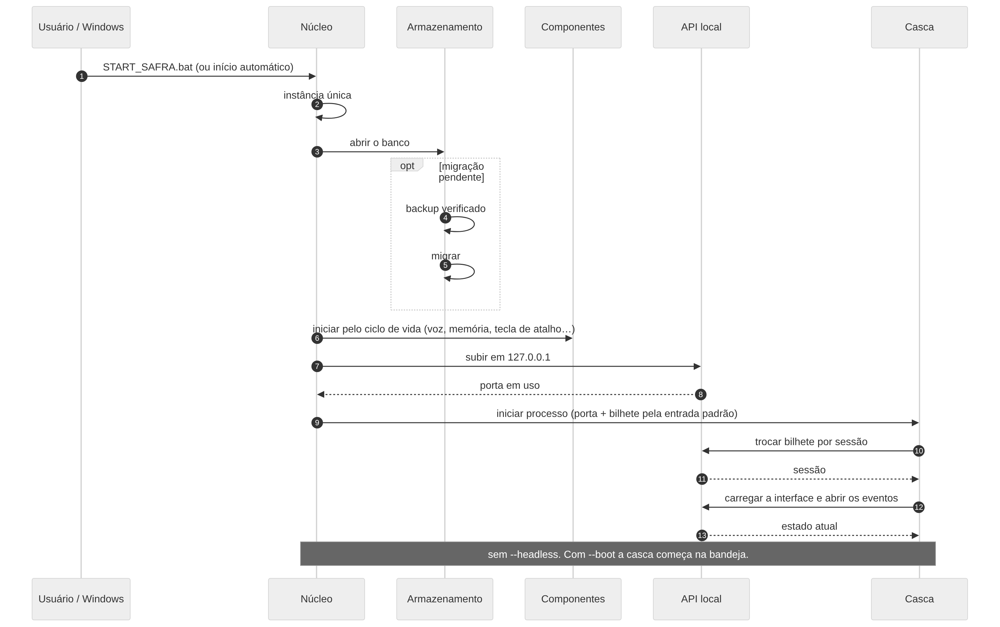
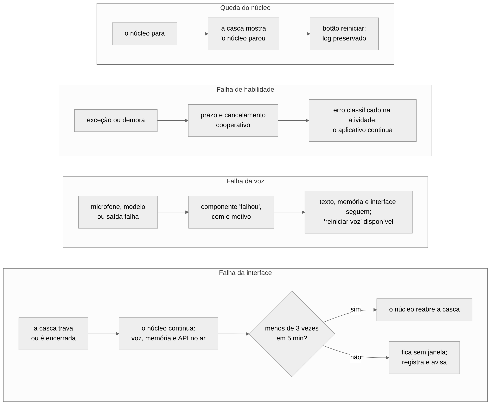
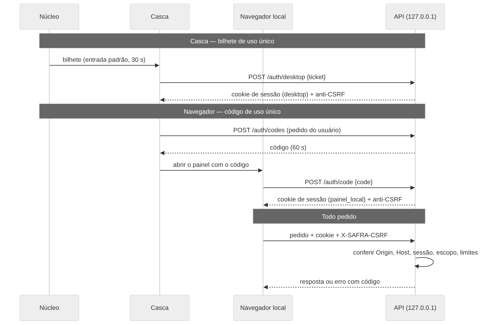
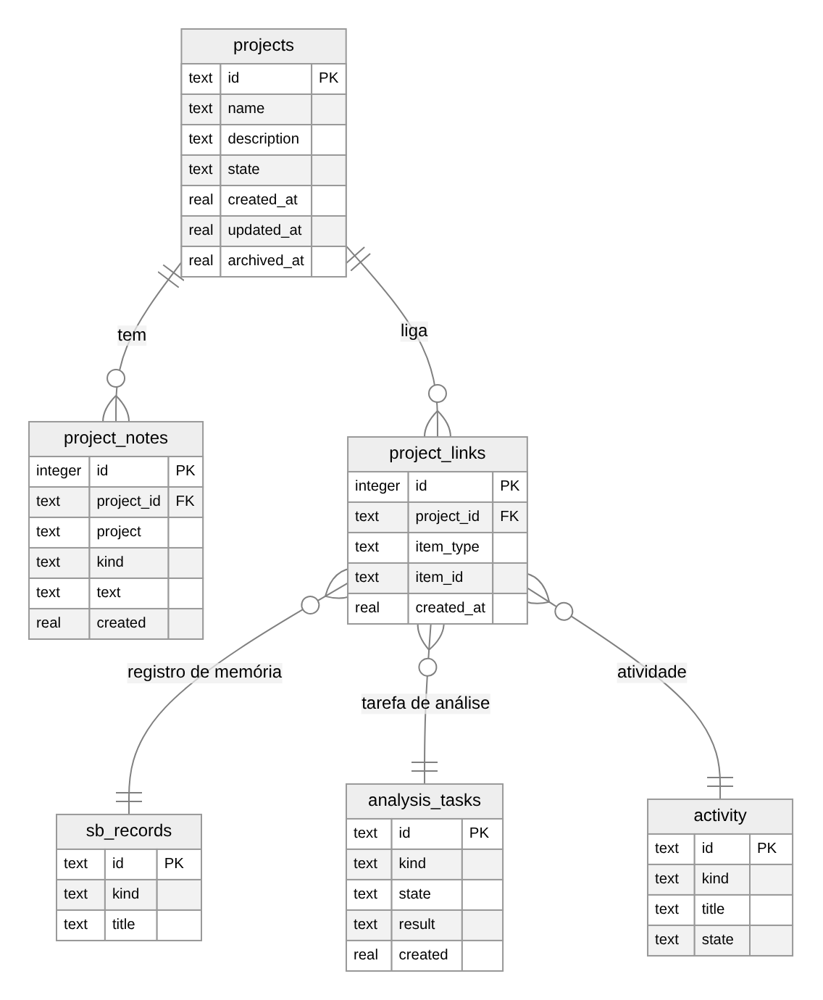

# Arquitetura de destino do SAFRA

Especificação da Fase 2. Descreve **para onde** o sistema vai; o que existe hoje está em
`../technical/ARQUITETURA.md` e na auditoria. As decisões citadas (ADR-nnn) estão em `DECISOES.md`. Enquanto a
migração não terminar, este documento descreve um alvo, não um resultado.

## 1. Princípios

1. **Um núcleo só.** Texto, voz, interface, painel e retransmissor chegam ao mesmo `NeuralCore`, com a mesma
   memória, o mesmo executor e as mesmas permissões.
2. **A interface não tem estado próprio.** Tudo o que ela mostra vem do núcleo; sem conexão, ela diz que está
   sem conexão e desabilita as ações.
3. **Falhas ficam onde nascem.** Interface, voz e habilidades falham sem levar o resto (seção 6).
4. **Menor privilégio.** A API não acrescenta poder; toda alteração passa pelo executor único (ADR-008).
5. **Local por padrão.** Nada depende de internet; a API só escuta em 127.0.0.1.
6. **Dependências apontam para dentro.** Domínios dependem do *kernel*, nunca o contrário (seção 4).
7. **Nada de terceiros sem licença registrada.** Sem nomes, personagens, cenários ou sons de obras alheias.

## 2. Visão geral



| Processo | O que é | Inicia | Encerra |
|---|---|---|---|
| **Núcleo** (`python -m safra`) | todos os domínios, voz, banco, API local | `START_SAFRA.bat`, início automático, linha de comando | pedido do usuário, `--stop`, desligamento do sistema |
| **Casca** (`python -m safra.desktop`) | janela principal, bandeja, janela compacta | o núcleo (ou a casca reinicia o núcleo, se ele cair) | fechar a janela só recolhe para a bandeja; "Sair" encerra os dois |
| **Navegador** (opcional) | o mesmo painel, numa aba | o usuário | fechar a aba |
| **Retransmissor** (opcional, etapa posterior) | serviço num servidor; repassa o contrato a outros dispositivos | implantação à parte | — |

## 3. Domínios

Estrutura de pastas ao fim da migração (o nome da pasta do aplicativo é trocado por último, ADR-014):

```
safra/
  core/           kernel: eventos, barramento, estado, ciclo de vida, workers, erros, logs
    bootstrap/    composição: monta os domínios e expõe a fachada do núcleo
  storage/        banco, migrações, backup, exportação, caminhos
  security/       permissões, autorização, privacidade, credenciais, validação, sessões
  intelligence/   intenção, raciocínio, planejamento, modelos, personalidade, proatividade,
                  imaginação, modelo do mundo, analysis/ (motor de Análises)
  memory/         memórias, recuperação, grafo, personal/ (memória pessoal e lembretes)
  projects/       projetos, notas, vínculos
  voice/          captura, reconhecimento, ativação, síntese, prosódia, nível de áudio, diagnóstico
  skills/         habilidades, registro, plugins, executor, verificação, recuperação
  health/         monitor, métricas, diagnóstico, atividades
  platform/       Windows: início automático, instância única, tecla global, avisos,
                  sensores de janelas/processos/tela, rede local
  communication/  contrato v1 (modelos), catálogo de eventos, ponte do barramento, agente de enlace
  api/            FastAPI: rotas, WebSocket, autenticação; static/ (interface compilada)
  desktop/        casca do Windows
frontend/         código-fonte da interface (React + TypeScript)
gateway/          retransmissor (existente; passa a repassar o contrato)
ultron/           camada de compatibilidade (apelidos), enquanto durar a transição
```

### 3.1 De onde vem cada domínio

| Domínio | Origem no código atual | Mudança além de mover |
|---|---|---|
| `core` | `core/{events,event_bus,state,lifecycle,runtime}.py`, `config/settings.py` | `neural_core.py` e `orchestrator.py` vão para `core/bootstrap`; novos `errors.py` e `logging.py` |
| `storage` | `memory/store.py` (banco e migrações), `memory/backup.py`, `config/paths.py` | migração v8; exportação do legado |
| `security` | `agent/{permissions,autonomy}.py`, `privacy/`, `platform/credentials.py` | Modo Operador; sessões da API |
| `intelligence` | `cognition/`, `models/`, `personality/`, `proactive/`, `imagination/`, `world/`, `tardis/` | `tardis/` vira `intelligence/analysis`; persona ULTRON sai |
| `memory` | `memory/` (exceto banco e backup), `graph/`, `secondbrain/` | desfaz o ciclo `memory` ↔ `graph` |
| `projects` | `tardis/store.py` (notas), registros "projeto" da memória pessoal | **novo**: entidade projeto e vínculos |
| `voice` | `voice/`, `audio/neural_audio.py` | `lipsync.py` vira `level.py` (só energia); `tardis_sfx.py` sai; ativação só "safra" |
| `skills` | `skills/`, `plugins/`, `agent/{execution,verification,recovery}.py` | `skills/tardis` vira `analysis` e `projects`; tabela de apelidos |
| `health` | `health/`, `diagnose.py`, `core/metrics.py`, `core/activity.py` | — |
| `platform` | `platform/`, `perception/`, `network/` | **novo**: tecla de atalho global |
| `communication` | `remote/agent.py` | **novo**: modelos do contrato, catálogo e ponte de eventos |
| `api` | — | **novo** |
| `desktop` | bandeja, atalhos e janela de `hud/controller.py`, `hud/window.py`, `hud/orb.py` | **novo** como processo |
| `frontend` | — (substitui `hud/` e o site da ORBE) | **novo** |

Saem sem substituto de código: `hud/avatar/`, `hud/scene3d/` (com three.js), `hud/tardis*.py`,
`hud/tardis_room/`, `hud/ultron_protocol.py`, `hud/brain_*.py`, `hud/scene.py`, `audio/tardis_sfx.py`,
`gateway/.../static/orb*`. As páginas Qt (`platform.py`, `panels.py`, `settings_page.py`,
`diagnostics_page.py`, `activity_page.py`, `conversation.py`, `voice_panel.py`) saem depois da paridade.

## 4. Regra de dependência



| Camada | Pode importar |
|---|---|
| `core` (kernel) | só a biblioteca padrão |
| `storage` | `core` |
| `security`, `memory`, `voice`, `platform`, `health` | `core`, `storage` |
| `intelligence`, `projects`, `skills` | as de cima, e `security`, `memory` |
| `communication` | `core` (modelos do contrato não importam domínios) |
| `core/bootstrap` | todos os domínios — é o único lugar onde o sistema é montado |
| `api` | `communication` e a fachada de `core/bootstrap` |
| `desktop`, `frontend` | nada do núcleo: só falam pela API |

Um teste de arquitetura lê as importações e falha em qualquer violação. No início ele aceita uma lista de
exceções (o estado atual); a lista só pode diminuir. Os ciclos conhecidos (`memory` ↔ `graph`;
`config` → `secondbrain` → `memory` → `config`) têm etapa própria no plano.

## 5. Inicialização, encerramento e sessões



1. `START_SAFRA.bat` chama `pythonw -m safra` (com `--boot` no início automático).
2. O núcleo adquire a instância única. Se já houver uma, pede que ela mostre a janela e sai (como hoje).
3. Configura o log, abre o banco; se houver migração pendente, faz o backup verificado antes.
4. Inicia os componentes pelo ciclo de vida (como hoje) e a tecla de atalho global.
5. Sobe a API em 127.0.0.1 e grava `run/nucleo.json` (processo, porta, versão — nenhum segredo).
6. Sem `--headless`, inicia a casca e entrega a ela, pela entrada padrão, a porta e um bilhete de uso único.
7. A casca troca o bilhete por uma sessão e abre a interface. Com `--boot`, começa recolhida na bandeja.

Encerramento: "Sair" pede o encerramento ordenado ao núcleo, que para os componentes na ordem inversa, fecha a
API e termina a casca. `--stop` e `--status` continuam funcionando.

Se a interface compilada ou o QtWebEngine faltarem, o núcleo sobe do mesmo jeito e informa como usar o
console; a casca sem interface compilada mostra uma página local com a explicação.

## 6. Isolamento de falhas



| Falha | Efeito | Reação | Como se testa |
|---|---|---|---|
| A casca trava ou é encerrada | núcleo, voz e memória continuam | o núcleo reabre a casca (até 3 vezes em 5 min); depois fica sem janela e registra | encerrar o processo da casca e conferir que a API responde e um comando de texto é atendido |
| O navegador fecha ou perde a conexão | nada | a sessão expira por inatividade | fechar a conexão de eventos no meio de um pedido |
| A voz falha (microfone, modelo, saída) | texto, memória e interface continuam | o componente fica "falhou", com motivo; "reiniciar voz" disponível | derrubar o componente de voz e gravar e ler memória |
| Uma habilidade lança exceção ou trava | o pedido termina com erro classificado | prazo por habilidade; cancelamento cooperativo | habilidade de teste que lança e outra que não retorna |
| O modelo de linguagem não responde | comandos diretos continuam | resposta honesta "modelo indisponível" | servidor de modelo simulado fora do ar |
| A API não sobe (porta ocupada, biblioteca ausente) | núcleo e console continuam | tenta as portas alternativas; registra e avisa | ocupar as portas antes de iniciar |
| O banco está danificado ou só leitura | o sistema inicia em modo degradado, como hoje | orienta a restaurar um backup | testes existentes (`test_failures`) |
| O núcleo cai | a casca mostra "o núcleo parou" | botão para reiniciar; log preservado | encerrar o núcleo e conferir a tela e o reinício |
| Assinante lento de eventos | não atrasa o barramento | fila limitada por assinante; telemetria é descartada, autorizações nunca | assinante de teste que não lê |

## 7. Segurança



| Camada | Regra |
|---|---|
| Rede | escuta só em 127.0.0.1; nenhuma porta aberta no roteador; acesso externo só por conexão de saída ao retransmissor |
| Origem | `Origin` e `Host` conferidos em todo pedido e no WebSocket; CORS fechado |
| Identidade | bilhete (casca) ou código de uso único (navegador); sessão em *cookie* `HttpOnly`/`SameSite=Strict`; sessões listadas e revogáveis |
| Alteração | cabeçalho anti-CSRF; chave de idempotência nos pedidos com efeito |
| Autorização | executor único: permissões por categoria, pisos, confirmação, verificação, auditoria |
| Escopo da sessão | `desktop` (a janela do SAFRA) pode tudo o que a interface atual pode; `painel_local` não confirma ações sensíveis, não liga o Modo Operador, não administra sessões e não redefine configurações; `remoto` (futuro) terá, no máximo, o mesmo |
| Entrada | modelos tipados; limite de 64 KiB por pedido e 4.000 caracteres por comando; limite de frequência |
| Saída | segredos nunca saem (a chave da OpenAI só informa "configurada"); eventos de percepção com conteúdo de tela não são transmitidos |
| Segredos | só no cofre do sistema; nada em arquivo, no JavaScript ou no Git |
| Registro | toda ação com origem e sessão no histórico de atividades e no log estruturado |

O que continua valendo sem mudança: nada contorna o UAC nem desativa proteções do Windows; exclusões vão para
a Lixeira; pastas protegidas são recusadas antes de pedir autorização; segredos são recusados antes de gravar
em memória; a rede local só é observada por meios passivos.

## 8. Interface e casca

- A interface compilada é servida pela própria API (`/`), com todos os recursos embutidos. Ela só conhece o
  contrato v1. Detalhes em `ESPECIFICACAO_DA_INTERFACE.md`.
- A casca abre `http://127.0.0.1:<porta>/` numa janela QtWebEngine, mantém o ícone na bandeja (mostrar,
  falar, modo privacidade, sair), a **janela compacta** (o Símbolo sempre visível, sucessora da ORBE
  flutuante) e repassa avisos nativos. Não contém regra de negócio.
- Navegação para qualquer endereço fora da própria API é bloqueada na casca; *links* externos abrem no
  navegador padrão.

## 9. Dados

Um banco, aberto só pelo núcleo. Mudanças de esquema desta migração (v8), todas precedidas de backup:



| Mudança | Tipo |
|---|---|
| `tardis_tasks` → `analysis_tasks` (e o índice) | renomeação |
| `projects` (id, nome, descrição, estado, datas) | nova |
| `project_links` (projeto, tipo do item, id do item, data) | nova |
| `project_notes.project_id` preenchido a partir do nome já gravado | coluna nova; o nome antigo permanece |
| `noctario_runs`, `noctario_ops` | exportadas e conferidas, depois removidas (ADR-013) |

Projetos iniciais são criados a partir dos nomes distintos em `project_notes` e dos registros do tipo
"projeto" da memória pessoal; nada é apagado nessa criação. Configurações passam à versão 4 (mapa completo no
plano de migração). A pasta de dados não muda de lugar nesta migração.

## 10. Acesso por outros dispositivos (preparado, não entregue)

O que fica pronto agora: interface responsiva; contrato com origem e capacidades por sessão; funções do
contrato independentes do transporte; agente de enlace por conexão de saída. O que fica para depois:
retransmissor repassando o contrato v1, pareamento com confirmação no computador, implantação com HTTPS e
verificação externa. Até lá o painel remoto **não é declarado disponível**.

## 11. Observabilidade

Log estruturado com identificador de correlação que acompanha o pedido da API até a ação executada;
métricas já existentes (laço, filas, latências) expostas na Central de Comando; a rota de saúde sem
autenticação devolve só "no ar" e a versão.

## 12. O que esta arquitetura não resolve

- A qualidade da ativação por voz e da recuperação por paráfrase (limites medidos, tratados à parte).
- Isolamento de habilidades em processo separado: continuam em *thread* com prazo. Uma falha nativa dentro de
  uma habilidade ainda pode derrubar o núcleo; fica registrado como limitação e candidato a etapa futura.
- Instalador e atualização automática (ADR-006, adiado).
