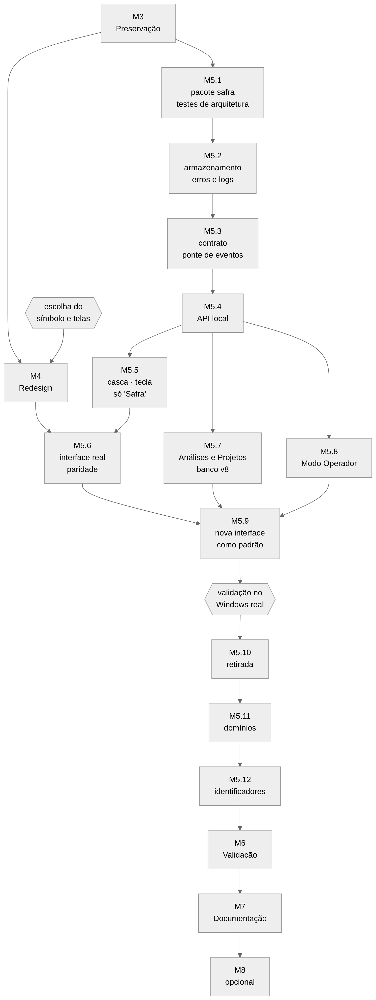

# Plano de migração do SAFRA

Especificação da Fase 2. Diz **em que ordem** o sistema atual vira o da `ARQUITETURA_DESTINO.md`, o que cada
etapa muda, como se confere e como se desfaz. Nada aqui foi executado ainda.

## 1. Regras de execução

1. **Uma etapa por vez**, em commits pequenos na branch de trabalho. Cada etapa termina com: arquivos
   alterados, testes executados com resultado, problemas restantes e CHANGELOG atualizado.
2. **O repositório fica executável em todo commit**: a suíte passa e o SAFRA inicia.
3. **Nada sai antes de ter substituto conferido.** A interface antiga continua disponível até a nova cumprir a
   lista de paridade (`ESPECIFICACAO_DA_INTERFACE.md` §3).
4. **Dados nunca são tocados sem backup verificado**, e os testes usam sempre pasta temporária.
5. **"Concluída" exige evidência.** O que só pode ser conferido no Windows real fica marcado "aguardando
   validação no Windows" até você rodar o roteiro.
6. **CI** (Linux 3.11/3.13 e Windows) roda em cada etapa que muda código.
7. Mudança de rumo vira decisão registrada em `DECISOES.md` antes de ser executada.

## 2. Visão geral

| Etapa | Nome | Depende de | Resultado |
|---|---|---|---|
| M3 | Preservação | — | ponto de restauração, linha de base, ensaio de reversão, arquivo legado |
| M4 | Redesign | M3 | design system, símbolo, as telas sobre dados simulados |
| M5.1 | Pacote `safra`, compatibilidade, testes de arquitetura e identidade | M3 | base para todo código novo |
| M5.2 | Armazenamento, erros e logs | M5.1 | `storage`, log estruturado |
| M5.3 | Contrato e ponte de eventos | M5.2 | `communication` |
| M5.4 | API local | M5.3 | `api`, em três fatias |
| M5.5 | Casca em processo separado; tecla de atalho; ativação só "Safra" | M5.4 | `desktop`, configurações v4 |
| M5.6 | Interface ligada à API real; paridade | M4, M5.5 | nova interface utilizável |
| M5.7 | Análises e Projetos | M5.4 | banco v8; fim do nome TARDIS no código |
| M5.8 | Modo Operador | M5.4 | fim da persona |
| M5.9 | Nova interface como padrão | M5.6–M5.8 | antiga atrás de uma opção |
| M5.10 | Retirada | M5.9 + validação no Windows | saem 3D, avatar, telas Qt, temas antigos |
| M5.11 | Reorganização em domínios | M5.10 | regra de dependência sem exceções |
| M5.12 | Identificadores públicos e internos | M5.11 | nomes antigos só na compatibilidade |
| M6 | Validação | M5.12 | relatório de validação |
| M7 | Documentação | M6 | os sete documentos |
| M8 | Pasta de dados e fim da compatibilidade (opcional) | validação no Windows | decisão sua, depois de tudo conferido |

## 3. M3 — Preservação

| Passo | O que faz | Critério de saída |
|---|---|---|
| M3.1 | *Tag* anotada `pre-transformacao-safra` no último commit antes de qualquer mudança de código, e branch `safety/pre-transformacao-safra`. As duas branches de segurança existentes não são tocadas | *tag* e branch no remoto, conferidas |
| M3.2 | Pasta `legado/` na raiz do repositório, com índice. Movidos agora (com `git mv`) os 15 documentos puramente históricos e o TCC versão 1 (§9.7) | nenhum arquivo apagado: contagem antes e depois; suíte verde |
| M3.3 | Linha de base de desempenho no contêiner: tempo de abertura, memória e CPU em repouso, latência (PV-02), estabilidade de 30 min (PV-07) | resultados versionados, com ambiente declarado |
| M3.4 | Banco e configurações **de exemplo** na versão atual (esquema v7, configurações v3), com linhas em todas as tabelas — inclusive nas duas do NOCTARIO e em `tardis_tasks` — gerados por script. Servem aos testes de atualização | script e arquivos de exemplo versionados; nenhum dado real |
| M3.5 | Ensaio de reversão com o banco de exemplo: backup, alteração simulada, restauração, comparação de contagens e de integridade | ensaio passa; roteiro escrito em `PRESERVACAO.md` |
| M3.6 | Roteiro para o seu computador: como fazer, antes de atualizar, o backup do banco (`START_SAFRA.bat --backup`) e a cópia da pasta `%LOCALAPPDATA%\ULTRON` | roteiro em `PRESERVACAO.md` |

## 4. M4 — Redesign

Feito em `frontend/`, sem tocar o núcleo. As telas usam um **simulador do contrato** (só em desenvolvimento),
e toda captura feita com ele leva a faixa "DADOS SIMULADOS".

| Passo | O que faz | Critério de saída |
|---|---|---|
| M4.1 | Estrutura do projeto: React, TypeScript, Vite, testes, verificação de tipos; *job* de Node no CI; compilado em `safra/api/static/` | compila do arquivo de trava; CI verde |
| M4.2 | *Tokens* (cores, tipografia, medidas, movimento) em fonte única; teste de contraste | teste passa para todos os pares em uso |
| M4.3 | Três estudos do símbolo nos doze estados, com versão de ícone e conferência contra símbolos conhecidos | **sua escolha** |
| M4.4 | Componentes da §5.5 da especificação, com todos os estados, e o catálogo | testes de componente; catálogo capturado |
| M4.5 | Cotidiano, Central de Comando, navegação, autorização, estados de conexão, responsividade | testes funcionais contra o simulador em 1440, 900 e 390 px |
| M4.6 | Inventário de licenças dos recursos usados (fontes, ícones, bibliotecas) | cada recurso com licença conferida, ou trocado |

## 5. M5 — Migração técnica

### M5.1 — Pacote `safra`, compatibilidade, testes de arquitetura e de identidade

- Cria `safra/` (vazio de início) e a regra: código novo nasce ali.
- Mecanismo de compatibilidade: ao mover um módulo, o caminho antigo vira **apelido do mesmo módulo** (mesmo
  objeto), para que importações antigas, plugins e testes continuem valendo.
- Teste de arquitetura com a lista de exceções igual ao estado atual.
- Teste de identidade com a lista de onde cada nome antigo ainda é permitido.
- pytest como executor; `TEST_JARVIS.py` continua funcionando.

*Saída:* suíte igual à linha de base mais os dois testes novos. *Reversão:* reverter os commits.

### M5.2 — Armazenamento, erros e logs

- Move banco, migrações, backup, exportação e caminhos para `safra.storage` (sem mudar o esquema).
- `core/errors.py` (erros com código estável) e `core/logging.py` (JSON Lines, correlação, mascaramento).

*Saída:* testes de memória, backup e falhas passam pelos dois caminhos de importação; o log novo é gravado e o
antigo não é apagado.

### M5.3 — Contrato e ponte de eventos

- `safra.communication`: modelos tipados do contrato v1, catálogo fechado de eventos, ponte do barramento para
  assinantes com fila limitada e janela de 1.000 eventos.
- Funções do contrato independentes do transporte.

*Saída:* testes da ponte (ordem, descarte só de descartáveis, retomada por `since`, `resync`).

### M5.4 — API local

| Fatia | Rotas | Saída |
|---|---|---|
| a | saúde, entrada e sessões, estado, eventos, atividades, telemetria, componentes | testes de contrato e de segurança sobre todas as rotas da fatia |
| b | comandos, cancelamento, autorizações, voz, configurações, privacidade, parada de emergência | idem; idempotência; escopos |
| c | memória, backups, exportação, diagnóstico, log, habilidades, modelos, rede | idem |

A API sobe com o núcleo, mas ainda sem interface nova ligada. *Reversão:* opção `api_enabled` desligada.

### M5.5 — Casca, tecla de atalho, ativação só por "Safra"

- `safra.desktop`: processo separado; bilhete; bandeja; janela compacta; supervisão nos dois sentidos.
- Opção `--legacy-ui`: mantém a interface Qt antiga, no processo do núcleo, como hoje.
- `platform/hotkeys.py`: tecla global; estado e conflito no diagnóstico.
- Configurações **v4**, parte 1: ativação e tecla (§9.3).
- "jarvis" sai dos alvos da ativação, das formas padrão e da calibração.

*Saída:* teste de injeção de falhas (encerrar a casca; o núcleo responde); teste: "jarvis" não ativa; teste de
atualização das configurações. *Aguardando Windows real:* bandeja, janela compacta, teclado físico.

### M5.6 — Interface ligada à API real

A interface troca o simulador pela API. Paridade página a página, na ordem: Cotidiano e autorização →
Atividades → Configurações → Voz → Memória → Saúde e Rede → Habilidades.

*Saída:* testes funcionais com o núcleo real e modelo simulado; lista de paridade preenchida.

### M5.7 — Análises e Projetos

- `tardis/` → `safra.intelligence.analysis`; eventos, habilidades e frases de voz renomeados (ADR-010);
  tabela de apelidos para referências gravadas.
- `safra.projects`: serviço, rotas e telas.
- Banco **v8** (§9.2), com backup e exportação do legado antes.
- Os 37 testes do motor são renomeados e mantidos.

*Saída:* teste de atualização com o banco de exemplo: tarefas antigas legíveis, projetos criados, tabelas do
NOCTARIO exportadas, conferidas e removidas. *Reversão:* restaurar o backup feito pela própria migração.

### M5.8 — Modo Operador

- Sai a persona (`hud/ultron_protocol.py`, perfis de voz e de tom, ativação ocasional, demonstração).
- `security`: perfil de operador com prazo obrigatório; `emergency-stop`; evento `operator.changed`.
- Configurações v4, parte 2.

*Saída:* testes de permissões sob o perfil (existentes, adaptados) e novos: prazo, só a partir do `desktop`.

### M5.9 — Nova interface como padrão

`START_SAFRA.bat` abre a nova; `--legacy-ui` abre a antiga. CI roda as duas.

*Saída:* **roteiro de validação no Windows real executado por você** com a interface nova (§7). Sem ele, a
M5.10 não começa.

### M5.10 — Retirada

Precedida da *tag* `legado-interface-qt-final`. Arquivos em §9.5.

*Saída:* suíte e CI verdes; pacote sem arquivos 3D; teste de identidade sem ocorrências de TARDIS, Doctor Who,
NOCTARIO e ULTRON (persona) fora de `legado/` e da compatibilidade.

### M5.11 — Reorganização em domínios

Move os pacotes restantes para os domínios, um por commit, na ordem das camadas: `core` → `security` →
`memory` → `voice` → `platform` → `health` → `intelligence` → `skills`. Desfaz os ciclos
(`memory` ↔ `graph`; `config` → `secondbrain`) e separa o *kernel* da composição.

*Saída:* teste de arquitetura com a lista de exceções vazia.

### M5.12 — Identificadores

Trocas da ADR-014, exceto pasta de dados e nome do banco: variáveis de ambiente, cofre, início automático,
arquivos de controle, trava, pasta de imagens, retransmissor, nome do pacote ZIP, do fluxo de CI e do executor
de testes, scripts (os antigos viram redirecionadores) e, por último, a pasta `ULTRON/` do repositório.

*Saída:* teste de identidade com a lista final; teste de atualização: credencial e início automático lidos
pelos nomes antigos e gravados pelos novos. *Aguardando Windows real:* cofre e Registro.

## 6. M6 — Validação

| Bateria | Conteúdo |
|---|---|
| Automática | unitários, arquitetura, identidade, contrato, segurança, integração, atualização, funcionais, componentes — em Linux e Windows no CI |
| Medições no contêiner | PV-02, PV-03, PV-04 novo, PV-05 novo, PV-06, PV-07 (30 min), PV-08; comparação com a linha de base |
| Windows real (você) | §7 |
| Medições no PC de referência | PV-01B (voz humana), PV-02 com modelo real, PV-04 novo, PV-07 de 8 h |

Entrega: `RELATORIO_DE_VALIDACAO.md`, com cada critério da auditoria (CA1–CA12), o resultado, a evidência e o
que ficou sem validar.

## 7. Roteiro de validação no Windows real

Será entregue como `VALIDAR_SAFRA.bat`, que executa o que pode ser automatizado, pergunta o que só você pode
ver e grava um arquivo de resultado para você me enviar. Itens:

1. Atualizar uma instalação existente: banco, configurações, credencial e início automático preservados.
2. Abrir pelo atalho e pelo início automático; começar recolhido.
3. Janela, bandeja e janela compacta; fechar a janela não encerra o núcleo.
4. Texto: um comando direto e uma pergunta ao modelo.
5. Voz: microfone, "Safra, que horas são?", tecla de atalho, interrupção, diagnóstico de 8 etapas.
6. Autorização: aprovar, negar, deixar expirar.
7. Encerrar a casca pelo Gerenciador de Tarefas: ela volta e o núcleo não caiu.
8. Painel no navegador com o código; revogar a sessão.
9. Modo Operador: ligar, rótulo, prazo, parada de emergência.
10. Backup e restauração.
11. Sair: nenhum processo restante.

## 8. M7 — Documentação e M8 — Encerramento opcional

**M7.** TCC SAFRA (reescrito), Relatório de Engenharia, Relatório de Validação, Manual de Instalação e
Utilização, Documento de Arquitetura (como construído), Registro de Decisões (este, atualizado), Inventário de
Licenças e Recursos; README novo. Os 9 documentos em uso vão para `legado/` quando cada substituto existir.

**M8 (decisão sua, depois de tudo validado).** Cópia verificada dos dados para `%LOCALAPPDATA%\SAFRA` por
comando explícito, com a pasta antiga preservada; retirada dos redirecionadores `.bat` antigos; modelos e ZIP
fora do Git, quando o instalador e o CI souberem obtê-los e conferi-los. A compatibilidade para plugins
(`ultron.plugins`, `ultron.skills.base`) permanece.

## 9. Mapas

### 9.1 Código renomeado

| De | Para |
|---|---|
| `ultron/tardis/{engine,protocol,store}.py`, `analyzers/` | `safra/intelligence/analysis/` (notas de projeto → `safra/projects/`) |
| `ultron/skills/tardis` | `safra/skills/analysis`, `safra/skills/projects` |
| `tardis.consult`, `tardis.note` | `analysis.consult`, `projects.note` |
| `TardisEngine`, `TardisStore`, `TardisContext` | `AnalysisEngine`, `AnalysisStore`, `AnalysisContext` |
| `EventType.TARDIS_TASK_*`, `TARDIS_STATE` | `ANALYSIS_TASK_*`, `ANALYSIS_STATE` |
| `EventType.PERSONA_CHANGED`; estado `persona` | `OPERATOR_CHANGED`; `operator` |
| `ULTRON_OPERATOR`, `OPERATOR_ALWAYS_CONFIRM` | `OPERATOR`; mantido |
| `voice/lipsync.py` | `voice/level.py` (só a energia do áudio) |
| `secondbrain/` | `safra/memory/personal/` (tabelas `sb_*` não mudam) |
| `remote/agent.py` | `safra/communication/relay_agent.py` |
| `gateway/jarvis_gateway` | `gateway/safra_gateway` |
| `TEST_JARVIS.py`, `jarvis-validation.yml`, `JARVIS_FINAL.zip` | `TEST_SAFRA.py`, `safra-validation.yml`, `SAFRA.zip` |

### 9.2 Banco: versão 8

Ordem dentro da migração; qualquer falha interrompe e deixa o banco como estava.

1. Backup completo, verificado, com motivo "antes da v8".
2. Exportar `noctario_runs` e `noctario_ops` para `backups/legado/noctario_<data>.json` (todas as colunas;
   binários em base64; resumo SHA-256). Reler o arquivo e comparar contagens e resumo.
3. `DROP TABLE noctario_runs`, `noctario_ops` e seus índices.
4. `ALTER TABLE tardis_tasks RENAME TO analysis_tasks`; recriar o índice como `idx_analysis_created`.
5. Criar `projects` e `project_links`; acrescentar `project_id` a `project_notes`.
6. Criar um projeto para cada nome distinto em `project_notes.project` e para cada registro do tipo "projeto"
   da memória pessoal; preencher `project_id`; criar os vínculos. Nomes iguais (sem diferenciar maiúsculas e
   acentos) viram um projeto só. Nada é apagado.
7. Gravar a versão 8.

Linhas históricas (atividades, auditoria) não são reescritas; a interface mostra rótulos neutros para os
valores antigos.

### 9.3 Configurações: versão 4

Cópia `settings.v3-backup.json` antes. Chaves desconhecidas são mantidas.

| Chave v3 | v4 |
|---|---|
| `wake_words` | sem "jarvis" (fica `("safra",)`; palavras que o usuário acrescentou são mantidas) |
| `wake_variants`, `wake_names`, `wake_weak_variants` | saem as formas derivadas de "jarvis" |
| `ultron_operator` | `operator_allowed` |
| `ultron_operator_policy` | `operator_policy` |
| `ultron_duration_s` | `operator_duration_s` (0 vira o padrão de 600 s: o modo sempre tem prazo) |
| `ultron_emergency_key` | `emergency_key` |
| `ultron_manual`, `ultron_occasional`, `ultron_chance_per_hour`, `ultron_min_interval_hours`, `ultron_operator_occasional` | removidas |
| `tardis_sfx`, `tardis_sfx_volume`, `ambient_sound` | removidas |
| `avatar_mode`, `scene3d`, `render_backend`, `heavy_effects`, `hud_fps`, `performance_profile` | removidas; `heavy_effects = false` ou perfil `economy` vira `reduced_motion = "sempre"` |
| `hud_start_minimized`, `hud_auto_expand`, `orb_position` | `start_minimized`, `auto_expand`, `compact_position` |
| `start_page` | `"jarvis"` → `"cotidiano"`; `"tardis"` → `"memoria"`; demais iguais |
| `theme` | `"safra"` |
| — | novas: `voice_hotkey` (`Ctrl+Alt+Space`), `voice_hotkey_enabled`, `api_enabled`, `api_port` (47800), `panel_enabled`, `session_idle_minutes`, `reduced_motion` (`auto`), `form_of_address` (vazio), `ui_context` (`cotidiano`) |

As outras 92 chaves não mudam.

### 9.4 Referências gravadas

| Onde | O que pode conter | Tratamento |
|---|---|---|
| `automations.tool_name`, `procedures.steps` | `tardis.consult`, `tardis.note` | apelidos resolvidos na leitura; a linha não é reescrita |
| `autorizacoes_permanentes.json` | nome de habilidade | idem |
| `activity`, `audit` | textos com nomes antigos | não são reescritos |
| `protocolo_ultron.json`, pasta `sons_tardis` | estado da persona; sons do usuário | deixam de ser lidos; **não são apagados** |

### 9.5 O que é retirado na M5.10

| Grupo | Arquivos |
|---|---|
| Cena 3D | `ultron/hud/scene3d/` (Python, HTML, CSS, JavaScript e three.js) |
| Avatar 2D | `ultron/hud/avatar/` |
| Telas temáticas | `ultron/hud/tardis.py`, `tardis_scene.py`, `tardis_room/` |
| Vistas 2D antigas | `ultron/hud/brain_model.py`, `brain_view.py`, `scene.py`, `quality.py` |
| Telas Qt substituídas | `platform.py`, `panels.py`, `settings_page.py`, `diagnostics_page.py`, `activity_page.py`, `conversation.py`, `voice_panel.py`, `systems_panel.py`, `window.py`, `orb.py`, `controller.py`, `theme.py`, `palette.py`, `design/` |
| Sons temáticos | `ultron/audio/tardis_sfx.py` |
| Site antigo | `gateway/.../static/` (substituído pela interface compilada) |
| Ferramentas | `tools/benchmark_avatar.py`, `benchmark_scene3d.py`, `benchmark_tardis_room.py`, `gerar_tokens.py`; `tools/experimentos/pv04_interface.py` e `pv05_sincronizacao.py` (substituídos) |
| Testes | `test_scene3d`, `scene3d_probe`, `test_avatar`, `test_tardis_room`, `test_tardis_sfx`; partes de `test_hud`, `test_lipsync`, `test_ultron_protocol` |

O que tem lógica aproveitável (bandeja, atalhos, posição da janela compacta) é levado para `safra/desktop`
antes da retirada. Tudo continua no histórico e na *tag*.

### 9.6 Testes

| Situação | Testes |
|---|---|
| Mantidos como estão | núcleo, barramento, executor, falhas, inteligência, memória, modelos, rede, permissões, planejador, plataforma, plugins, recuperação, memória pessoal, segurança, inicialização, verificação, voz, prosódia, modelo do mundo, atividades, imaginação, desempenho, integridade, linha de comando |
| Renomeados e mantidos | `test_tardis`, `test_tardis_logic` (37) → `test_analysis*` |
| Adaptados | `test_lipsync` (fica a energia do áudio), `test_ultron_protocol` (ficam permissões sob o perfil, prazo e parada), `test_hud` (vira teste da casca), `test_web_orb` (vira teste do retransmissor), `test_jarvis_voice` e `test_original_recovery` (compatibilidade com dados antigos) |
| Retirados com justificativa | `test_scene3d` (24), `test_avatar` (12), `test_tardis_room` (12), `test_tardis_sfx` (5) |
| Novos | arquitetura, identidade, contrato, segurança da API, ponte de eventos, sessões, casca e supervisão, tecla de atalho, projetos, atualização (banco v8, configurações v4), componentes e funcionais da interface, injeção de falhas |

### 9.7 Documentos para `legado/`

| Quando | Documentos |
|---|---|
| M3.2 (históricos) | `ARCHITECTURE_JARVIS.md`, `ARCHITECTURE_REPORT.md`, `ARQUITETURA_ULTIMATE.md`, `AUDITORIA_INICIALIZACAO.md`, `AUDITORIA_VISUAL_3D.md`, `DESIGN_VISUAL.md`, `ENTREGA_JARVIS_ULTIMATE.md`, `INVENTARIO_JARVIS_ORIGINAL.md`, `PERFORMANCE_REPORT.md`, `PHOENIX_AUDITORIA_E_PLANO.md`, `PLANO_APRIMORAMENTO_E_WEB_ORB.md`, `PLANO_DE_EVOLUCAO.md`, `README_ULTRON.md`, `REMOCAO_NOCTARIO.md`, `TEST_REPORT.md`; `docs/JARVIS_AUDITORIA_E_PLANO.md` |
| M3.2 (TCC versão 1) | `docs/academic/`, `docs/export/`, `docs/capturas/`, diagramas 04, 07 e 09, protocolos e resultados PV-04 e PV-05, `docs/benchmarks/` da cena 3D |
| Quando o substituto existir (M7) | `README_JARVIS.md`, `COMANDOS_JARVIS.md`, `CHANGELOG_JARVIS.md`, `DESIGN_SYSTEM.md`, `RECURSOS_EXTERNOS.md`, `SEGURANCA_E_BACKUP.md`, `CI_E_RELEASE.md`, `VOICE_DIAGNOSTICS.md`, `WEB_ORB.md` |

Permanecem em `docs/` e são reaproveitados: referências verificadas, protocolos e resultados PV-01, PV-02,
PV-03, PV-06 e PV-07, a auditoria e esta especificação.

## 10. Reversão

| Se falhar em… | Volta-se assim |
|---|---|
| M3–M4 | reverter os commits; nada do núcleo mudou |
| M5.1–M5.6 | reverter os commits da etapa; a interface antiga continua sendo o padrão até a M5.9 |
| M5.7 (banco v8) | a migração é interrompida sozinha em caso de falha. Depois de concluída: restaurar o backup "antes da v8" com o SAFRA fechado e voltar à *tag* anterior |
| M5.9 | `--legacy-ui` |
| M5.10 em diante | voltar à *tag* `legado-interface-qt-final`; os dados não mudaram de formato entre a M5.7 e este ponto |
| qualquer ponto | *tag* `pre-transformacao-safra` + backup do banco + `settings.v3-backup.json` |

## 11. Cronograma

| Período | Etapas |
|---|---|
| novembro/2026 | M3; início da M4 |
| dezembro/2026 | M4 (com as suas escolhas); M5.1–M5.3 |
| janeiro/2027 | M5.4–M5.6 |
| fevereiro/2027 | M5.7–M5.9; primeira validação no Windows |
| março/2027 | M5.10–M5.12; M6 automática |
| abril/2027 | M6 no PC de referência; primeira rodada de medições para o TCC |
| maio/2027 | congelamento de funcionalidades; M7 em andamento |

Se atrasar, corta-se nesta ordem: M8, renomeação da pasta `ULTRON/`, itens "O" dos requisitos, a página Rede.
Não se cortam: preservação, segurança da API, testes de atualização, validação no Windows.

## 12. O que depende de você

| Quando | O quê |
|---|---|
| Agora | objeções aos nomes (ADR-010), ao tom (ADR-026) ou a qualquer decisão derivada |
| M4.3 | escolher o estudo do símbolo |
| M4.5 | aprovar as telas |
| M5.9 | rodar o roteiro de validação no Windows |
| Antes de publicar | decidir a licença (ADR-024) |
| M8 | autorizar a cópia da pasta de dados e a retirada dos redirecionadores |
| Quando quiser | renomear o repositório no GitHub |
