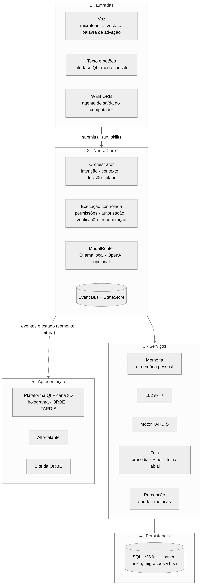
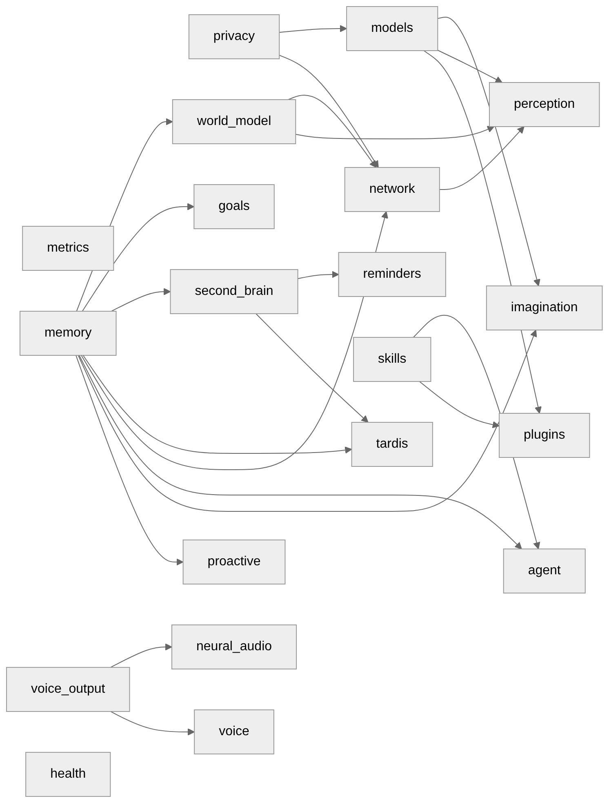
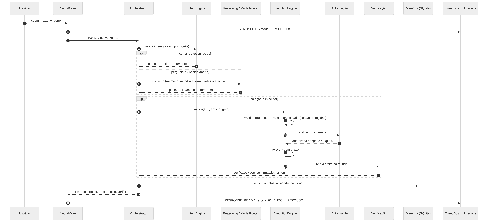
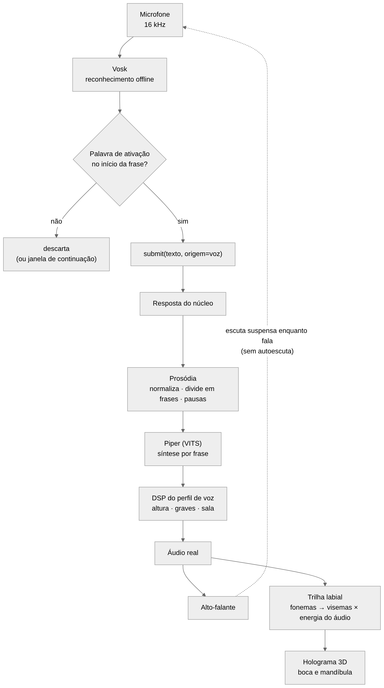
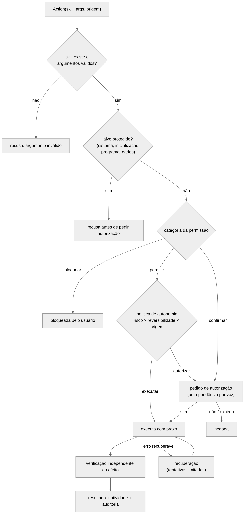
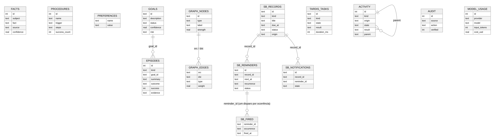
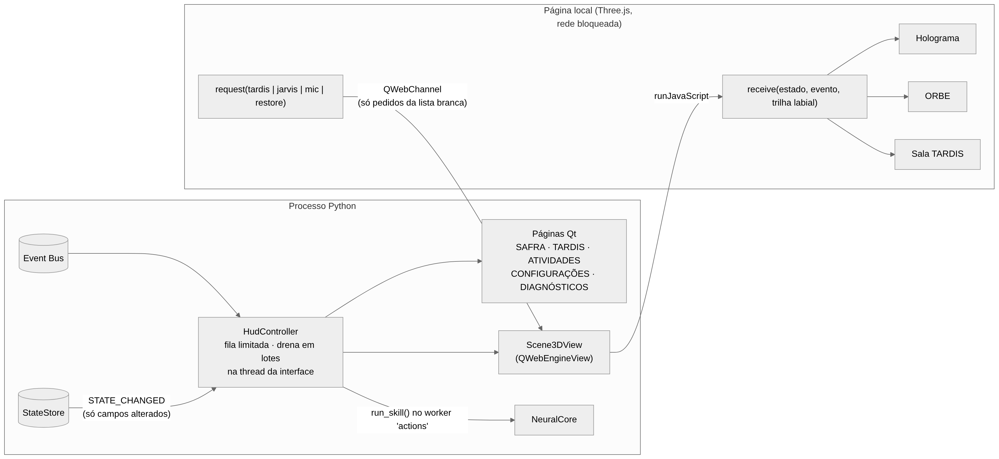
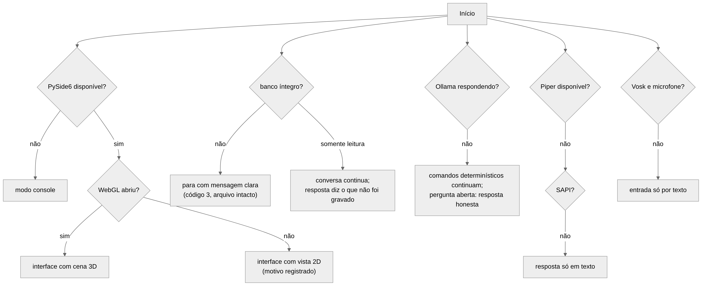
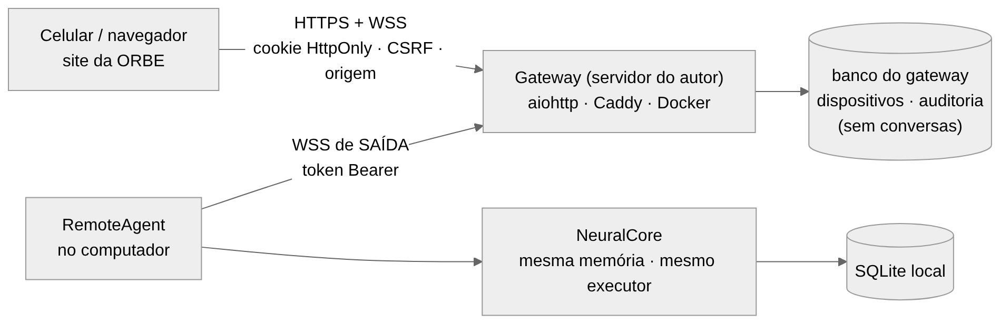

# Arquitetura do SAFRA

Descrição da arquitetura **como ela está no código** (pacote `ultron`, commit de referência `bf070f6` e
alterações da fase SAFRA). Os diagramas foram desenhados a partir da leitura dos módulos citados; as
fontes estão em `docs/diagrams/src/*.mmd` (Mermaid) e as imagens são geradas por
`docs/diagrams/render.js` (instruções em `docs/README.md`).

> **Nomes.** O produto chama-se **SAFRA**. Os identificadores internos da primeira identidade continuam:
> pasta `ULTRON/`, pacote Python `ultron`, pasta de dados `%LOCALAPPDATA%\ULTRON`, banco `ultron.sqlite3`,
> variáveis `JARVIS_*`/`ULTRON_*`. Mudá-los quebraria instalações, atalhos e dados existentes (ver
> `RELATORIO_TECNICO.md`, decisão D1).

## 1. Princípios arquiteturais

| Princípio | Como aparece no código | Por quê |
|---|---|---|
| **Núcleo único** | `NeuralCore` constrói e liga todos os componentes; toda entrada passa por `submit()` ou `run_skill()` | uma só memória, um só executor e uma só política de segurança, qualquer que seja a interface (voz, texto, botões, web) |
| **Comunicação por eventos** | `EventBus` (fila limitada) + `StateStore` (publica só os campos alterados) | os módulos não se chamam diretamente para informar mudanças; a interface é leitora e pode faltar sem afetar o núcleo |
| **Executar ≠ verificar** | `ExecutionEngine` executa; `VerificationEngine` relê o efeito | "feito" só quando o efeito foi observado |
| **Segurança por camadas** | recusa antecipada → permissão por categoria → política de autonomia → autorização explícita → auditoria | uma falha de uma camada não libera a ação sozinha |
| **Degradação controlada** | console sem Qt, 2D sem WebGL, regras sem modelo, SAPI ou texto sem Piper, texto sem microfone | o sistema continua útil quando uma parte falta |
| **Nada visual sem causa real** | estados da interface derivam de eventos reais (nível do microfone, energia do áudio, etapas do plano) | a interface não inventa estados |
| **A interface nunca bloqueia** | E/S em workers nomeados; a thread do Qt só desenha | resposta visual estável |

## 2. Visão em camadas

| Camada | Componentes | Responsabilidade |
|---|---|---|
| Entradas | `VoicePipeline` (`voice/processor.py`), interface Qt, `console.py`, `RemoteAgent` (`remote/agent.py`) | transformar fala, texto e cliques em pedidos ao núcleo |
| Núcleo | `NeuralCore`, `Orchestrator`, cognição (`cognition/*`), `ExecutionEngine` e agente (`agent/*`), `ModelRouter` (`models/*`), `EventBus`, `StateStore` | decidir o que fazer, executar com segurança, informar o que acontece |
| Serviços | memória (`memory/*`), memória pessoal (`secondbrain/*`), skills (`skills/*`), motor TARDIS (`tardis/*`), fala (`voice/tts.py`, `prosody.py`, `lipsync.py`), percepção, saúde, métricas | capacidades especializadas, cada uma com fronteira própria |
| Persistência | `memory/store.py` (`Database`) | banco SQLite único, migrações, auditoria, backup |
| Apresentação | `hud/*` (Qt), `hud/scene3d/web` (Three.js), alto-falante, site da ORBE | mostrar o estado real; devolver pedidos ao núcleo |

## 3. Componentes do núcleo e ordem de início

`NeuralCore._register_components` registra cada serviço no `LifecycleManager` com as suas dependências; o
início segue a ordem topológica e o encerramento, a inversa. Componentes sem dependências (métricas,
privacidade, memória, skills, saúde) iniciam primeiro.

Os serviços de voz e percepção só são registrados quando habilitados (`voice=`, `perception=`); os
plugins, idem. Isso permite que testes e o modo console montem o MESMO núcleo com menos partes.

## 4. Fluxo de um pedido

1. A entrada chama `submit(texto, origem)`; o núcleo publica `USER_INPUT` e muda o estado de atividade.
2. O `Orchestrator` roda no worker `ai`. O `IntentEngine` tenta as regras determinísticas em português
   (comandos, memória pessoal, controle, identidade); se nenhuma regra reconhece o pedido, o
   `ReasoningEngine` consulta o modelo pelo `ModelRouter`, com o contexto montado pelo `ContextEngine`
   (memórias relevantes, modelo do mundo, percepção) e **só** as ferramentas oferecidas para aquele pedido.
3. Uma ação vira `Action(skill, args, origem)` e passa pelo executor (seção 6).
4. O resultado é registrado (episódio, atividade, auditoria) e devolvido como `Response` com
   **procedência** (memória, ação verificada, modelo local, inferência) e indicação de verificação.
5. A resposta é publicada (`RESPONSE_READY`); a fala e a interface reagem ao evento.

Limites de segurança do fluxo: no máximo 30 passos e 3 recuperações por objetivo
(`MAX_STEPS_PER_GOAL`, `MAX_RECOVERIES_PER_GOAL`), cancelamento cooperativo em todas as etapas.

## 5. Voz, fala e sincronização labial

* **Captura:** um único dono do microfone (`ultron-microphone`), 16 kHz, com reamostragem quando o
  dispositivo recusa a taxa.
* **Reconhecimento:** Vosk (Kaldi) offline, modelos pt-BR pequeno e grande.
* **Ativação:** a palavra precisa abrir a frase; formas fortes, nomes e formas fracas (confusões medidas
  do reconhecedor, que só valem seguidas de comando); janela de continuação após uma interação.
* **Síntese:** a prosódia normaliza o texto (números, horas, valores, siglas), divide em frases e define
  pausas; o Piper (modelo VITS) sintetiza frase a frase; o DSP aplica o perfil de voz.
* **Sincronização labial:** a trilha é calculada **do áudio real** — fonemas da voz distribuídos pelos
  quadros sonoros, abertura multiplicada pela energia; no silêncio a boca fecha. Sem fonemas (SAPI), a
  forma vem do espectro.
* **Sem autoescuta:** a escuta é suspensa enquanto o sistema fala; "pare" interrompe.

## 6. Execução e segurança

| Camada | Onde | Regra |
|---|---|---|
| Validação | `agent/execution.py` | skill registrada, argumentos validados (inclusive NaN e tipos) |
| Recusa antecipada | `refuse_reason` das skills de arquivos | pastas do sistema, da inicialização automática, do programa e dos dados nunca são alvo — recusa **antes** de pedir autorização, inclusive por link simbólico |
| Permissão por categoria | `agent/permissions.py` | `consultar`, `configurar`, `executar_programas`, `arquivos`, `apagar_dados` × `permitir`/`confirmar`/`bloquear`, com pisos que o usuário não pode rebaixar |
| Política de autonomia | `agent/autonomy.py` | risco × reversibilidade × origem; origem proativa nunca executa sozinha |
| Autorização | `AuthorizationManager` | uma pendência por vez; expirar = negar; autorização permanente só escopada (ação + recurso + validade) e nunca para sensível, crítico, irreversível ou proativo |
| Verificação | `agent/verification.py` | a skill relê o efeito |
| Recuperação | `agent/recovery.py` | tentativas limitadas; erros não recuperáveis (negado, inválido, cancelado) não se repetem |
| Registro | `core/activity.py`, tabela `audit` | toda ação fica no histórico de atividades e na auditoria |

O perfil alternativo `ULTRON_OPERATOR` (Protocolo ULTRON) é **uma política aplicada a esse mesmo
executor**, não um segundo executor: categorias bloqueadas continuam bloqueadas, apagar dados e risco alto
continuam exigindo confirmação, e uma lista de ações sempre confirma.

## 7. Armazenamento

* Um único arquivo SQLite em modo WAL (`%LOCALAPPDATA%\ULTRON\ultron.sqlite3`), 27 tabelas e um índice de
  texto completo (FTS5) na memória pessoal. O diagrama mostra as tabelas centrais e as colunas
  principais, conferidas num banco criado pelo próprio código (`PRAGMA table_info`).
* **Migrações v1–v7**, idempotentes e registradas em `schema_version`: v1 memórias, objetivos, grafo,
  auditoria, rede, criações e imagens; v2 memória pessoal, relações, histórico, lembretes, disparos e
  notificações; v3 novos campos do inventário de rede; v4 histórico de atividades; v5 tarefas da TARDIS
  e notas de projeto; v6 tabelas do módulo de robótica descontinuado (inertes, mantidas para não apagar
  dados); v7 consumo dos modelos.
* Nenhum banco paralelo: o gateway da WEB ORB tem o próprio banco **no servidor**, só com dispositivos
  pareados e auditoria — nunca conversas ou memória.
* Backup pela API de backup do SQLite, com rotação; restauração guarda a cópia danificada.

## 8. Interface e ponte com a cena 3D

* O `HudController` assina o Event Bus; os eventos entram numa fila limitada e a thread do Qt drena em
  lotes. `STATE_CHANGED` traz só os campos alterados, copiados para um cache compartilhado pelas páginas.
* A cena 3D é uma página **local** num `QWebEngineView` com a rede bloqueada (interceptador de pedidos):
  só arquivos do próprio pacote. O Python envia estado, eventos e a trilha labial por `runJavaScript`; a
  página devolve apenas pedidos de uma lista branca (`tardis`, `jarvis`, `mic`, `restore`) por
  `QWebChannel`.
* Uma única cena é emprestada entre a página principal, a TARDIS e a ORBE compacta.
* Qualquer falha da cena (WebGL indisponível, contexto perdido, tempo esgotado) vira o sinal
  `unavailable(motivo)` e a interface volta para a vista 2D, registrando o motivo.

## 9. Ambiente virtual TARDIS

A TARDIS tem dois lados:

* **Lógico** (`ultron/tardis`): motor com fila própria, prazos, cancelamento e persistência
  (`tardis_tasks`), e analisadores **determinísticos** — diagnóstico do estado real dos módulos, telemetria
  medida, organização da memória pessoal, planejamento sem execução. Usa o MESMO roteador de modelos do
  núcleo quando precisa de linguagem.
* **Visual** (`room.js`, `exterior.js`, `hud/tardis_room`): sala de controle 3D (console hexagonal, rotor,
  colunas, roundels, mobiliário) cujo rotor e painéis refletem o modo e as tarefas reais do motor; cabine
  externa; arquivo da memória espacial em 2D.

## 10. Tratamento de falhas

| Falha | Comportamento | Evidência |
|---|---|---|
| Sem PySide6 | modo console completo | `test_cli`, CI Windows |
| WebGL indisponível | vista 2D, motivo registrado | CI Windows (`34f1fa0`) |
| Banco danificado | início para com mensagem clara, código 3, arquivo intacto | `test_failures` |
| Banco somente leitura | conversa continua; a resposta diz o que não foi gravado | `test_failures` |
| Modelo indisponível ou que quebra | comandos determinísticos continuam; resposta honesta; estado de erro visível | `test_failures`, `test_transitions` |
| Assinante do Event Bus que falha | os outros continuam recebendo | `test_event_bus` |
| Sensor que falha | marcado com o motivo e recupera | `test_failures` |
| `settings.json` ilegível | padrões carregados e o original guardado | `test_failures` |

## 11. Integrações externas

| Integração | Direção | Proteção |
|---|---|---|
| Ollama (`127.0.0.1:11434`) | saída local | só HTTP local por padrão; modo local bloqueia rede externa |
| OpenAI | saída (opcional) | desligada por padrão; chave no cofre do sistema; autorização no primeiro uso pago; limites mensais de gasto e de tokens; memória só enviada com opção explícita |
| Gateway da WEB ORB | saída (WSS) | ver figura abaixo; nenhuma porta aberta no computador |
| Rede local | leitura passiva | tabela de vizinhos, ping de um pacote, DNS reverso, SSDP opcional; sem varredura de portas |

## 12. Concorrência

| Thread | Dono | Observação |
|---|---|---|
| principal (Qt) | interface | só desenho e eventos de interface |
| `ultron-event-bus` | Event Bus | entrega de eventos |
| `ultron-scheduler` | runtime | tarefas periódicas (saúde, métricas, backup, consolidação) |
| `ultron-<fila>` | runtime | `ai`, `vision`, `voice`, `network`, `memory`, `perception`, `imagination`, `health`, `actions` |
| `ultron-reminders` | lembretes | dorme até o próximo instante relevante |
| `ultron-microphone`, `ultron-speaker` | voz | único leitor do microfone; fila de fala |
| `ultron-remote` | WEB ORB | laço assíncrono da conexão de saída |

Encerramento: `core.shutdown()` → `LifecycleManager.stop_all()` na ordem inversa; o teste
`test_tardis.ShutdownTest` confirma que nenhuma thread do sistema sobra.
