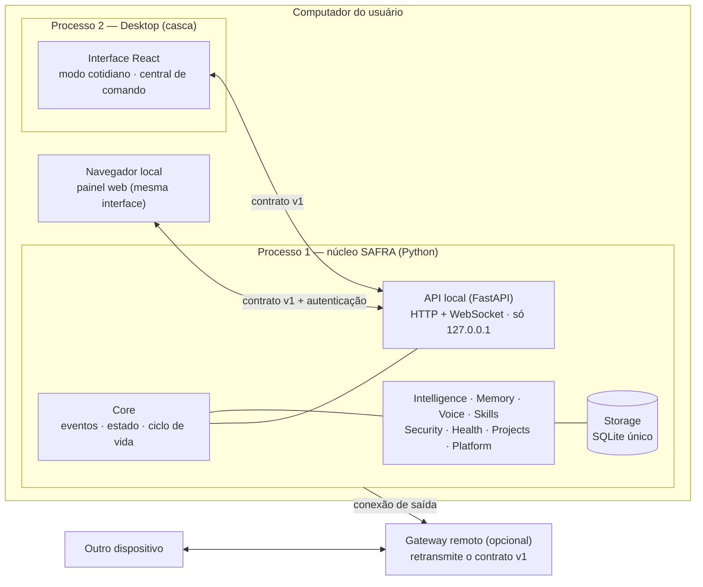

# Auditoria para a transformação em SAFRA — Fase 1

| | |
|---|---|
| Data | 13/11/2026 |
| Commit auditado | `34c712b` (branch `claude/adoring-brahmagupta-vcejpt`) |
| Ambiente da auditoria | contêiner Linux 6.18, 4 vCPUs, Python 3.13.18, PySide6 6.8.3, Qt *offscreen*; sem GPU, microfone, alto-falante, Ollama ou Windows |
| O que esta fase alterou | **nada no código.** Só este documento, o registro da suíte e os índices da documentação |
| Situação | **aguardando aprovação** — nenhuma migração estrutural começa antes dela |

Este documento responde aos dez itens pedidos para a primeira tarefa. Ele substitui, para a nova missão, a
`AUDITORIA_INICIAL.md` (feita para o TCC da fase anterior, que continua válida como registro histórico).

## Resumo para decisão

1. **O sistema atual funciona e está testado**: 475 testes automatizados aprovados neste commit, CI aprovado em
   Linux e Windows no último commit de código (`f1a9e2e`).
2. **A identidade atual contraria quatro regras novas**: avatar humanoide 3D com rosto, ambiente TARDIS
   (inclusive um modelo 3D de cabine policial), a persona "ULTRON" (personagem de franquia) e restos públicos
   do nome JARVIS. NOCTARIO já não tem código; restam duas tabelas vazias de uso no banco e textos históricos.
3. **TARDIS e ULTRON não são só aparência.** Por baixo do nome TARDIS há um motor de análise, planejamento e
   notas de projeto; por baixo do ULTRON há um perfil de autonomia. A proposta é **remover o nome e o tema e
   preservar a função** com nomes originais.
4. **Hoje interface e núcleo rodam no mesmo processo e não existe API local.** As três garantias pedidas
   ("falha de interface não derruba o núcleo" etc.) pedem a separação em dois processos ligados por uma API.
5. **Recomendação de arquitetura**: núcleo Python mantido; API local com FastAPI; uma única interface em
   React + TypeScript usada pelo desktop e pelo painel web; casca do desktop em QtWebEngine (que já é
   dependência), com Tauri reavaliado depois. Electron não é recomendado. Justificativas na seção 7.
6. **Custo principal**: cerca de 14,6 mil linhas de interface Qt e 4,5 mil de cena 3D serão substituídas, 120
   dos 475 testes cobrem módulos que saem, e o TCC entregue ontem (título, objetivos, duas hipóteses e dois
   protocolos) precisa ser reescrito porque fala de avatar humanoide, sincronização labial e TARDIS.
7. **Onze decisões dependem de você** (seção 11). Cada uma traz uma recomendação.

---

## 1. Diagnóstico do estado atual

### 1.1 Números

| Item | Valor | Como foi obtido |
|---|---|---|
| Pacote Python `ultron/` | 206 módulos, 46.364 linhas, 25 pacotes | contagem por script (`ast`) neste commit |
| Interface Qt (`ultron/hud/`) | 35 módulos, 14.647 linhas | idem |
| Cena 3D (HTML/CSS/JS próprios) | 4.517 linhas + three.js r170 embutido (692 KB) | `wc -l` |
| Gateway da WEB ORB (`gateway/`) | 1.265 linhas, aiohttp | `wc -l` |
| Testes | 39 módulos, 475 casos | execução da suíte |
| Habilidades (skills) | 102, em 17 pacotes | auditoria anterior, conferida pela lista de pacotes |
| Banco | 1 arquivo SQLite (WAL), 27 tabelas + índice de texto `sb_fts`, migrações v1–v7 | `memory/store.py` |
| Arquivos versionados | 511; modelos de voz em `assets/` somam 315 MB **dentro do Git** | `git ls-files`, `du` |

### 1.2 Como o sistema roda hoje

- **Um processo só.** `main.py` cria o `NeuralCore` (núcleo único: barramento de eventos, estado, ciclo de
  vida, *workers*, orquestrador, executor, memória, voz) e, no mesmo processo, a interface Qt
  (`HudController`). A cena 3D roda no QtWebEngine e conversa com o Python por duas pontes (`window.JARVIS`
  e QWebChannel).
- **Sem interface** o sistema já funciona: `--headless` (console), `--say`, `--diagnose`.
- **Não existe API local.** Nenhum servidor HTTP ou WebSocket escuta neste computador. O acesso remoto
  (WEB ORB) usa uma conexão **de saída** do agente (`remote/agent.py`) para um gateway aiohttp separado; a
  publicação desse gateway nunca foi feita ("Planejada" no inventário).
- **Dados** ficam em `%LOCALAPPDATA%\ULTRON` (seção 9).

### 1.3 Evidências de funcionamento nesta auditoria

| Verificação | Resultado |
|---|---|
| Suíte completa (`python TEST_JARVIS.py`), commit `34c712b`, ambiente acima | **475 testes, 0 falhas, 1 pulado**, 178,7 s — registro em `docs/research/resultados/linha_de_base_34c712b.txt` |
| O teste pulado | cena 3D real (precisa de servidor gráfico); foi executada à parte em `f1a9e2e`: 24/24 |
| CI (GitHub Actions) | execução [64](https://github.com/JLeoBRx/utron-jarvis/actions/runs/43215305694) aprovada em Linux 3.11/3.13 e Windows, no commit `f1a9e2e`. O commit `34c712b` mudou só documentação e **não passou pelo CI** |
| Medições PV-01…PV-07 | feitas na fase anterior, no contêiner; resumo em `TESTES.md` §5 |

Não verificado nesta auditoria: nada foi executado em Windows real, com microfone, alto-falante, GPU ou
modelo de linguagem real. Oito funcionalidades do inventário continuam "não verificadas" por esse motivo.

### 1.4 Distância entre o estado atual e as regras da nova missão

| Regra da missão | Estado atual | O que falta |
|---|---|---|
| Nome SAFRA; sem JARVIS nos elementos públicos | Nome SAFRA 3.0.0 aplicado em interface, voz, console e manual. **Restam**: scripts `*_JARVIS.bat` e `*_ULTRON.bat`, mensagens que citam `START_JARVIS.bat`, "Jarvis" como palavra de ativação alternativa, pasta `Imagens/JARVIS`, 6 documentos com JARVIS no nome (e os 24 da raiz o citam), `JARVIS_FINAL.zip`, workflow `jarvis-validation.yml`, variáveis `JARVIS_*` | seção 11, decisões D7 e D8 |
| Sem NOCTARIO | Código removido em `4f540b1`/`7385b99`. Restam: tabelas `noctario_runs` e `noctario_ops` na migração v6, conferências de ausência em 4 arquivos de teste, `REMOCAO_NOCTARIO.md` e menções em outros 6 documentos da raiz e em 5 de `docs/` | D4 |
| Sem TARDIS nem Doctor Who | 1.278 linhas citam TARDIS. Código: `ultron/tardis/` (motor de análise), `hud/tardis*.py` e `hud/tardis_room/` (2.945 linhas), `skills/tardis`, `audio/tardis_sfx.py`, `room.js`, `exterior.js` (classe `PoliceBox`: cabine policial azul em 3D), 54 testes, tabela `tardis_tasks` | D4 |
| Sem rosto humano, sem avatar 3D, só 2D/2.5D | Holograma humanoide de 57 ossos (`avatar.js`, `avatar_dress.js`), avatar 2D com olhos e boca (`hud/avatar/`, 1.492 linhas), sincronização labial (`voice/lipsync.py`), three.js | D5 |
| Sem personagens de franquias | "Protocolo ULTRON": persona alternativa com o nome de um personagem, voz e aparência próprias (`hud/ultron_protocol.py`, `personality/persona.py`, `ultron.js`, 21 testes) | D6 |
| Paleta definida (#101114, #191B20, #23262D, #E32636, #8F1725, #F2F2F2, #A6A8AF) | Paleta vermelha da fase anterior, com valores diferentes (#07070A, #EA2840, #7A0F1F…) | trocar os *tokens*; ver contraste em 7.6 |
| Dois contextos: cotidiano e central de comando | Uma plataforma Qt de 5 páginas, sem essa divisão | Fase 4 |
| Desktop + painel web com o mesmo backend e os mesmos contratos | Interface Qt acoplada ao núcleo por chamadas diretas; site da ORBE separado, com protocolo próprio | Fases 4 e 5 |
| Organização por projetos | Parcial: registros do tipo "projeto" na memória pessoal e tabela `project_notes` | domínio Projects |
| Uma falha de interface não derruba o núcleo | Parcial: exceções da interface vão para o log e há reserva 2D, mas é o mesmo processo — uma falha nativa do Qt encerra tudo | dois processos |

---

## 2. Mapa dos módulos

Pacotes de `ultron/`, com o domínio de destino pedido na missão e o que se propõe para cada um.

| Pacote atual | Arq. | Linhas | Papel | Domínio de destino | Proposta |
|---|---:|---:|---|---|---|
| `core` | 9 | 3.312 | barramento, eventos, estado, ciclo de vida, *workers*, orquestrador, `neural_core.py` (composição, 1.112 linhas) | Core | manter; separar o *kernel* (sem dependências) da composição |
| `config` | 4 | 688 | configurações validadas, caminhos, migração de versões | Core / Storage | manter |
| `cognition` | 9 | 1.759 | intenção, raciocínio, planejamento, procedência, objetivos | Intelligence | manter |
| `models` | 6 | 1.536 | Ollama, OpenAI, perfis, roteamento, limite de gasto | Intelligence | manter |
| `personality` | 7 | 437 | identidade, estilo, perfil de voz, persona | Intelligence | manter; persona ULTRON sai (D6) |
| `proactive`, `imagination`, `world` | 12 | 1.507 | sugestões, cenários, modelo do mundo | Intelligence | manter |
| `tardis` | 10 | 1.527 | motor de tarefas de análise, analisadores determinísticos, notas de projeto | Intelligence (análise) + Projects | **manter a função, trocar o nome** (D4) |
| `memory` | 12 | 1.523 | memórias, recuperação, banco, migrações, backup | Memory + Storage | manter; banco e backup vão para Storage |
| `graph` | 3 | 372 | grafo de conceitos | Memory | manter |
| `secondbrain` | 9 | 2.663 | memória pessoal, lembretes, busca | Memory | manter |
| `voice`, `audio` | 15 | 3.816 | microfone, Vosk, palavra de ativação, Piper, SAPI, prosódia, diagnóstico; sons | Voice | manter; `lipsync.py` vira "reatividade à voz"; `tardis_sfx.py` sai |
| `skills`, `plugins` | 25 | 4.923 | 102 habilidades, registro, plugins | Skills | manter; `skills/tardis` renomeado |
| `agent` | 6 | 1.089 | executor único, permissões, autorização, verificação, recuperação | Skills (execução) + Security (política) | manter |
| `privacy`, `platform/credentials.py` | 4 | ~350 | modo privacidade, cofre de credenciais | Security | manter |
| `health`, `diagnose.py`, `core/metrics.py`, `core/activity.py` | — | ~1.130 | monitor de saúde, diagnóstico por etapas, métricas, histórico | Health | manter |
| `platform` | 9 | 860 | início automático, instância única, Windows, avisos | Platform | manter |
| `perception`, `network` | 23 | 3.605 | sensores de janelas/processos/tela, inventário passivo da rede | Platform | manter |
| `remote` | 2 | 404 | agente de saída para o gateway | Communication | manter; passa a falar o contrato único |
| `hud` | 35 | 14.647 | toda a interface Qt, avatar 2D, TARDIS, cena 3D, Protocolo ULTRON | Frontend + Desktop | **substituir** pela nova interface; bandeja, atalhos e janela viram a casca Desktop |
| raiz (`app.py`, `console.py`…) | 5 | 1.209 | linha de comando, console, inicialização | Core / Desktop | manter |
| — | — | — | — | **API** | **novo** |
| — | — | — | — | **Projects** | **novo** (a partir de `project_notes` e dos registros "projeto") |

Fora do pacote: `gateway/` (retransmissor remoto), `tests/`, `tools/` (empacotamento, medições, geração de
documentos), `docs/`, 24 documentos soltos na raiz de `ULTRON/` (históricos; todos citam JARVIS, 18 citam TARDIS).

---

## 3. Mapa de dependências

### 3.1 Entre pacotes (importações reais, contadas por script)

| Pacote | Importa de |
|---|---|
| `core` | 22 dos outros 24 pacotes (é onde o sistema é montado) |
| `hud` | agent, cognition, config, core, health, models, perception, platform, secondbrain, tardis, voice |
| `skills` | config, core, memory, models, network, perception, platform, secondbrain, tardis, voice |
| `agent` | config, core, personality, skills |
| `cognition` | core, memory, personality, skills |
| `voice` | config, core, perception, personality |
| `memory` | config, core, graph |
| `secondbrain` | core, memory |
| `tardis` | core, memory |
| `remote` | cognition, config, core, personality, platform, voice |
| `config` | secondbrain |
| `personality` | nenhum |

Observações que a migração precisa resolver:

- **`core` mistura duas coisas**: as peças básicas (eventos, barramento, estado), que todos importam, e a
  montagem do sistema (`neural_core.py`), que importa todos. Por isso quase todo pacote forma um ciclo com
  `core`. Separar o *kernel* da composição desfaz esses ciclos sem mudar comportamento.
- **Ciclos reais fora do `core`**: `memory` ↔ `graph`; `config` → `secondbrain` → `memory` → `config`.
- **A interface depende de 11 pacotes por chamada direta.** É isso que a API local substitui.
- **TARDIS é importada por `core`, `hud` e `skills`** — a troca de nome toca os três.

### 3.2 Bibliotecas externas

Licença lida dos metadados instalados neste ambiente (`importlib.metadata`). As bibliotecas só de Windows não
estão instaladas aqui; a licença delas fica para o inventário da Fase 7.

| Biblioteca | Uso | Licença declarada |
|---|---|---|
| PySide6 6.8.3 (Essentials, Addons) | interface, QtWebEngine | LGPL-3.0 / GPL / comercial |
| numpy, psutil | cálculo, sistema | BSD-3-Clause |
| vosk 0.3.45 | reconhecimento de fala | Apache (classificador do pacote) |
| **piper-tts 1.8.0** | voz neural | **GPL-3.0-or-later** — ver problema P9 |
| sounddevice, mss, onnxruntime | áudio, captura, inferência | MIT |
| pyttsx3 | voz SAPI | MPL-2.0 |
| websockets, segno, send2trash, pyautogui | agente remoto, QR, Lixeira, teclado | BSD |
| Pillow | imagens | MIT-CMU |
| aiohttp (só no gateway) | servidor da WEB ORB | Apache-2.0 e MIT |
| three.js r170 (embutido) | cena 3D | MIT — **sai com a cena 3D** |
| keyring, pywin32, pywinauto, pycaw, comtypes, tzdata | Windows | não instaladas aqui: a levantar |

Modelos e recursos:

| Recurso | Origem | Licença |
|---|---|---|
| Voz `pt_BR-faber-medium` | rhasspy/piper-voices | o cartão do modelo indica conjunto de dados CC0; o repositório é marcado como MIT ([cartão](https://huggingface.co/rhasspy/piper-voices/blob/refs%2Fpr%2F11/pt/pt_BR/faber/medium/MODEL_CARD)) |
| `vosk-model-small-pt-0.3` e `vosk-model-pt-fb-v0.1.1` | alphacephei.com/vosk/models | **não verificada**: a página oficial lista a licença por modelo e está fora da rede permitida nesta sessão |
| Sons da interface e da TARDIS | sintetizados pelo próprio código | próprios |
| Fontes, ícones, imagens, músicas | nenhum arquivo no repositório | — |

---

## 4. Funcionalidades existentes

O inventário completo (83 itens, com evidência de cada um) está em `INVENTARIO_FUNCIONALIDADES.md`: 68
funcionais, 2 parciais, 8 não verificadas, 2 planejadas, 3 descontinuadas. Abaixo, a situação das
funcionalidades que a missão lista e o efeito das novas regras.

### 4.1 Funcionalidades pedidas na seção 5 da missão

| Funcionalidade | Hoje | Evidência / limite |
|---|---|---|
| Assistente por texto | funcional | interface, console, `--say`; `test_core`, `test_intelligence` |
| Assistente por voz | funcional, com um limite | Vosk + Piper testados com fala sintética; ativação por "Safra" mediu 2–4 % com voz sintética; microfone real não verificado |
| Memória persistente | funcional, com um limite | perguntas com as mesmas palavras: 100 %; paráfrases: 45 % |
| Organização por projetos | **parcial** | não existe a entidade "projeto" ligando conversa, memória e tarefas |
| Sistema de habilidades | funcional | 102 habilidades; `test_executor`, `test_plugins` |
| Execução controlada de ferramentas | funcional | executor único com validação, prazo e auditoria |
| Sistema de permissões | funcional | por categoria, com pisos; 11 de 11 ações indevidas bloqueadas (PV-06) |
| Confirmação de operações sensíveis | funcional | uma pendência por vez; expirar equivale a negar |
| Histórico de atividades | funcional | `core/activity.py`, `test_activity` |
| Monitoramento | funcional | monitor de saúde e métricas |
| Diagnóstico | funcional | `--diagnose`, diagnóstico de voz em 8 etapas |
| Recuperação de falhas | funcional | tentativas limitadas; banco danificado, modelo que quebra, sensor que falha (`test_failures`, `test_recovery`) |
| Configurações | funcional | validação, migração v1→v3 com cópia de segurança |
| Atualizações controladas | **parcial** | `ATUALIZAR_*.bat` atualiza dependências; não confere versão, não verifica integridade e não tem retorno automático |

### 4.2 Itens de segurança e confiabilidade da seção 6

| Item | Hoje |
|---|---|
| Validação de entradas | sim nos argumentos das habilidades e nas configurações; não há entradas de rede locais |
| Controle de permissões, menor privilégio | sim (categorias, pisos, pastas protegidas, nada contorna o UAC) |
| *Timeouts* | sim (`run_with_timeout` por habilidade; prazos nos *workers*) |
| Tratamento centralizado de erros | sim (ganchos globais e classificação de erros no executor) |
| Logs estruturados | **não**: texto simples em `logs/ultron.log` |
| Proteção de credenciais | sim (cofre do sistema; nunca em arquivo) |
| Isolamento de ferramentas | parcial: *thread* com prazo, mesmo processo |
| Prevenção de operações duplicadas | parcial: lembretes, capturas e autorização única; não há chave de idempotência geral |
| Backups e recuperação de dados | sim (API de backup do SQLite, diário, restauração com conferência de integridade, exportação) |
| Proteção da API local | não se aplica hoje — **a API ainda não existe** |
| Autenticação do painel web | existe no gateway (pareamento por código confirmado no computador, cookie de dispositivo, anti-CSRF, limite de tentativas); nunca foi implantada |
| Falha de interface × núcleo | parcial (mesmo processo) |
| Falha de voz × memória | sim (componentes isolados no ciclo de vida; `test_failures`) |
| Falha de ferramenta × aplicativo | sim para exceções e demora; não para falha nativa |

### 4.3 Efeito das novas regras sobre o que existe

| O que existe | O que acontece | Função preservada |
|---|---|---|
| Holograma humanoide 3D, roupas, olhar, gestos | sai (regra: sem avatar 3D) | os **estados reais** do núcleo passam a animar o símbolo |
| Avatar 2D com olhos e boca | sai (regra: sem rosto) | idem |
| Sincronização labial | sai como "boca"; a análise de energia do áudio fica | o símbolo reage à voz real |
| Sala de controle e cabine da TARDIS, sons temáticos | saem (regra: sem Doctor Who, sem 3D) | — |
| Motor de análise, analisadores, notas de projeto (hoje "TARDIS") | ficam com nome próprio | análise, planejamento, telemetria, projetos |
| "Arquivo" (memória navegável da TARDIS) | vira página de memória da nova interface | consulta à memória |
| Protocolo ULTRON (persona) | sai (regra: sem personagens de franquias) | perfil de autonomia e parada de emergência (D6) |
| ORBE compacta e site da ORBE | viram o símbolo e o painel web | acesso rápido e remoto |
| Plataforma Qt de 5 páginas | substituída pela nova interface | todas as páginas têm equivalente planejado |

---

## 5. Problemas encontrados

| # | Problema | Gravidade |
|---|---|---|
| P1 | Elementos de terceiros: modelo 3D de cabine policial e ambiente TARDIS (Doctor Who); persona ULTRON e nome JARVIS (personagens de franquia) | alta — contraria regras inegociáveis |
| P2 | Avatar humanoide com rosto, em 3D e em 2D | alta — idem |
| P3 | Interface e núcleo no mesmo processo; uma falha nativa da interface encerra tudo | alta |
| P4 | Sem API local: a interface chama 11 pacotes diretamente; o site da ORBE usa outro protocolo | alta |
| P5 | Três implementações visuais do assistente (Qt 2D, cena 3D, site da ORBE), cada uma com o seu código | média |
| P6 | `core` mistura *kernel* e composição; ciclos `memory` ↔ `graph` e `config` → `secondbrain` → `memory` → `config` | média |
| P7 | `neural_core.py` (1.112 linhas) e `hud/controller.py` (1.207) concentram responsabilidades | média |
| P8 | Logs em texto simples, sem campos estruturados | média |
| P9 | **Licenças**: o repositório não tem arquivo de licença; `piper-tts` instalado (1.8.0) é GPL-3.0-or-later e é importado dentro do processo; licença dos modelos Vosk não verificada | média — decide como o SAFRA pode ser distribuído |
| P10 | 315 MB de modelos e o `JARVIS_FINAL.zip` versionados no Git | média |
| P11 | Nomes de franquia em identificadores: pacote `ultron`, pasta `ULTRON/`, `%LOCALAPPDATA%\ULTRON`, `ultron.sqlite3`, `jarvis_gateway`, serviço "JARVIS" no cofre, valor "JARVIS" no Registro, repositório `utron-jarvis` | média — troca arriscada; ver D8 |
| P12 | 24 documentos soltos na raiz de `ULTRON/`, com nomes e conteúdo das identidades antigas | baixa |
| P13 | Três gerações de scripts (`*_ULTRON.bat`, `*_JARVIS.bat`, `*_SAFRA.bat`) | baixa |
| P14 | Organização por projetos incompleta; atualização sem verificação nem retorno | média |
| P15 | Limites já medidos: ativação por "Safra" (2–4 % com voz sintética); paráfrases na memória (45 %); lembrança indevida (70 %) | média — não são causados pela migração, mas ela não pode piorá-los |
| P16 | Oito funcionalidades nunca verificadas em Windows real (microfone, alto-falante, bandeja, GPU…) | média |
| P17 | Paleta pedida: o vermelho #E32636 sobre o fundo #101114 tem contraste 4,13:1, abaixo de 4,5:1 exigido para texto pequeno; #8F1725 sobre o fundo tem 2,08:1 | baixa — resolve-se com regras de uso (7.6) |
| P18 | O TCC entregue descreve avatar humanoide, sincronização labial e TARDIS como objetivos | alta para o cronograma acadêmico |

---

## 6. Avaliação de riscos da migração

Probabilidade e impacto: B baixa, M média, A alta.

| # | Risco | P | I | Mitigação |
|---|---|:-:|:-:|---|
| R1 | Regressão por reescrita grande (interface inteira) | A | A | migração progressiva: a interface antiga continua disponível até a nova ter paridade conferida item a item; nada é removido antes disso |
| R2 | Perda ou corrupção de dados do usuário | B | A | backup verificado antes de qualquer migração de banco; nenhuma exclusão sem exportação; pasta de dados não muda de lugar (seção 9) |
| R3 | Quebra da inicialização no Windows (dois processos, porta, atalhos, início automático) | M | A | CI no Windows a cada etapa; roteiro de validação para você rodar no PC real; a etapa só fecha com essa evidência |
| R4 | Comportamento do Windows não verificável neste ambiente | A | M | declarar "não verificado" até haver evidência; `DIAGNOSTICO_SAFRA.bat` ampliado para coletar a evidência |
| R5 | Superfície de ataque nova: API em 127.0.0.1 alcançável por qualquer programa ou página aberta no navegador | M | A | token por sessão, conferência de `Origin` e `Host`, só *loopback*, sem rota de execução arbitrária, testes de segurança próprios (7.5) |
| R6 | Cadeia de dependências nova (Node, React, FastAPI) | M | M | versões fixadas, arquivos de trava, `npm ci`, interface compilada entra pronta no pacote (o usuário não instala Node) |
| R7 | Queda de cobertura: 120 testes cobrem módulos que saem (TARDIS 54, cena 3D 24, ULTRON 21, avatar 12, sincronização labial 9) | A | M | cada funcionalidade preservada mantém ou ganha teste; os testes retirados são listados com justificativa |
| R8 | Desempenho pior (interface web no lugar de Qt nativo) | M | M | medir antes e depois: tempo de abertura, memória, uso de CPU em repouso |
| R9 | Ativação por voz pior ao retirar "Jarvis" como alternativa | M | M | tecla de atalho para falar, calibração com voz real, medição com voz humana antes de decidir |
| R10 | Licenças impedem a distribuição pretendida | M | M | inventário de licenças antes de publicar; decisão sobre o Piper (P9) |
| R11 | Cronograma do TCC: a migração ocupa os meses previstos para os experimentos | A | A | congelamento de funcionalidades mantido em maio de 2027; se a migração atrasar, cortar o que é secundário (seção 8) |
| R12 | Troca de identificadores internos quebra instalações existentes | M | A | fazer por último, com camada de compatibilidade e teste de atualização a partir da versão atual |
| R13 | O histórico do Git guarda para sempre os nomes antigos | certa | B | o histórico não é reescrito (regra de preservação); a árvore atual e o produto ficam limpos |

---

## 7. Arquitetura proposta

### 7.1 Comparação das tecnologias

A missão pede avaliar, não migrar automaticamente. Nenhuma das alternativas abaixo foi instalada ou medida
nesta auditoria; a comparação usa o que o repositório já tem e características conhecidas de cada tecnologia.

**API local**

| Critério | FastAPI | aiohttp (já usado no gateway) | Sem API (manter chamadas diretas) |
|---|---|---|---|
| Contrato descrito e verificável | esquema OpenAPI gerado do código | manual | não há |
| Validação de entradas | embutida (modelos tipados) | manual | — |
| Tipos para a interface TypeScript | gerados do esquema | manuais | — |
| HTTP e WebSocket | sim | sim | — |
| Custo | dependências novas no desktop | dependência nova no desktop | nenhum |
| Atende "mesmo backend, mesmos contratos" | sim | sim, com mais trabalho manual | não |

**Recomendação: FastAPI** para a API local. O gateway remoto continua em aiohttp nesta etapa, mas passa a
retransmitir o mesmo contrato; unificá-lo fica como decisão posterior registrada.

**Interface**

| Critério | React + TypeScript | Qt Widgets (atual) | HTML/JS sem framework (como a cena atual) |
|---|---|---|---|
| Uma interface para desktop e web | sim | não (seria preciso outra para a web) | sim |
| Tipos conferidos contra o contrato | sim | não | não |
| Design system com componentes reutilizáveis | sim | parcial (folhas de estilo) | manual |
| Testes de componente e de ponta a ponta | sim (Playwright já está neste ambiente) | limitados | limitados |
| Custo | Node só para desenvolver e compilar | nenhum | nenhum |

**Recomendação: React + TypeScript**, compilado para arquivos estáticos que entram prontos no pacote e
funcionam sem internet.

**Casca do desktop**

| Critério | QtWebEngine (PySide6) | Tauri | Electron |
|---|---|---|---|
| Já é dependência do projeto | **sim** | não | não |
| Linguagem da casca | Python | Rust | JavaScript (Node) |
| Motor web | Chromium embutido no Qt | WebView2 do Windows | Chromium embutido |
| Novo ambiente de execução a manter | nenhum | *toolchain* Rust para compilar | Node + Chromium no pacote |
| Bandeja, início automático, instância única | **código existente e testado** | reescrever | reescrever |
| Verificável no CI atual | sim (já roda sob Xvfb e no Windows) | exige *pipeline* novo | exige *pipeline* novo |
| Instalador e atualização automática | não tem (hoje: `.bat`) | tem | tem |

**Recomendação: QtWebEngine agora**, como casca fina que só abre a interface web e cuida de janela, bandeja e
atalhos. Como a interface fala apenas com a API, trocar a casca por **Tauri** depois é barato; fica registrado
como alternativa a reavaliar quando houver necessidade de instalador e atualização automática. **Electron não
é recomendado**: acrescenta um segundo ambiente de execução e mais superfície de ataque sem vantagem sobre as
outras duas opções.

**Persistência e testes**: SQLite continua (banco único, só o núcleo o abre). A suíte atual usa `unittest` com
executor próprio; o **pytest** executa esses mesmos testes sem reescrevê-los, então a adoção é gradual.

### 7.2 Arquitetura de destino



- **Processo 1, núcleo**: tudo o que existe hoje menos a interface, mais a API. É o dono do banco, da voz e da
  instância única. Funciona sozinho (modo console e `--say` continuam).
- **Processo 2, casca**: janela, bandeja e atalhos. Se ela falhar, o núcleo continua e a reabre; se o núcleo
  cair, a casca mostra o erro e oferece reiniciar.
- **Painel web**: a mesma interface compilada, servida pela API local e aberta no navegador do próprio
  computador. O acesso de outro dispositivo continua opcional, pelo gateway, sem abrir portas.

### 7.3 Domínios e regra de dependência

```
núcleo/      core · intelligence · memory · communication · voice · skills · security
             health · projects · storage · api · platform
frontend/    interface React + TypeScript (design system, símbolo, dois modos)
desktop/     casca do Windows
gateway/     retransmissor remoto (existente)
```

Regra: `core` (kernel) não importa ninguém; `storage` importa `core`; os domínios importam `core` e `storage`;
`api` importa só os contratos de `communication` e a fachada do núcleo; `frontend` e `desktop` falam apenas
pela API. Um teste automatizado confere essa regra a cada execução (o script usado na seção 3 vira esse teste).

### 7.4 Contratos de comunicação (versão 1, a detalhar na Fase 2)

- **HTTP** para pedidos e consultas: estado, envio de comando de texto, autorizações pendentes (aprovar ou
  negar), atividades, memória, projetos, configurações, diagnóstico, backups, controles de voz.
- **WebSocket** para eventos: envelope com versão, identificador, tipo, horário e dados; filtro por tipo;
  fila limitada (telemetria pode ser descartada sob pressão, autorizações nunca).
- **Idempotência**: pedidos que causam efeito levam uma chave; repetir a chave não repete a ação.
- Tudo o que entra pela API vira `core.submit(...)` — **o mesmo caminho** do texto e da voz, com as mesmas
  permissões, confirmações e auditoria. A API não ganha poderes que a interface atual não tem.

### 7.5 Proteção da API local

Escuta só em 127.0.0.1; *token* por sessão entregue à casca sem passar por arquivo; painel no navegador entra
por código mostrado no desktop; conferência de `Origin` e `Host` (bloqueia páginas de terceiros e
*DNS rebinding*); CORS fechado; limite de tentativas; nenhuma rota expõe SQLite, terminal, Ollama ou execução
arbitrária; ações sensíveis só se confirmam no computador principal; chaves de API nunca vão para o JavaScript.

### 7.6 Identidade visual

**Paleta pedida — contraste medido (WCAG 2.x):**

| Par | Contraste | Uso recomendado |
|---|---:|---|
| Texto #F2F2F2 sobre fundo #101114 / superfície #191B20 / elevada #23262D | 16,9 / 15,4 / 13,5 | qualquer texto |
| Texto secundário #A6A8AF sobre os três fundos | 7,9 / 7,2 / 6,4 | qualquer texto |
| Vermelho #E32636 sobre fundo / superfície / elevada | 4,1 / 3,8 / 3,3 | preenchimentos, ícones, títulos grandes, indicadores (≥ 3:1). **Não** para texto pequeno |
| Texto #F2F2F2 sobre botão #E32636 | 4,1 | rótulo em negrito ou ≥ 18 px; com #FFFFFF sobe para 4,6 |
| Vermelho profundo #8F1725 sobre o fundo | 2,1 | só fundos e decoração; texto #F2F2F2 sobre ele tem 8,1 |

Proposta: manter os sete valores exatamente como definidos e acrescentar **um** tom derivado para texto
vermelho pequeno (por exemplo #E84A58: 5,0 sobre o fundo, 4,6 sobre a superfície), mais as cores de estado
(sucesso, atenção, erro distinguível do vermelho da marca), a definir no design system.

**Símbolo**: forma abstrata original em 2D/2.5D (SVG ou *canvas*, camadas com profundidade simulada), sem
rosto. Estados ligados ao núcleo real: repouso, escutando, pensando, falando (amplitude da voz real),
executando, aguardando confirmação, erro. Nenhum estado inventado.

**Dois contextos**: *cotidiano* (símbolo, conversa, o que precisa de atenção) e *central de comando*
(monitoramento, atividades, diagnóstico, memória, projetos, habilidades, configurações). São a mesma
aplicação e os mesmos dados; muda a densidade.

---

## 8. Plano de execução por etapas

Cada etapa termina com: arquivos alterados, testes executados, problemas restantes, CHANGELOG atualizado e o
repositório executável. Nenhuma etapa é declarada concluída sem evidência.

| Fase | Conteúdo | Entregas | Critério para fechar |
|---|---|---|---|
| **1 Auditoria** | este documento | diagnóstico, mapas, riscos, proposta | sua aprovação |
| **2 Especificação** | arquitetura de destino detalhada, requisitos funcionais e não funcionais revistos, contrato v1 (esquema), diagramas, registro de decisões (ADR), plano de migração | `ARQUITETURA.md`, `REQUISITOS.md`, `DECISOES.md`, esquema do contrato | sua aprovação das decisões |
| **3 Preservação** | *tag* e branch de restauração, backup verificado do banco de teste, roteiro de reversão, teste de atualização "versão atual → nova" | `PRESERVACAO.md`, *tag* | restauração ensaiada de ponta a ponta |
| **4 Redesign** | design system (*tokens*, tipografia, espaçamento, componentes, estados, movimento), símbolo, interface principal, navegação, modo cotidiano, central de comando — primeiro sobre dados simulados do contrato, declarados como tais | `frontend/`, `DESIGN_SYSTEM.md` | componentes testados; contraste conferido; capturas |
| **5 Migração técnica** | 5a API de leitura (estado, eventos) · 5b comandos e autorizações · 5c casca em processo separado · 5d paridade página a página · 5e nova interface como padrão (a antiga atrás de uma opção) · 5f **retirada** de 3D, avatar, TARDIS (tema), ULTRON, NOCTARIO · 5g reorganização em domínios | código, testes de contrato | suíte verde a cada subetapa; paridade conferida antes de 5f |
| **6 Validação** | unitários, integração, funcionais, segurança, estabilidade, regressão, **Windows real** | `RELATORIO_DE_VALIDACAO.md` | critérios da seção 10 |
| **7 Documentação** | README, arquitetura, relatório de engenharia, inventário de licenças, manual de instalação e uso, registro de decisões, TCC reescrito | os sete documentos da missão | revisão sua |

**Ordem das retiradas.** A retirada (5f) vem **depois** da paridade (5d/5e), num conjunto de commits auditável,
precedido de uma *tag* no último commit que contém o código antigo. Assim o repositório nunca fica sem
interface e o que sai continua recuperável pelo histórico.

**Encaixe no cronograma do TCC.** O cronograma atual previa experimentos de março a maio de 2027 e
congelamento em maio. A migração ocupa dezembro a março. Proposta: fases 2–4 em dezembro e janeiro, fase 5 em
fevereiro e março, validação e primeira rodada de medições em abril, congelamento mantido em maio. Se atrasar,
corta-se primeiro: troca dos identificadores internos (D8), Tauri, unificação do gateway.

---

## 9. Estratégia de preservação de dados

### 9.1 Inventário de dados e configurações

| Dado | Onde | Observação |
|---|---|---|
| Banco (memórias, lembretes, atividades, rede, tarefas) | `%LOCALAPPDATA%\ULTRON\ultron.sqlite3` (+ `-wal`, `-shm`) | 27 tabelas, migrações v1–v7 |
| Backups do banco | `…\ULTRON\backups\` | diários, 10 mais recentes |
| Configurações | `…\ULTRON\settings.json` (+ `settings.ultron-backup.json`, `settings.jarvis-backup.json`) | versão 3 |
| Autorizações permanentes | `…\ULTRON\autorizacoes_permanentes.json` | |
| Modelo do mundo, índice de aplicativos, fabricantes | `world_model.json`, `apps_index.json`, `oui.csv` | regeneráveis, exceto o primeiro |
| Estado do Protocolo ULTRON | `protocolo_ultron.json` | perde o sentido se D6 for aprovada; o arquivo não é apagado |
| Sons substitutos | `…\ULTRON\sons_tardis\` | arquivos do usuário; não são apagados |
| Logs, exportações, imagens, plugins do usuário | `logs\`, `exports\`, `images\`, `plugins\` | |
| Capturas de tela | `Imagens\JARVIS` | pasta do usuário |
| Credenciais | Gerenciador de Credenciais do Windows, serviço "JARVIS" | chave da OpenAI, *token* do agente remoto |
| Início automático | Registro, `HKCU\…\Run`, valor "JARVIS" | |
| Modelos | `assets\stt\`, `assets\voices\` na pasta do programa | 315 MB |
| Ambiente Python | `.venv\` na pasta do programa | recriável |

### 9.2 Regras

1. **Ponto de restauração antes da Fase 5**: *tag* anotada no commit atual, branch de segurança nova e as duas
   branches de segurança existentes intactas.
2. **A pasta de dados não muda de lugar nesta migração.** Se D8 aprovar um novo local, será por **cópia**
   conferida (integridade do SQLite e contagem de registros), com a pasta antiga preservada.
3. **Banco**: só migrações aditivas ou de renomeação, cada uma precedida de backup automático verificado.
   Nenhuma tabela com dados é apagada sem exportação prévia para arquivo (ver D4 para as tabelas NOCTARIO).
4. **Configurações**: migração v3 → v4 em passos, com cópia `settings.v3-backup.json`; chaves desconhecidas são
   mantidas, nunca descartadas.
5. **Credenciais e início automático**: os nomes antigos continuam sendo lidos; um nome novo só passa a valer
   depois de copiar o valor e conferir a leitura.
6. **Arquivos do usuário nunca são apagados** pelo instalador nem pela atualização.
7. **Reversão**: voltar à *tag*, restaurar o backup do banco feito antes da migração e a cópia das
   configurações. O roteiro é ensaiado na Fase 3 com um banco de teste, não com dados reais.
8. **Testes nunca tocam dados reais**: continuam usando pasta temporária (`SAFRA_DATA_DIR`).

---

## 10. Plano de testes e critérios de aceitação

### 10.1 Tipos de teste

| Tipo | O que cobre | Ferramenta |
|---|---|---|
| Unitário | cada domínio isolado | suíte atual; pytest como executor |
| Arquitetura | regra de dependência entre domínios | teste novo (script da seção 3) |
| Contrato | toda rota e todo evento contra o esquema v1; o mesmo conjunto roda contra a API local e contra o gateway | teste novo |
| Integração | núcleo + API + casca; atualização a partir da versão atual com banco de teste | teste novo |
| Funcional | fluxos na interface real (conversa, confirmação, memória, projetos, configurações) com modelo simulado e declarado | Playwright |
| Segurança | PV-06 mantido e ampliado; API sem *token*, com `Origin` errado, com excesso de tentativas; ausência de rotas perigosas; segredos fora do JavaScript e do Git | teste novo |
| Injeção de falhas | encerrar a casca (núcleo continua respondendo); derrubar a voz (memória continua gravando e lendo); habilidade que lança exceção ou trava (aplicativo continua, prazo respeitado) | teste novo |
| Estabilidade | PV-07: 30 min no CI/contêiner; 8 h no PC real | instrumento existente |
| Regressão | suíte inteira a cada commit de código, Linux e Windows | CI |
| Windows real | instalação, início automático, bandeja, microfone, alto-falante, dois processos, atualização | roteiro para você executar + CI Windows |

### 10.2 Critérios de aceitação da migração

| # | Critério | Como se confere |
|---|---|---|
| CA1 | Nenhuma funcionalidade preservada perde seu teste; cada teste retirado tem justificativa escrita | tabela "antes × depois" no relatório de validação |
| CA2 | Suíte e CI verdes em Linux e Windows no commit final | execução do CI |
| CA3 | Busca na árvore atual por TARDIS, Doctor Who, NOCTARIO e JARVIS retorna só o que D4, D7 e D8 autorizarem | teste automatizado de identidade |
| CA4 | Nenhum arquivo 3D, modelo de personagem ou biblioteca 3D no pacote | conferência do pacote |
| CA5 | Encerrar a casca não encerra o núcleo; a API continua respondendo | teste de injeção de falhas |
| CA6 | Falha da voz não impede gravar e ler memória; falha de habilidade não encerra o aplicativo | idem |
| CA7 | Desktop e painel web passam o mesmo conjunto de testes de contrato | teste de contrato |
| CA8 | API recusa pedido sem autenticação, de outra origem ou fora de 127.0.0.1 | teste de segurança |
| CA9 | Atualizar uma instalação da versão atual preserva banco, configurações, credenciais e início automático | teste de atualização + roteiro no Windows real |
| CA10 | Tempo de abertura, memória em repouso e resposta a comandos diretos **medidos** antes e depois; nenhuma piora sem registro e justificativa | medições versionadas |
| CA11 | Contraste de todos os pares texto/fundo do design system ≥ 4,5:1 (texto) e ≥ 3:1 (componentes) | teste automatizado sobre os *tokens* |
| CA12 | Validação no Windows real registrada com data, versão e resultado de cada item; o que não foi validado fica declarado | relatório de validação |

---

## 11. Decisões que dependem da sua aprovação

| # | Decisão | Recomendação |
|---|---|---|
| D1 | Casca do desktop | QtWebEngine agora; Tauri reavaliado depois; Electron descartado |
| D2 | Interface | React + TypeScript, uma só para desktop e web |
| D3 | API local | FastAPI; gateway remoto continua em aiohttp e passa a usar o mesmo contrato |
| D4 | TARDIS e NOCTARIO | TARDIS: remover nome, tema, sala, cabine e sons; **preservar** motor de análise e notas de projeto com nomes próprios; renomear a tabela `tardis_tasks` por migração com backup. NOCTARIO: exportar o conteúdo das duas tabelas para um arquivo na pasta de backups e então removê-las; apagar os documentos e testes que só existem para citá-lo |
| D5 | Avatar e 3D | remover holograma, avatar 2D com rosto, cena 3D e three.js; reaproveitar a análise de energia do áudio para animar o símbolo |
| D6 | Protocolo ULTRON | remover a persona (nome, voz, aparência); manter o perfil de autonomia para rotinas autorizadas como parte das permissões, com nome próprio, e manter a parada de emergência |
| D7 | Palavra de ativação "Jarvis" | retirar do padrão (fica só "Safra"); acrescentar tecla de atalho para falar; decidir ajustes depois da medição com voz humana |
| D8 | Identificadores internos com nomes antigos (pacote `ultron`, pasta `ULTRON/`, `%LOCALAPPDATA%\ULTRON`, `ultron.sqlite3`, serviço e valor "JARVIS", `jarvis_gateway`, variáveis `JARVIS_*`) | trocar **por último**, depois da migração validada, com camada de compatibilidade; a pasta de dados e o arquivo do banco não mudam de lugar nesta migração. Scripts `*_JARVIS.bat` e `*_ULTRON.bat` saem do pacote quando o instalador novo recriar atalhos e início automático |
| D9 | Repositório | parar de versionar os 315 MB de modelos e o ZIP (o histórico continua com eles); renomear o repositório `utron-jarvis` é ação sua no GitHub |
| D10 | Documentos históricos (24 na raiz, com JARVIS, TARDIS e NOCTARIO) | marcar com uma *tag* e removê-los da árvore atual; ficam recuperáveis no histórico. Alternativa: mantê-los em `docs/historico/`, o que deixa as referências no repositório |
| D11 | TCC | reescrever título, objetivos, hipóteses e capítulos 6 e 10–13 para o novo escopo (arquitetura modular com isolamento de processos, contratos compartilhados, segurança e confiabilidade). Protocolos de voz, latência, memória, segurança e estabilidade continuam; os de cena 3D e sincronização labial são substituídos por isolamento de falhas e conformidade de contrato. Os resultados já medidos de 3D e sincronização ficam fora do TCC novo |

Uma pergunta em aberto, que muda o desenho do painel web: ele precisa funcionar **de outro dispositivo**
(celular) já nesta migração, ou basta o navegador do próprio computador? A proposta acima entrega o segundo e
mantém o primeiro como opcional pelo gateway.

---

## 12. O que esta auditoria não verificou

- Nada em Windows real: instalação, bandeja, início automático, microfone, alto-falante, GPU.
- Nenhuma das tecnologias novas (FastAPI, React, Tauri, Electron) foi instalada ou medida.
- Licenças dos dois modelos Vosk e das bibliotecas só de Windows.
- Conteúdo real das tabelas `noctario_*` e `tardis_tasks` no seu computador (aqui só existe banco de teste).
- O CI não rodou sobre o commit `34c712b` (só documentação mudou desde a execução 64).
