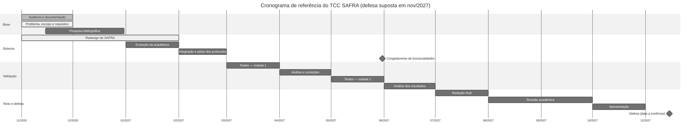

# Cronograma do TCC — SAFRA (novembro de 2026 a 2027)

A data exata da entrega ainda não foi informada. O cronograma usa duas variáveis, que devem ser preenchidas
assim que a instituição as divulgar:

| Variável | Valor | Observação |
|---|---|---|
| `DATA_ENTREGA_TEXTO` | **[a definir — 2027]** | entrega do texto final à banca |
| `DATA_DEFESA` | **[a definir — 2027]** | apresentação pública |

O plano de referência supõe a defesa em **novembro de 2027**. Se a data for anterior, aplicar o plano
comprimido (§3), que preserva as etapas essenciais e corta primeiro o que é secundário.

## 1. Princípios

1. **Congelamento de funcionalidades** em maio de 2027: depois dele, só correções e instrumentação de
   medição. Funcionalidades novas não entram se ameaçarem os experimentos ou a redação.
2. **Medir antes de escrever resultados.** Os capítulos de resultados só são redigidos com dados versionados
   em `docs/research/resultados/`.
3. **Cada mês termina com um entregável verificável** (documento, commit com CI verde ou dado medido).
4. **Prioridade acadêmica:** o que não responde ao problema de pesquisa é secundário.

## 2. Plano mensal de referência (defesa em novembro de 2027)

| Mês | Etapas (numeração do plano) | Entregáveis | Situação |
|---|---|---|---|
| nov/2026 | 1 Auditoria e documentação · 2 Problema e escopo · 4 Requisitos (versão 1) · 5 Redesign do SAFRA (início) | `AUDITORIA_INICIAL.md`, `INVENTARIO_FUNCIONALIDADES.md`, `ARQUITETURA.md`, `REQUISITOS.md`, identidade SAFRA, rascunho completo do TCC, protocolos PV-01…PV-07 | **concluído** (12/11/2026: rascunho completo, medições no ambiente C) |
| dez/2026 | 3 Pesquisa bibliográfica (ampliação) · validação do escopo com o orientador | fundamentação revisada com o orientador; registro de referências ampliado; título definitivo | planejado |
| jan/2027 | 6 Evolução da arquitetura (somente o necessário à pesquisa) · 5 Redesign (acabamento) | instrumentação de medição no aplicativo; ajustes de interface apontados pelo orientador | planejado |
| fev/2027 | 7 Integração · **piloto dos protocolos** no computador de referência | execução-piloto de PV-01…PV-07 (poucas repetições); correção dos protocolos | planejado |
| mar/2027 | 8 Testes experimentais — rodada 1 | dados brutos da rodada 1 versionados | planejado |
| abr/2027 | 9 Análise da rodada 1 · correções de defeitos encontrados | relatório parcial de resultados; lista de correções | planejado |
| mai/2027 | 8 Testes experimentais — rodada 2 (inclui voz de voluntários, se autorizado) · **congelamento de funcionalidades** | dados da rodada 2; versão congelada (tag sugerida `tcc-v1.0`) | planejado |
| jun/2027 | 9 Análise dos resultados | tabelas e gráficos finais; comparação com as metas dos RNF | planejado |
| jul/2027 | 10 Redação final | capítulos de resultados, discussão e conclusão completos | planejado |
| ago/2027 | 11 Revisão acadêmica | revisão do orientador; adequação ao manual da instituição (ABNT) | planejado |
| set/2027 | 11 Revisão final · entrega do texto (`DATA_ENTREGA_TEXTO`) | versão para a banca (DOCX e PDF) | planejado |
| out/2027 | 12 Preparação da apresentação | slides, roteiro de demonstração, vídeo de reserva, ensaios cronometrados | planejado |
| nov/2027 | Defesa (`DATA_DEFESA`) · ajustes pós-banca | versão final com as correções da banca | planejado |

## 3. Plano comprimido (se a defesa for antes de novembro de 2027)

| Se a defesa for em… | Cortar / juntar |
|---|---|
| set/2027 | juntar a rodada 2 de testes com a análise (abril–maio); redação em junho–julho; revisão em agosto |
| jul/2027 | uma só rodada de testes (março); análise em abril; redação em maio; revisão e apresentação em junho; sem voluntários (voz apenas do autor e sintetizada, declarada como limitação) |
| antes de jul/2027 | o TCC usa os dados disponíveis e declara explicitamente o que não foi medido; nenhuma funcionalidade nova |

## 4. Riscos do cronograma

| Risco | Probabilidade | Impacto | Mitigação |
|---|---|---|---|
| Hardware de referência indisponível ou trocado | baixa | alto | registrar a configuração no início; repetir as medições se trocar |
| Funcionalidades novas consumindo o tempo de testes | média | alto | congelamento em maio; lista de "depois do TCC" |
| Exigências da instituição diferentes do previsto (normas, tamanho, formato) | média | médio | confirmar o manual em dezembro; documentos editáveis em Markdown/DOCX |
| Uso de voz de voluntários exigir autorização formal | média | médio | termo de consentimento; guardar só os resultados, não as gravações; alternativa: voz do autor + fala sintetizada |
| Atualização de bibliotecas quebrar o sistema perto da entrega | média | alto | versões fixadas; CI; nenhuma atualização depois do congelamento |
| Mudança do modelo de linguagem alterar os resultados | média | médio | fixar o modelo e a versão do Ollama nas medições e registrá-los |
