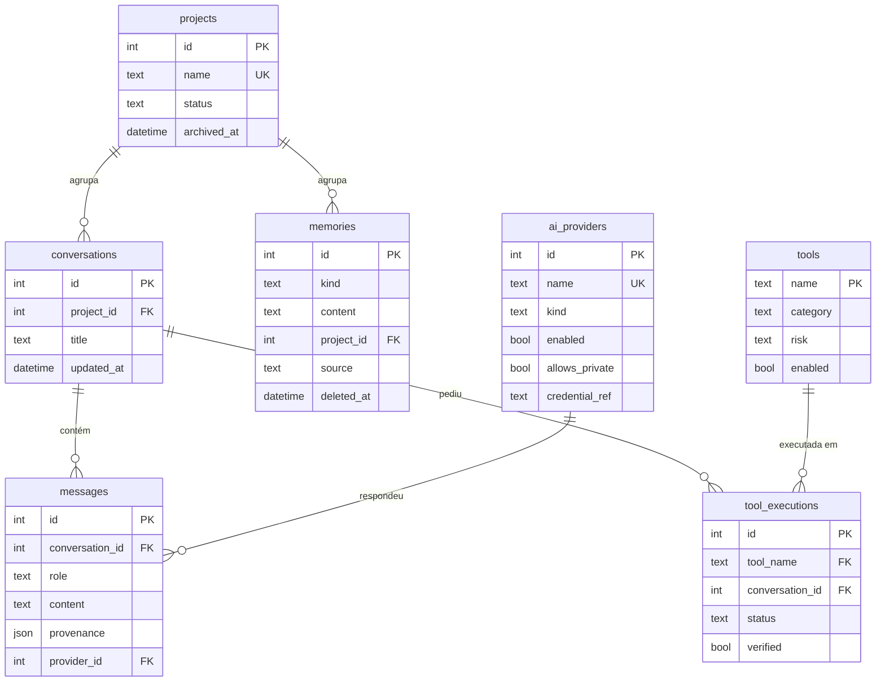
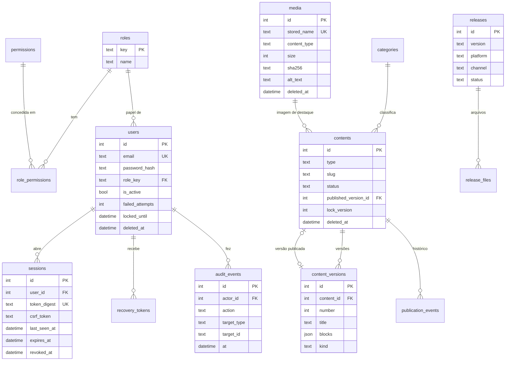

# Modelo de dados

Data: 15/11/2026. São **dois bancos sem nada em comum**: o do SAFRA Assistant (privado, um arquivo SQLite no
computador do usuário) e o do SAFRA Portal (PostgreSQL em produção; SQLite só em desenvolvimento e teste).
Cada banco grava na tabela `safra_service` o serviço dono; um serviço recusa o banco do outro.

Fontes: `backend/assistant/src/safra/storage/models.py` e `…/migrations/versions/`;
`backend/portal/src/safra_portal/domain/models.py` e `…/infrastructure/migrations/versions/`. Um teste em cada
serviço confere que a migração e o modelo descrevem exatamente as mesmas tabelas e colunas.

## 1. Regras comuns

| Regra | Como |
|---|---|
| Migrações versionadas, com retorno | Alembic; cada serviço com o seu conjunto e a sua tabela de versão (`alembic_version_assistant`, `alembic_version_portal`) |
| Backup antes de mexer | antes de migrar ou desfazer um banco que já tem tabelas, cópia pela API de backup do SQLite, conferida com `PRAGMA integrity_check`; uma cópia nunca sobrescreve outra |
| Restauração | com o serviço parado; o backup é conferido antes, o banco atual é guardado, e o resultado é conferido depois |
| Integridade referencial | chaves estrangeiras declaradas e ligadas no SQLite (`PRAGMA foreign_keys=ON`); domínios fechados por `CHECK` |
| Datas | sempre UTC com fuso (`DateTime(timezone=True)`) |
| Exclusão lógica | `deleted_at` onde perder o registro faria falta (contas, conteúdo, mídia, categorias, versões de download, memórias) |
| Histórico | versões imutáveis de conteúdo, histórico de publicação e auditoria no Portal; atividades e execuções no Assistant |
| Segredos | nenhuma coluna guarda senha ou *token* em claro: o Portal guarda resumos (scrypt, SHA-256); o Assistant guarda o **nome** da credencial no cofre do sistema |

## 2. SAFRA Assistant (migrações 0001 e 0002)

O modelo existe e é testado; os serviços que gravam nestas tabelas chegam nas Fases 4 a 7.

| Tabela | Conteúdo | Destaques |
|---|---|---|
| `safra_service` | dono do banco (`assistant`) | criada pela 0001 |
| `app_meta` | metadados da instalação | 0001 |
| `settings` | configurações alteráveis em uso | a do processo vem de variáveis de ambiente |
| `preferences` | preferências do usuário | origem: usuário, aprendida ou importada |
| `projects` | projetos e contextos | nome único; arquivar não apaga |
| `conversations`, `messages` | conversas e mensagens | apagar a conversa apaga as mensagens; papel da mensagem fechado (`user`, `assistant`, `system`, `tool`); procedência da resposta |
| `memories` | fatos, episódios, procedimentos, notas, lembretes | exclusão lógica; sobrevive ao projeto apagado |
| `ai_providers` | provedores de IA locais e remotos | `allows_private` diz se pode receber conteúdo privado; `credential_ref` é o nome no cofre |
| `tools`, `tool_executions` | ferramentas e cada execução | estado fechado; `verified` registra se o efeito foi conferido; a execução sobrevive à conversa apagada |
| `activity_events` | histórico visível de atividades | — |
| `log_events` | eventos operacionais consultáveis | o log completo fica em arquivo JSON |

**Dados do legado:** a importação (Fase 6) lê o banco antigo em modo só leitura e grava neste banco novo, em
outra pasta. Mapa tabela a tabela em `docs/architecture/LEGACY_AUDIT.md` §5.1.

## 3. SAFRA Portal (migração 0001)

| Tabela | Conteúdo | Destaques |
|---|---|---|
| `roles`, `permissions`, `role_permissions` | papéis e a matriz de permissões | preenchidas pela migração; conferidas contra o código por teste |
| `users` | contas administrativas | e-mail único; senha só como resumo scrypt; contador de falhas e bloqueio; exclusão lógica |
| `sessions` | sessões do painel | só o resumo do *token*; prazo absoluto, último uso e revogação |
| `recovery_tokens` | códigos de recuperação | só o resumo; prazo; uso único |
| `contents` | páginas e notícias (o **rascunho** corrente) | `(type, slug)` único; `status` fechado; `lock_version` para edição simultânea; `published_version_id` aponta o que o público vê |
| `content_versions` | cada gravação, imutável | `(content_id, number)` único; tipo: gravação, restauração ou conteúdo inicial |
| `publication_events` | criar, publicar, despublicar, restaurar, excluir | quem e quando |
| `categories` | categorias de notícias | exclusão lógica |
| `media` | imagens | nome no disco gerado pelo servidor; tipo real; dimensões; SHA-256; texto alternativo |
| `releases`, `release_files` | versões para download e seus arquivos | `(version, platform)` único; canal e estado fechados; **publicação bloqueada no código** |
| `audit_events` | auditoria administrativa | ação, alvo, endereço; nunca senha, código ou corpo do conteúdo |
| `site_settings` | página inicial, rodapé e contato | só dados públicos, validados por modelo |

**Índices:** tipo e estado do conteúdo; versões por conteúdo; sessões por usuário e por vencimento; auditoria por
autor, ação e data; histórico de publicação por conteúdo e data; mídia por resumo.

**PostgreSQL:** a migração e o fluxo principal do CMS rodam no CI sobre PostgreSQL 16 (`tests/test_postgres.py`).

## 4. O que fica para depois

| Item | Fase |
|---|---|
| Tabelas de lembretes, grafo de conceitos e memória pessoal detalhada, a partir do legado | 6 |
| Sessões locais do Assistant (bilhete da casca, código do navegador) | 4 |
| Agendamento de publicação no Portal | 9 |
| Arquivos de instalação (envio e conferência de integridade) | depois da decisão de licença |
